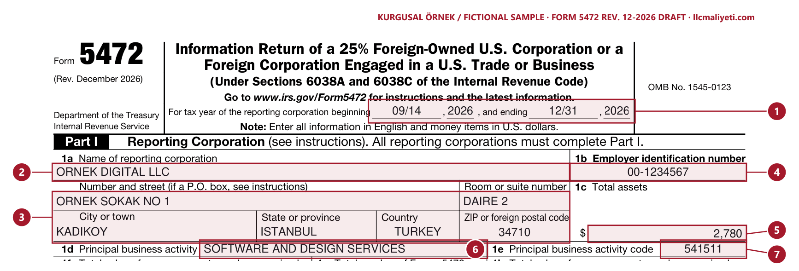
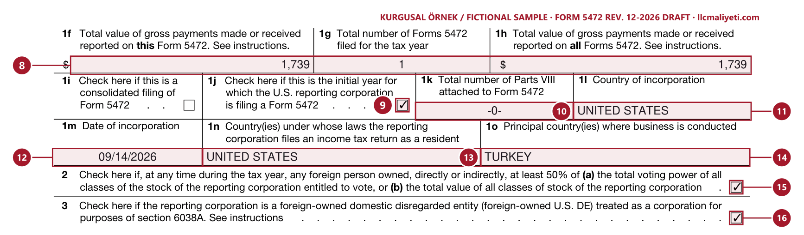
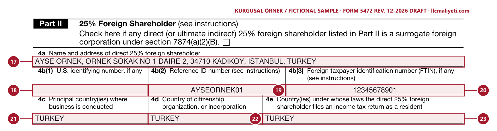
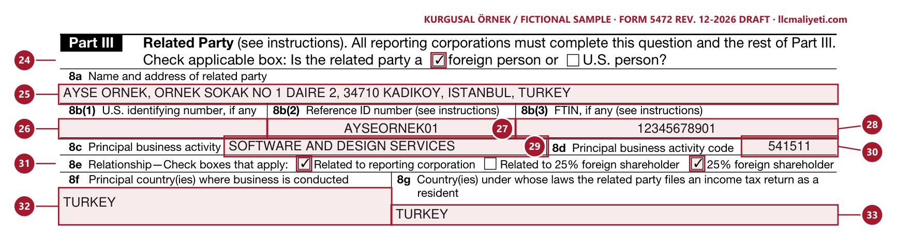
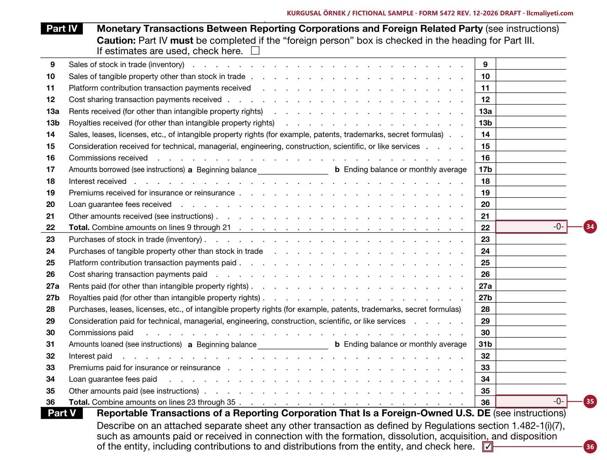
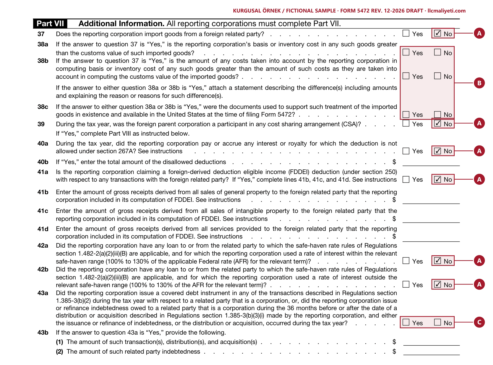
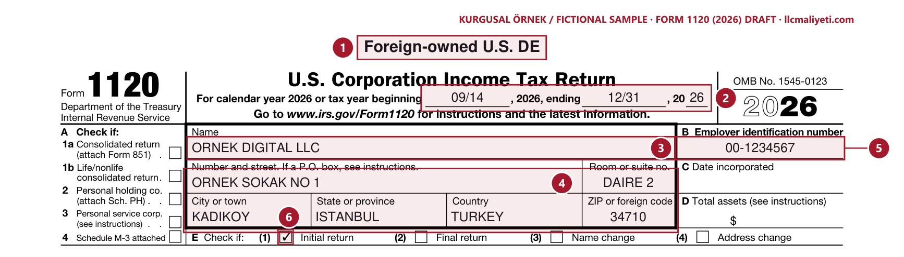
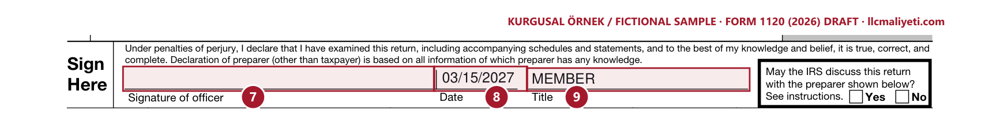
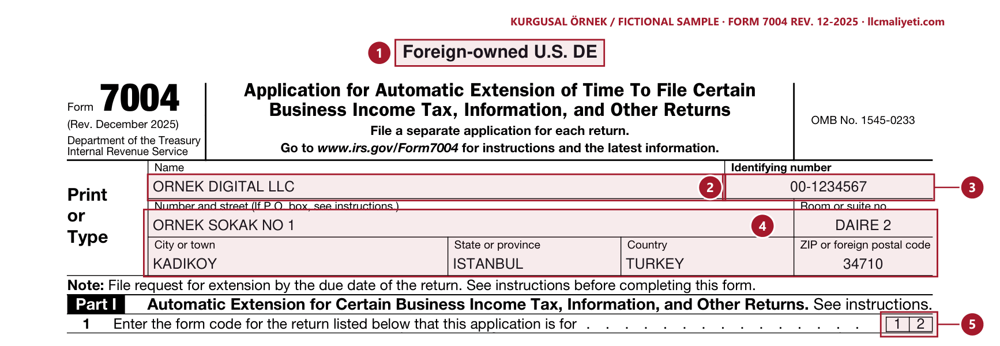
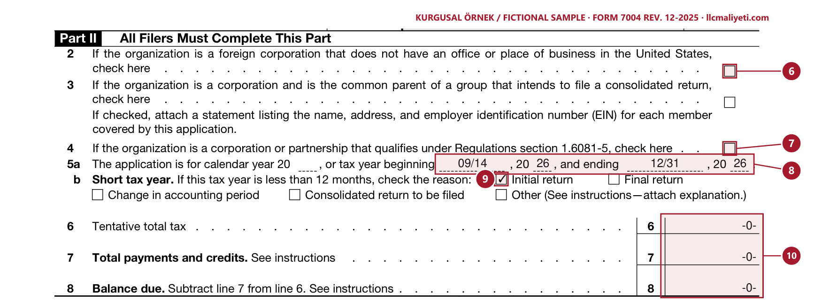

# US Company Formation Kit · Full Content

> End-to-end setup kit for a non-US founder: US LLC formation, EIN, Mercury, Stripe, Apple Wallet and a company account on the app stores.
> **Data stamp:** All figures and steps verified as of August 25, 2026. Section 7 was added on August 26, 2026 and verified that day. The SSN online path in Section 3 was added on August 30, 2026 and verified that day. September 2, 2026 sweep: 17 YouTube videos plus a fresh read of the primary sources at the IRS, Mercury, Stripe, Apple, Google and Florida Sunbiz; the lines that changed are listed in Appendix B. The Form 5472 part of Section 8 was rewritten on September 14, 2026 from the IRS instructions, forms, regulations and internal manual. November 24, 2026 fee sweep: official sources for Wyoming, Delaware, Florida, Kansas, Louisiana and New Jersey were re-read; changed lines are in Appendix B. The Northwest 39/125 figures could not be read from the primary site in this pass.
> **Version:** v1.8 EN · **Next refresh:** December 3, 2026

---

## How to read this kit

This kit is a checklist meant to stay open next to you. The kit sits on one side of your screen, the form you are filling sits on the other. Each section matches one gate: formation, tax number, bank, payment infrastructure, wallet, app store, annual calendar.

If you have never dealt with the US system, you are not missing anything. Every unfamiliar term is explained in one sentence the first time it appears, and all of them sit together in the glossary in the next section. Form field names are written exactly as they appear on screen, so you can match them one to one. The explanation next to each one tells you what to do right now.

The reading order is simple: skim the glossary once, set up the calendar in Section 1, then start at Section 2 and move in order. Do not skip ahead, because every gate needs the output of the one before it.

Three labels appear throughout, and each means the same thing every time:

| Label | What it means |
|---|---|
| **Verified** | Read from a primary source (IRS, state secretary of state, Mercury support center, Apple support, Google Play help center, Dun & Bradstreet). Dated August 25, 2026, and August 26, 2026 for Section 7; lines re-read in the September 2, 2026 sweep carry that date. The Form 5472 part of Section 8 rests on IRS sources read on September 14, 2026. Fee-table rows re-read on November 24, 2026 carry that date. This is what you will see on screen. |
| **Variable** | This item changes on the service side or by institution. If your screen shows something different, the screen wins. I am not inventing exact figures, I point you to the current source instead. |
| **Instructions unclear** | The IRS instructions do not spell this point out. I chose an answer for the sample and wrote the reason next to it; settle this point with your accountant for your own return. |

You can click the links inside the steps to go straight to the relevant page. All sources are collected in Appendix A. The disclaimer sits at the very bottom, in Appendix D.

---

## Glossary · Words used in this kit

Read this list once and nothing in the rest of the kit will trip you up. Every term is explained again in the section where it first appears, so you do not have to come back here.

- **LLC (Limited Liability Company).** The US limited liability company. One person can form one. This is the structure you are building.
- **SSN (Social Security Number).** The identity number given to US citizens and to people authorized to work in the US. The main path of this kit assumes you do not have one, and you do not need one. Everywhere a form asks for an SSN you will tick the second option, and I show you exactly how in the relevant step. If you do have an SSN or an ITIN, the online path heading in Section 3 gives you a shortcut.
- **ITIN (Individual Taxpayer Identification Number).** The tax identification number the IRS gives to foreign individuals who cannot get an SSN. It is not required at any step of the path in this kit. It only comes up if PayPal asks for it, and that is in Section 11.
- **EIN (Employer Identification Number).** Your company's US tax number. What an SSN is to a person, an EIN is to a company. Both the bank and Stripe ask for it. It is **free** and you can get it yourself. Section 3 walks through it line by line.
- **Registered agent.** The person or company with an address in your formation state that receives official state mail on behalf of your company. Required by law. If you live outside the US you buy this as a service, and that is exactly what Northwest sells.
- **Disregarded entity.** The tax status the IRS gives a single-member LLC. The company is not treated as a separate entity for federal tax, it is assessed together with its owner. You will type this phrase by hand on Form SS-4.
- **SS-4.** The name of the EIN application form. A one-page IRS form. We fill it line by line in Section 3.
- **CP 575.** The official letter the IRS sends when it approves your EIN. This is your company's tax number document. The bank asks for it.
- **147C.** The letter you can request from the IRS in place of CP 575 if you lose it. The bank accepts this one too.
- **Form 5472.** The information return a foreign-owned single-member LLC files with the IRS. It is filed for every year in which you put money into the company, take money out of it or pay a company expense with your own card; having no income does not exempt you. The calendar and a filled sample are in Section 8.
- **Operating Agreement.** The document that sets out the internal rules of the company and is signed by the members. In a single-member company you sign it yourself. It is not filed with the state, but the bank may ask for it.
- **Articles of Organization / Certificate of Formation.** The formation document showing the state has registered your company. Northwest puts it in your dashboard once formation is complete.
- **BOI / FinCEN.** This was the rule requiring company owners to be reported to the US Treasury. As of August 14, 2026, companies formed in the US are exempt from this report. Details are in Section 8, together with why the old texts you will still find online are stale.
- **CMRA (Commercial Mail Receiving Agency).** A commercial mail receiving address. PO boxes, UPS Store addresses and virtual office addresses fall in this group. Mercury rejects addresses of this type, and this is the most expensive mistake in the kit.
- **Apple Pay and Apple Card are not the same thing.** Apple Pay is adding your card to your phone and paying contactless. Apple Card is Apple's credit card product and it requires an SSN. This kit builds the Apple Pay path.
- **Fax.** Almost nobody uses fax anymore, but the IRS still treats it as the fastest channel. You do not need a fax machine, you send it from your browser. Section 3 shows you how.
- **D-U-N-S Number (Data Universal Numbering System).** A nine-digit number that identifies businesses. Apple and Google use it to verify that your company is real when you open a developer account in the company's name. **Free.** Section 7 shows you how to get it.
- **D&B (Dun & Bradstreet).** The American company that issues the D-U-N-S Number and maintains business data. It is not a government agency.
- **Legal entity.** A structure that can enter into contracts and hold rights in its own name under the law. Your LLC fits this definition, and Apple lists it explicitly in its own text.
- **Organization account vs individual account.** The two account types on the app stores. On an individual account your own first and last name appear as the seller in the store, and no D-U-N-S Number is required. On an organization account your company name appears and a D-U-N-S Number is mandatory. The comparison table is in Section 7.
- **Legal entity name.** Your company's full name as registered with the state. Apple does not accept a DBA, a trade name or an abbreviation in its place. It has to match the spelling on your formation document exactly.

---

## Section 1 · Roadmap: a realistic timeline from application to Apple Pay

In this section you do one thing: you set up your calendar. If you write the durations below into your own calendar app, you will know from the start when each gate opens and you will not wait around for nothing.

Order matters. Every gate needs the output of the one before it: the bank will not open an account without a formation document and an EIN document. Stripe, for its part, asks for the EIN and a US bank account opened in the LLC's name.

```
Formation  →  EIN  →  Mercury  →  Virtual card  →  Apple Wallet
                         ↓
                      Stripe (apply once the EIN is in hand; IRS match 3-4 weeks, in parallel)
                         ↓
                   Physical card (2-3 weeks to arrive)
```

### Timeline table

| Step | Realistic duration | Source / status |
|---|---|---|
| Filling the Northwest order | 15-20 minutes | Live form read (Aug 25, 2026) · Verified |
| State filing approval | 1 day to 3 weeks depending on the state: Wyoming online instantly, Florida 2-5 business days, New Mexico a few business days (state queue ~3 weeks in summer 2026), Delaware 2-3 weeks | **Variable.** The `N days Processing` line in the Northwest order summary plus state sources, details in Section 2 |
| Filling and faxing SS-4 | 1 hour | IRS SS-4 instructions (Rev. December 2025) · Verified |
| EIN response (fax, return fax number given) | The IRS instructions say 4 business days; the IRS live processing status page showed 9 business days for fax on August 28, 2026; real experience in 2025-2026 videos is 2-4 weeks. Plan for 4 weeks | IRS SS-4 instructions + IRS processing status page + IRM 21.7.13 (Sep 2, 2026) · **Variable**, check the status page before you send |
| EIN response (fax, no return fax number) | ~2 weeks, confirmation letter by mail | IRM 21.7.13 (Sep 2, 2026) · Verified |
| EIN response (mail) | ~4 weeks; the IRS processing status page says 30 days | IRS instructions + processing status page · Verified |
| Mercury application review | Usually 0-2 business days, the in-app timeline shows 2-4 days; longer if they ask for extra documents | Mercury support center (Sep 2, 2026) · Verified |
| Virtual card | Ready with the approval, works once money lands in the account | Mercury support center · Verified |
| Adding to Apple Wallet | Same day, 5 minutes | Mercury + Apple support · Verified |
| Physical card reaching an international address | 2-3 weeks | Mercury support center · Verified |
| Stripe application | Apply once the EIN is in hand; IRS match takes 3-4 weeks, in parallel | Stripe support pages (Sep 2, 2026) · Verified |

### Total

**4 to 8 weeks.** The lower bound assumes every gate opens quickly, the upper bound assumes the IRS is busy and Mercury asks for extra documents. The item that sets the calendar is the EIN turnaround: in 2025-2026, founders applying by fax mostly waited 2-4 weeks.

There is exactly one real way to speed this up: send the SS-4 by fax rather than mail, and write a number of your own that can receive faxes in the signature block. That single field decides whether the answer comes back by fax or by mail, and I remind you again in Section 3.

You can start using Apple Pay with the virtual card after Mercury approves you and the first money lands in the account. You do not have to wait for the physical card to arrive.

**Variable.** The day counts in the timeline shift with how busy each institution is. As the real day counts from my own setup get measured they get written into this table, and the changelog sits in Appendix B.

---

## Section 2 · Formation through Northwest: step by step

In this section you form your company. At the end you will hold the formation document issued by the state and you can move on to Section 3.

### First you decide on the state

In the US you form the company in one state and you pay that state's fees. Four states are genuine candidates. The figures are for formation through Northwest. Official fees for the four recommended states were re-read on November 24, 2026 (the New Mexico formation fee was not re-read from the official site in this pass and keeps its earlier stamp). The Northwest 39 dollar service fee could not be confirmed from the primary site in this pass.

| State | Formation (39 service + state fee) | Year 2 and after (agent 125 + state + return 399) | Annual report due date |
|---|---|---|---|
| New Mexico | **89 USD** | **524 USD** | No annual report requirement |
| Wyoming | **139 USD** | **584 USD** | First day of the anniversary month of formation |
| Delaware | **149 USD** | **924 USD** | June 1 (annual tax) |
| Florida | **164 USD** | **662.75 USD** | May 1 |

What you need to know while deciding:

- **The Delaware figure changed in 2026.** House Bill 400 (signed May 21, 2026) raised the LLC annual tax from 300 to 400 dollars. The amount paid on June 1, 2026 still belonged to the 2025 tax year and was 300 dollars. The new 400 dollars will be collected for the first time on June 1, 2027. Every "Delaware is 300 dollars" sentence you see online is stale.
- **Florida's late penalty is harsh.** After May 1 a 400 dollar penalty is added and it is not waived. After the third Friday in September the company is administratively dissolved. Write the due date in your calendar and this line never concerns you.
- **You do not pay a state annual report in your formation year.** In all four states the first report starts in the period following formation.
- **The formation state cannot be changed later.** If you want to change it you have to close and re-form. So make the decision here and make it clean.

For a single-member LLC managed from outside the US with no physical activity in the US, Delaware gives you nothing in return for the extra 400 dollars. If you are not building a structure that will raise investment, decide between Wyoming and New Mexico. New Mexico carries the lowest annual load, Wyoming has the more familiar ecosystem. I formed my own LLC in Florida.

### You open the formation page

You do the formation through Northwest Registered Agent. Northwest both files with the state on your behalf and provides the registered agent service that is legally required. A registered agent is the party with an address in that state that receives official state mail on behalf of your company. Since you live outside the US that address cannot be yours, so you have to buy this service.

You open the order page with the button below.

[[northwest-kurulum]]

I opened the order form up to payment on August 25, 2026; the screens after payment were added on September 2, 2026 from a buyer's screenshots (Step 5). There is **no** passport upload screen, no ID upload screen and no SSN field in the order flow. A passport is first requested at the bank, which means Section 4. In 2026-dated walkthrough videos on YouTube the business purpose, address and member screens come before payment; since August 2026 Northwest asks for these fields in the `Add State Filing Details` form after payment. The questions and the answers are the same, only their place changed.

### The Northwest order: 5 steps

**Step 1 · Formation**

Here you choose what you are forming and where.

- In the `Entity Type` field select `LLC`.
- In the `Jurisdiction` field select the state you decided on above.

**Step 2 · Company Name**

Here you set your company name. Type the name you have in mind. If the name is already taken in that state the form warns you, and Northwest lets you search. Search the name on the state's own registry site first (New Mexico `enterprise.sos.nm.gov`, Wyoming `wyobiz.wyo.gov`, Florida `search.sunbiz.org`, Delaware `icis.corp.delaware.gov`); Northwest's box is only a pre-check, and a rejected name restarts the filing from scratch.

- The `Designator` field is the form of the suffix at the end of the name. You can pick `LLC` or `L.L.C.`, both are valid.
- **The EIN service choice.** Two options sit live on the form and you make a decision here:
  - `I have a U.S. Social Security Number (SSN)`
  - `I don't have a U.S. Social Security Number (SSN) - $200`
  - **What you will do:** an SSN is the identity number of US citizens and you do not have one. So the second option describes your situation. But you are not obliged to tick it. You can pay Northwest 200 dollars to get the EIN, or you can get it yourself for **free**. Section 3 walks through getting it yourself line by line, and if you are going to follow that guide do not buy this 200 dollar option. If you do not want the hassle, 200 dollars is a valid choice, but it is not required and it does not speed anything up. The work still moves at IRS speed.
  - There are 2026-dated reviews out there claiming "Northwest does not get EINs for people without an SSN". That is wrong, the option is right there on the form.

**Step 3 · Account Creation**

Here you create your account in the Northwest dashboard. You will download your formation document from this dashboard later.

- You enter first name, last name, mobile phone, email and a password.
- The phone number is used for two-step verification. A non-US mobile number is accepted, enter it with your country code.

**Step 4 · Payment**

Here you pay.

- You enter card details and a billing address.
- The `Country` dropdown includes countries outside the US. Payment with a non-US card goes through.

After the payment clears, Northwest takes you into the dashboard, and the filing has not started yet. There is one more form.

**Step 5 · Add State Filing Details (after payment)**

The dashboard opens a three-screen form titled `Add State Filing Details`: Business Details (with the Addresses block inside it), People & Roles, Review & Submit. The state filing does not start until this form is submitted. The first version of the kit never saw this screen, because the order form had been opened only up to payment; it was added on September 2, 2026 from a buyer's screenshots of a New Mexico order. The field order may differ slightly in the other three states, the answers are the same.

**Screen 1 · Business Details**

- `Business Name`: The name that will appear on the state record. The green "available" box is Northwest's pre-check, the final approval comes from the state at filing.
- `Industry`: Pick the closest category. For software, consulting and design work, `Professional, Scientific, and Technical Services`. Northwest uses it for its recommendation engine, it does not bind you.
- `Business Purpose`: Leave `Use Generic Business Purpose` on, the text becomes `Any legal business purpose`. All four states accept a general purpose and it does not lock you into any activity. The bank, the IRS, Amazon and Etsy do not look at this line. If you still want to write your own (100 character limit), this pattern works: `Software development, digital products and online services, and any other lawful business purpose`. Keep the closing `any other lawful business purpose`, so it does not lock you into that activity.
- `Effective Date`: Leave `Upon Filing` on. The one exception is year end: if you form in November or December, Delaware and Florida trigger that year's annual obligation right away, and choosing January 1 of the next year saves you one annual report (Florida, 138.75 dollars) or one franchise tax (Delaware, 400 dollars from the 2026 tax year). In Wyoming the annual report starts on the anniversary of the formation month, so the difference is one month and does not matter. New Mexico has no annual report, so it makes no difference there. **Variable:** if you are at year end, compare with the dates in Section 8.
- `Trade Name`: Leave it empty. Unless you will sell under a name different from the company name, you do not need it.
- `File EIN Paperwork For Me`: **Off.** The 50 and 200 dollar EIN option shows up here (the same option if you saw it in step 2). You get the EIN yourself, for free, in Section 3.
- `File S Corp Paperwork For Me`: **Off.** It requires an SSN, and S Corp shareholders must be US citizens or residents. For a founder outside the US this option is closed anyway.

**Screen 1 · Addresses (the second block of the Business Details screen)**

- `Principal Address`: **`Registered Agent Address` (FREE).** This address goes on the public record. Northwest's address keeps your home address private and does not change when you move. Do not buy the `Virtual Business Address` (from 20 dollars a month): it adds nothing for the formation, and Mercury does not accept it as a physical address anyway (Section 4). It does not help with Amazon either: Amazon asks anyone who enters a US address to prove the business actually operates there (a lease, a utility bill or a bank statement at that address), a virtual address cannot produce that, and Amazon's own staff on the seller forum tells non-US sellers to pick their own country from the list; Amazon's postcard verification is under the Amazon question in Section 11. For Etsy, the registered agent address on the formation document serves as the company's US legal address. **Variable:** there is no source showing Etsy distinguishes address types, check at signup; the full Etsy flow is in Section 11. This paid address is for flat envelope mail only: Northwest does not accept parcels and forwards physical mail only to an address inside the US, so it is no use for return parcels or product samples. Do not pick `Enter a Different Address` and type your home address: it becomes public and the state's mail goes to your country.
- `Mailing Address`: Leave `Same as Principal Address` **on.** Everything the state sends lands at Northwest, gets scanned into the dashboard, free.

**Screen 2 · People & Roles**

- `Would you like to list Managers or Members on State Record?`: **No.** None of the four states requires it. With `No` your name does not appear on the state record. The bank and the IRS verify ownership through the formation document and the operating agreement, not the record. Florida is different: the manager or member name is optional, the title is `MGR` (manager) or `AMBR` (authorized member); the registered agent address is enough as the address, the Florida address requirement applies only to the registered agent. The state's own form (Sunbiz CR2E047, read September 2, 2026) says most traditional banks ask for this record when opening an account. Mercury's document list does not mention the state record (Section 4); still, if you picked Florida and there is any chance you will walk into a physical bank one day, saying `Yes` and listing yourself as `AMBR` saves you from filing Articles of Amendment later. **Variable:** that Mercury does not ask for the Florida record was not confirmed in this sweep. If you said `Yes`, no harm done: your name and the address you entered are visible to anyone on the state record, it creates no legal obligation, and nothing changes at the bank or the IRS. To remove it you file Articles of Amendment (50 dollar state fee in New Mexico). If you entered the registered agent's address, your home address is not showing anyway.
- `Management Type`: **`Member Managed`.** In a single-member company you run it yourself. The `Member` title in the SS-4 signature block and your role in the Mercury application follow from this.
- `Registered Agent`: Northwest's address comes pre-filled, leave it.

**Screen 3 · Review & Submit**

Check the name, the state and the two addresses one last time and submit. The state filing starts from this moment.

The filing time depends on the state, and the `<State> N days Processing` line on the Formation screen shows the time Northwest quotes for that state. In Wyoming online filing is same day, in Florida 2-5 business days, in New Mexico a few business days, in Delaware standard processing is 2-3 weeks. If you are in a hurry in Delaware, the 24-hour expedite option costs roughly 100 dollars extra. **Variable:** New Mexico's state queue stretched to three weeks in the summer of 2026, and the `enterprise.sos.nm.gov` home page shows the current backlog as a "processing date"; the state durations and the Delaware expedite fee come from secondary sources. Your formation document appears in the dashboard under `Documents`. Once you hold that document, move to Section 3.

**You get the operating agreement template here too.** Northwest provides a free operating agreement template, look under the `Legal Forms` heading in the dashboard. When your formation document arrives, open the template, fill in the company name, the state and your own name, sign it as the sole member and keep the PDF. It is not filed with the state. In Section 4 the bank may ask for this document, do not go hunting for it that day.

### What the 39 dollar package includes

Listed on the form: free domain name, free open-source website, free business email, free phone line, free business address, trademark protection, annual report reminders and a renewal service (it comes switched on by default, 100 dollars plus the state fee if you do not cancel it).

**The renewal service comes switched on by default.** Northwest enrolls you in its annual report filing service automatically. A notice lands in the dashboard 90 days before the due date, five days later they file the report on your behalf and charge the state fee plus a 100 dollar service fee to your card. If you will file the report yourself, go to the `Services` tab in the dashboard as soon as payment clears and cancel the annual report line. Cancelling is free. New Mexico has no annual report, so this line does not concern you there. In Delaware this service covers the franchise tax too, and if you do not cancel it 400 plus 100 dollars is charged. If you deliberately leave the service on, add 100 dollars to your annual cost in Section 8. **Variable:** the automatic enrollment is Northwest's own text on its January 2026 order form; whether the default is still on in the September 2026 flow was not verified, the `Services` tab in the dashboard settles it.

The free items are not a trial; the form says "Not a trial. No gotchas." and no card details are requested separately. Until January 2026 the same items were a 90-day trial followed by 9 dollars a month per item; if you see that figure in an older video or review, it is stale. **Variable:** the free status appears to hold as long as your registered agent service is active, meaning the 125 dollars you pay from the second year carries these items too; that link comes from a secondary source. If you will not use them you do not need to activate them either.

The first year of registered agent service is included. From the second year you pay 125 dollars a year. Multiple independent sources note that this price has been fixed for 20 years and does not increase on renewal.

### The most expensive mistake: giving the free business address to the bank

Read this now and keep it in mind, because it comes back at you in Section 4.

The free business address Northwest gives you is a mail forwarding address. Mercury **explicitly rejects** addresses of this type (registered agent address, PO box, mail center) on its own eligibility page. In the bank application, in the field for "the address where the company actually operates", you will write your own home address in your own country. Writing the Northwest address after formation because "now I have an address" is the shortest path to a rejection. Details in Section 4.

### If you want to form without Northwest

You can also file directly on the state site. You then do not pay the 39 dollar service fee, but you still have to find a registered agent address in that state (legally required) and you follow all correspondence yourself. If you are managing from outside the US, this path does not work in practice without a commercial registered agent, and a commercial agent runs 100-300 dollars a year. So the 39 dollar service fee is not a big line item in this picture.

**Variable · commercial registered agent price.** There is no separate source citation for this range, confirm the current price on the provider's own site.

**Variable · Delaware formation fee.** The 110 dollar fee came from two secondary sources, the state's official PDF came back closed to machine reading. If you pick Delaware, open the [Delaware Division of Corporations](https://corp.delaware.gov/) page on formation day and confirm the amount. HB 400 may have changed fee line items too.

**Variable · Northwest prices.** The 39 dollar and 125 dollar figures came from four independent sources. Northwest's own site rejects automated requests (403 again on September 2, 2026), so there is no page reading; on the other hand, the `$39.00 Basic Package` and `Renews at $125/year` lines on Northwest's own order screen were seen in a June 2026 form recording and on August 25, 2026, and the post-payment screens come from a buyer's screenshots. If the amount on the order screen is above these figures, the amount you see on screen is the valid one.

---

## Section 3 · EIN: SS-4 line by line

In this section you get your company's US tax number. The EIN (Employer Identification Number) is to your company what an SSN is to a person. Both the bank and Stripe ask for this number.

**The EIN is free.** The IRS states this plainly on its own page: you do not have to pay a fee for an EIN. In Section 2 you saw Northwest's 200 dollar EIN service, and if you did not buy it you are in the right place. If you did buy it, skip this section and go to Section 4.

### If you have an SSN or an ITIN: the online path

The fax walkthrough in this section is for people without an SSN. If you have an SSN or an ITIN you can try the IRS online assistant, and if it approves, the number appears on screen immediately. Two things to know before you start:

- The IRS's written condition is that the principal place of business is in the US. The address screen of the online form has no country field, it asks for a US address and a US phone number. Founders who run the company from abroad enter the registered agent's address there, and the system does not verify residence. A registered agent's address is not legally the company's physical location, so this is a grey area: common in practice and recommended by US LLC guides, but not guaranteed.
- At the end of the application you may see the screen "we are unable to provide you with an EIN through this online assistant. You must submit a Form SS-4 by fax or mail." The most common causes are the IRS finding your company name too similar to another record (reference 101) or the name and SSN not matching IRS records (reference 102). That is not a denial, it means the application has to be handled by an IRS employee. Trying again usually returns the same screen, the right move is to switch to fax. (Verified: IRS "Get an EIN" page, SS-4 instructions and IRM 21.7.13, September 1, 2026.)

The online path works like this:

1. Open the [IRS "Get an EIN" page](https://www.irs.gov/businesses/small-businesses-self-employed/get-an-employer-identification-number) and start the online application.
2. Fill the form in one sitting. When the application finishes the EIN appears on screen immediately, and the process is free.
3. The confirmation letter is given as a PDF on the same screen. Download it right away and put it in your document folder, you will show this document at the bank step.

Two more rules: the system is open weekdays 6:00 a.m. to 1:00 a.m., Saturdays 6:00 a.m. to 9:00 p.m., Sundays 6:00 p.m. to midnight (ET). One EIN per responsible party per day is issued, so if you are forming two companies, leave the second application to the next day.

**If you saw that screen online, or do not want to try it at all**, your route is fax, meaning the rest of this section. Everything reads the same for you, with one difference: on line 7b you do not write `Foreign`, you write your own SSN. You attach your formation document (Articles of Organization) to the fax in every case; if you got reference 101 online, this document is required outright, the IRS asks for it for the name check.

Northwest also has a 50 dollar EIN service for applicants with an SSN, where they fill the SS-4 for you. If the online path works for you there is no speed advantage, because the online application already returns a result instantly. On the fax route the IRS sets the pace either way, and the service only fills the form for you. (Verified: IRS "Get an EIN" page, August 30, 2026.)

### The online application does not work for you

The IRS online EIN tool asks the responsible party for an SSN or an ITIN, and the application does not start without one. An ITIN is the tax identification number the IRS gives to foreign individuals who cannot get an SSN, and you probably do not have one either. So for a founder without an SSN the online path is closed from the start. If you have an SSN, the heading above is for you.

So do not waste time looking for the online form. Your channels are fax or mail; the phone line does not issue new EINs to an LLC formed in the US, and the reason is in the table below.

### Which channel you will use

| Channel | Number / address | Duration | Note |
|---|---|---|---|
| **Fax (primary path)** | From outside the US: **+1 304-707-9471** · From inside the US: 855-215-1627 | The IRS instructions say 4 business days with a return fax number, and without one the confirmation letter comes by mail in ~2 weeks. The IRS processing status page showed 9 business days for fax on August 28, 2026, and real experience in 2025-2026 videos is 2-4 weeks | If you are sending from outside the US, use the 304 number. Enter the number in the service without dashes and with `+1`: `+13047079471`. |
| Phone | **+1 267-941-1099**, Mon-Fri 6:00 a.m. to 11:00 p.m. ET | Closed to you for a new EIN | The line only issues EINs to companies formed outside the US. Your LLC was formed in the US, the IRS reads that from line 8c and sends you to fax (IRM 21.7.13, March 2026 update). Use the line for two jobs: a status check once the fax window has run out, and a 147C if the document is lost. |
| Mail | Internal Revenue Service, Attn: EIN International Operation, Cincinnati, OH 45999 | ~4 weeks; the processing status page says 30 days | The slowest path. |

One more rule: **one EIN per responsible party per day.** If you are forming two companies, do not send two applications on the same day. Do not fax the same form a second time "to speed it up" either: the IRS turns away a second application from the same person under the daily limit, and it creates a clash in the queue.

Before you send, look at the [IRS processing status page](https://www.irs.gov/help/processing-status-for-tax-forms); the day count on the "Form SS-4" line is the real turnaround for that day. Plan for 4 weeks, and if it comes back in 4 days the gain is yours.

### You do not have a fax machine, that is fine

Almost nobody uses fax anymore, but the IRS still uses this channel and it is the fastest path. You do not need to buy a fax machine. Online fax services let you upload a PDF from your browser and send it to a US number.

You want two things from the fax service: sending, and a US number that can receive faxes on your behalf. The IRS faxes the EIN back to this number; without a number the answer comes by mail and takes two weeks. The free plan covers sending only; FAX.PLUS's free plan gives 10 pages in total and no number. Receiving needs a paid plan. On FAX.PLUS the two come together on the Basic plan: 6.99 dollars a month (83.99 dollars billed annually), 200 pages a month, one dedicated fax number and receiving included. The number can be chosen from more than 40 countries, and the US is on the list. Open an account, choose `Upgrade`, pick United States as the country, leave the area code as random, and your number is assigned instantly; a random number is included in the plan. Copy the number in its `+1` form and write it in the `Applicant's fax number` field at the bottom of the form. The figures are from [FAX.PLUS's pricing page](https://www.fax.plus/pricing), read September 2, 2026; the 9 dollars a month in older recordings is stale. On iFax the number comes with the Plus plan at 24.99 dollars a month. The subscription renews automatically every month, and you cancel from your account settings. Do not cancel the subscription until the EIN is in hand; close it after the answer arrives, and do not pay for a second month.

Any of the services that come up when you search `online fax service` will do the job. The two best-known names are FAX.PLUS and eFax. Whichever you pick, the things you check are the same:

- Does it send to an international number (a US number starting with `+1`)
- Does it give you a US number that can RECEIVE faxes (is the paid plan on)
- Does it give you a fax confirmation, and keep that confirmation
- Does the PDF you upload keep its resolution; the IRS sends an illegible form back with a request for a new one
- Enter the recipient number without dashes and with `+1`: `+13047079471`, the service throws an error if you type it with dashes
- Sending takes a few minutes, roughly a minute per page; if the service offers an "optimize for text" option, pick it

### Where to download the form

The form is called SS-4. You need two files:

- The form to fill: [IRS Form SS-4 (Rev. December 2025) PDF](https://www.irs.gov/pub/irs-pdf/fss4.pdf)
- The official instructions: [IRS, Instructions for Form SS-4](https://www.irs.gov/instructions/iss4)

Download the PDF, fill it on screen or print and fill it by hand. Then sign it, scan it and fax it. The list below tells you what to write on every line and why.

Put two files in the fax: the SS-4 and the formation document the state filed (Articles of Organization). The IRS does not require it, but if it finds another LLC with the same name it asks for this document and the application waits. Attaching it from the start spares you that exchange. The document sits ready in your Northwest dashboard.

### You fill the SS-4 line by line

- **Line 1 · Legal name of entity.** Write the full name of the LLC as registered with the state. It has to match the spelling on the formation document letter for letter, because the IRS matches this name against the state record. Write the whole form in plain English letters, with no accented or special characters from your own alphabet: letters like ş, ğ, ı, ö, ü, ç become s, g, i, o, u, c. Write your name with the Latin spelling in your passport, the bank will ask for the same spelling. Capital letters improve legibility; the IRS reads the form from the fax image and sends an illegible form back with a request for a new one.
- **Line 2 · Trade name of business.** Leave it blank if you are not using a different trade name. If you do not sell under a name other than the company name, this line does not concern you.
- **Line 3 · Executor, administrator, trustee, "care of" name.** Leave it blank. This line is for guardianship and estate structures, not your situation.
- **Line 4a-4b · Mailing address.** The correspondence address. The IRS sends the EIN confirmation letter (CP 575) here. Write Northwest's registered agent address here, the US address printed on your formation document. The CP 575 arrives at that address, Northwest scans it into the dashboard, and this sits within your five free scans a year. If you write your home address in your own country, the letter comes weeks later by international mail, and if it gets lost you have to request a 147C. The pro forma Form 1120 in Section 8 (the Form 1120 that Form 5472 is attached to, with only its identity lines filled) follows a different rule: the 1120 instructions prohibit the registered agent address, so you write your home-country address there.
- **Line 5a-5b · Street address.** The company's physical address, filled only if it differs from 4a. Write your address in your own country: street, district, city, postal code and the country name spelled out in full. The IRS does not accept an abbreviated country name, so do not write a two-letter country code in its place. A foreign address and an LLC formed in the US do not clash, the IRS's own manual processes this file as a domestic file.
- **Line 6 · County and state where principal business is located.** Write the formation state and the county within that state. The county is usually not printed on the formation document: type the registered agent's address into a search engine and the county comes up. If you leave it blank the IRS finds it itself, but writing it prevents correspondence.
- **Line 7a · Name of responsible party.** Write your own first and last name. You are the responsible party, because you control the company.
- **Line 7b · SSN, ITIN or EIN.** Write **`Foreign`** here. This is the single most critical line in the kit. The IRS instruction text says it directly: if the responsible party has no SSN or ITIN and is not eligible to get one, write "foreign" or "N/A" on this line. You have no SSN and no ITIN, so the correct answer is this one word. **If you do have an SSN or an ITIN**, you do not write `Foreign` here, you write your own number. Having been sent to fax by the online tool does not change that, the number is valid on the form.
- **Line 8a · Is this application for a limited liability company (LLC) (or a foreign equivalent)?** Tick `Yes`. What you formed is an LLC.
- **Line 8b · Number of LLC members.** Write `1` if you are forming a single-member company.
- **Line 8c · Was the LLC organized in the United States?** Tick `Yes`. The company was formed in the US, and where its owner lives does not change this answer.
- **Line 9a · Type of entity.** Tick the `Other` box and write **`Foreign-owned U.S. disregarded entity-Form 5472`** in the space next to it. The IRS instructions ask for exactly this wording for a foreign-owned single-member LLC that will file 5472. The short form `disregarded entity` is accepted too, the IRS's internal manual lists all three spellings; the long form puts your application in the right queue. A single-member foreign-owned LLC is not treated as a separate entity for federal tax. That is exactly the status described in the glossary.
- **Line 9b · State/foreign country.** The form's label asks it for corporations, but the IRS employee reads where your company was formed from 8c and 9b. Write the formation state in the `State` box (`Wyoming`, `Delaware`, `New Mexico`, `Florida`). Leaving it blank is not grounds for rejection, writing it makes the job easier.
- **Line 10 · Reason for applying.** Tick the `Started new business` box and write your line of business in the space next to it. Example: `Started new business - software and design services`. **Do not tick the `Banking purpose` box.** The IRS instructions define that box as "if you are requesting an EIN solely for banking purposes" and give a bowling league and an investment club as examples. Your LLC will file Form 5472 for every year with money moving between you and the company (Section 8), so you are not getting the EIN only for a bank. The table on page 2 of the form also puts a foreign-owned disregarded entity in the group that fills lines 1 through 18. The IRS instructions give a second route for this line too: tick `Other` and write `Foreign-owned U.S. disregarded entity filing Form 5472`. Both are accepted; this kit says `Started new business`, because that is the correct box for a newly formed company and all four of the 2025-2026 guides used it.
- **Line 11 · Date business started or acquired.** Write the date on the state formation document. Do not invent a date, the day printed on the document is the valid one. Write the date in American order: month/day/year. For May 25, 2026 that is `05/25/2026`. If you write day/month/year the IRS reads a different date and a correction exchange starts. The IRS instructions define this line for a foreign applicant as "the date you started business in the US", and for your LLC that is the day on the formation document.
- **Line 12 · Closing month of accounting year.** Write `December`. Choosing the calendar year simplifies the 5472 calendar. The April 15 deadline in Section 8 comes from here.
- **Line 13 · Highest number of employees expected in the next 12 months.** If you will not hire anyone, write `-0-` in all three boxes. The line has three boxes: Agricultural, Household, Other. The form wants the zero written as `-0-` between dashes, not as a plain `0`. Do not leave any of the three blank, because an empty box counts as "not answered".
- **Line 14 · Form 944 election (annual filing box).** Leave it blank. The form itself says to skip line 14 if you do not expect employees.
- **Line 15 · First date wages were paid.** Write `N/A`. There is no date because you pay no wages.
- **Line 16 · Principal activity.** Tick the box that fits your business, and if none fits tick `Other` and write a short description. Example: `Other - software and design services`.
- **Line 17 · Principal line of merchandise or services.** Write what you sell in one sentence. Example: `Web design and software development services`. The more concrete you write it the better.
- **Line 18 · Has the applicant ever applied for and received an EIN?** Tick `No` if you have not received an EIN before.
- **Third Party Designee block.** Leave it blank. This block is for authorizing someone else to get the EIN on your behalf. If you are sending the form yourself you do not need it.
- **Signature block.** Write your name, your title (`Member` or `Owner`), your phone (your own number with the country code, written in the `+` form) and **your return fax number**, and sign. The return fax number is the number the IRS will fax the EIN back to; if you do not write it the answer comes by mail and takes ~2 weeks. Write the US number from your fax service that can receive faxes. Sign by hand: sign on paper and scan it, or draw it with your PDF editor's drawing tool, do not type "signature" in a font; on your own application a missing signature is not grounds for rejection, but if you use a Third Party Designee the IRS accepts only a handwritten signature. In the `Date` field next to the signature write the day you send the fax, again as month/day/year. If you like, write `Please fax back to +1XXXXXXXXXX` in the top margin of page 1, it is the first thing the clerk's eye lands on. Send the fax so that it lands before 1:00 p.m. Eastern time; the IRS treats a fax that arrives after 1:00 p.m. ET as received on the next business day.

**Line numbers verified (compared one to one against the SS-4 Rev. December 2025 PDF, August 25, 2026).** Every line number and field name from 1 to 18 in the list above matches the names on the current version of the form, with no missing or extra lines. The comparison produced three corrections: on line 10 `Started new business` is the correct box rather than `Banking purpose`, on line 13 the zero is written as `-0-` in three separate boxes, and line 14 is a Form 944 election box. The form's identifiers: `Form SS-4 (Rev. 12-2025)`, Cat. No. 16055N.

A real filled-in example of the form (with personal details redacted) is being added to this section in the next update. The changelog sits in Appendix B.

### Checklist before you send the fax

Go through these one by one, then send.

- [ ] Does the company name match the formation document letter for letter
- [ ] Are there any non-English characters on the form (no ş, ğ, ı, ö, ü, ç)
- [ ] Does line 7b say `Foreign`
- [ ] Is 9a ticked `Other` with `Foreign-owned U.S. disregarded entity-Form 5472` written in the space
- [ ] Is `Started new business` ticked on line 10 (NOT `Banking purpose`)
- [ ] Are 10, 16 and 17 filled in (the IRS sends back a form with those left blank)
- [ ] Are line 11 and the signature date in month/day/year
- [ ] Is line 12 `December`
- [ ] Do all three boxes on line 13 contain `-0-`
- [ ] Is it signed and dated (the IRS instructions say "sign and date"; on your own application a missing signature is not grounds for rejection, if you use a Third Party Designee a handwritten signature is required)
- [ ] Is the return fax number written, and can that number RECEIVE faxes (is the paid plan on)
- [ ] Is the recipient number in the `+13047079471` form
- [ ] Is the formation document attached as the second file
- [ ] Did all the pages go through (the IRS sends a half page back as a "partial page")
- [ ] No second SS-4 was sent on the same day with the same responsible party
- [ ] Is the page you are sending legible (the IRS sends an illegible form back with a request for a new one)

### What happens after the fax goes out

**Keep the timing realistic.** The IRS's internal target is 4 business days, but the current processing time it published was 9 business days on August 28, 2026, and in 2025-2026 founders faxing from outside the US mostly waited 2 to 4 weeks. Plan for 4 weeks. If 3 weeks have passed and no fax has come, call +1 267-941-1099; you are the responsible party, they can verify your identity and give the EIN verbally. If you call before the time on the IRS processing status page has run out, they say "call again when the time is up". Do not fax the same form a second time in the meantime.

What arrives by fax is an IRS cover sheet with the EIN written on it. Download this page and keep it. The IRS also sends the **CP 575** letter. This is your company's tax number document, and the bank asks for it. The CP 575 is separate, it comes by mail to the address on 4a; if you wrote the registered agent address on 4a, Northwest scans the letter into the dashboard.

If you lose the document you can request the **147C** letter from the IRS, and the bank accepts that too; it takes 10-14 business days by mail. The third accepted document is an SS-4 stamped by the IRS. **Sending only your own application copy is not accepted**, because that document carries no IRS approval.

Start the Mercury application after you hold the document, and which document you go with is in Section 4.

---

## Section 4 · The Mercury application

In this section you open your company's US bank account. Mercury is a fintech banking platform and you do the whole application online, you do not have to travel to the US.

The application starts at [mercury.com](https://mercury.com). But read this section to the end before you open the form, because every rejection reason closes with preparation.

Mercury publishes a prohibited countries list. I read it end to end on August 25, 2026; the list changes often, it was reorganized on September 2, 2026, and my own country was still not on it. Open it and check your own country before you apply: [Mercury prohibited countries](https://support.mercury.com/hc/en-us/articles/28771710754580). You also do not need to be a US citizen or resident, Mercury states this on its own eligibility page.

### Eligibility requirements (Mercury's own text)

1. The company must be formed in the US or a US territory.
2. It must have existing or planned operations in the US.
3. It must have a US or international address for its principal place of business.

The third item is told wrong in the market. Most third-party 2026 guides say "a real operational address in the US is required". Mercury's own eligibility page says the opposite: an international address is allowed and **residential addresses are accepted**.

### The address rule: the most valuable item in this kit

Mercury keeps two separate addresses. Do not mix them up, because mixing them up means a direct rejection.

| Form field | What you will write | What you will not write |
|---|---|---|
| **Company legal address** | The US physical address from your formation document | It cannot be a PO box |
| **Company physical address** | **Where you actually work. Your home address in your own country is valid.** | Registered agent address, PO box, virtual address, CMRA, mail center, UPS Store address |

You remember the **free business address** Northwest gave you in Section 2. That address does not go in this field, because it is a mail forwarding address and it falls into the category Mercury rejects. Writing that address after formation because "now I have a US address" is the shortest path to a rejection.

In the legal address field write the address Northwest put on your formation document. Because that is a registered agent address, Mercury verifies your physical address with a document; keep one document from the list below at hand.

Write your home address. If they ask for verification you prove it with one of the documents below.

### Address verification documents (the ones Mercury accepts)

- Government-issued ID
- Signed lease agreement
- Utility bill or mortgage statement from the last 60 days
- Bank or credit card statement from the last 60 days (it cannot be from Mercury)
- Coworking space lease or invoice
- Subscription invoice from the last 60 days
- Tax document from the last year
- Recent payroll statement

Mercury's help page says 90 days, the form itself asks for 60 days. Prepare a document newer than 60 days and it passes both rules.

### Documents to prepare before you apply

Put these in one folder, because you want to finish the application in a single sitting.

1. **The state-filed formation document** (Articles of Organization or Certificate of Formation). Northwest puts this in your dashboard, it is the output of Section 2.
2. **The EIN document issued by the IRS.** CP 575, 147C or an SS-4 stamped by the IRS. The output of Section 3. Your own application copy is not enough.
3. **Your passport.** ID is requested for every person holding 25 percent or more of the company and for at least one person with operational control. International applicants can provide a passport. If someone other than you holds 25 percent or more, they have to be reported too.
4. **Operating Agreement (signed).** The document that sets out the internal rules of the company. It is not requested in every application, but you do not want to be waiting when it is, so keep it at hand. You download the template for free from the Northwest dashboard (Section 2).
5. **A bank statement in your own name, issued within the last 60 days.** The form asks "where will the first money come from": Investors, Revenue or Self. Since you will deposit the first money yourself from your own country, you pick Self, and at that point you have to upload a statement. The name on the statement has to match the Latin spelling in your passport exactly. Provide a checking or foreign currency account statement, a credit card statement does not fit this field. If you pick Revenue they may ask for proof of your store or platform account.

**The Ownership details screen.** For citizenship status you pick `Non-Resident`, and you write the phone with your country code. Identity verification runs from your phone: you scan the QR on screen and take a photo of your passport and a selfie. The `Professional social media exposure` field says optional, enter your LinkedIn profile anyway; it is one of the documents Mercury asks for after approval.

### The open-ended questions on the application form

Mercury asks you free-text questions. The templates below are a skeleton: they show what information your answer has to carry. Do not copy and paste them, write your own truth and do not exaggerate. A false statement is grounds for closing your account.

**"What does your company do?"**

> [Company name] provides [service: for example web design and software development] services to clients. Our clients are located in [your real client geography: for example the United States and Europe]. Revenue comes from [revenue model: for example project-based invoices and monthly retainers].

Be concrete. "Consulting" on its own is a weak answer. Give what you sell, who you sell it to and how you get paid, in three pieces of information.

**"Do you currently have employees, investors, customers, suppliers or locations in the US?"**

This question is not free text, it is a box with three options: `Yes` / `No, but I plan to in the next 6 months` / `No, I don't plan to`. If you have no US customers pick the second, then tick `Customers` and `Suppliers` in the boxes that open. This field is one of Mercury's eligibility requirements; for a single-member LLC managed from outside the US, no source says what gets checked six months later. Give accurate information and do not exaggerate. **Variable:** the option text is from an October 2025 screen, in July 2026 one user read it as "next 12 months".

**"How do you usually receive payments and what other types of transactions do you expect to flow through this account?"**

> We invoice U.S. clients and collect payments through U.S. payment processors. Our banking and payment infrastructure will be based in the U.S. [If you have US clients, suppliers or platform accounts, write them here.]

Write where the money will come from and what you will spend the account on, in three sentences. Some applications also show a `Who are your target customers?` question, answer it with the same concreteness.

**"Please provide example links to the types of products you're selling or intend to sell"**

Put links to the product or service pages on your site.

**"Expected activity"**

Answer `Yes` to the international transfers question, pick your top three currencies and the monthly volume band. Give a realistic range. An inflated figure attracts extra review, and writing zero signals "no activity". **Variable:** the bands on screen start at `$0 - 10K`, the exact text of the upper bands could not be read in this sweep.

**"Website"**

Give a link to a working site. Even the free site in the Northwest package beats an empty field. Make sure the site shows what you do and how to contact you. Mercury's own wording: a website is not mandatory but makes the review team's job much easier, and it has to be tied to the business. Do not apply if the site does not load; in July 2026 one founder got three rejections, the reasons were a site that did not work and a name on the bank statement that did not match the passport exactly.

### Notes that raise your approval odds

- Do not apply before you hold the EIN document. Missing documents are the most common cause of delay.
- Do not write a registered agent or virtual mail address in the physical address field.
- Write the company name identically everywhere. A single-letter difference between the formation document, the EIN document and the application form generates a query.
- Make the website and the business description match each other. Writing "software services" on the form while the site shows ecommerce creates a contradiction.
- They may ask you to prove the site link on the form belongs to you: a screenshot of the domain invoice showing your name and the domain together is enough. The company's LinkedIn page is requested too, have one open.
- Finish the application in one sitting. You can leave it half done, on sign-in it continues where you left off; but an application you have not submitted does not enter review, so collecting the documents and finishing in one go is the shortest path.

### Review time

Mercury's own page says "usually 0-2 business days" (read September 2, 2026), and the in-app timeline shows 2-4 days. If they ask for extra documents the time grows. If 7 business days have passed, check your spam folder first, Mercury may be waiting on a document from you.

After you submit, the "You're nearly there!" screen appears. The `Connect your bank account` step is there to speed up the review, it works only with Plaid (the service that links US banks directly)-supported US banks, skip it from outside the US. On the same screen you pick your virtual card and turn on two-step verification; 2FA is mandatory on every Mercury account, Google Authenticator or Authy is enough. If a "We need to get to know you better" box appears they want extra documents, upload from the same screen.

Your virtual card is ready with the approval (if you picked it in the `Set up cards` step during the application; if not, you open one in a minute from the `Cards` page) and you can move to Section 6. The card is ready but the account is at zero. After approval you deposit money first: you send USD by SWIFT from your bank at home, it takes 3 to 9 business days, and incoming USD transfers are free on Mercury's side. If you have a Wise account, sending by ACH from there is faster. No card payment goes through until money lands.

### Backup path: Relay

Relay is a second US business banking option. I read its terms on Relay's own support page on August 25, 2026, and the page was last updated on August 11, 2026. Three items matter:

**An SSN is not required.** For shareholder identity Relay says "Social Security Number (SSN) or passport number", meaning a passport number is accepted. The SSN requirement applies only to sole proprietor applications, not to an LLC. The "Relay requires an SSN" claim you will read elsewhere is wrong for an LLC.

**Foreign ownership is accepted, but on the condition of US operations.** Relay's own wording: it accepts companies registered in the US and owned by non-US persons, provided the company has an operating presence in the US.

**The real obstacle is the address.** Relay wants a physical US business address and a phone number, and does not accept a PO box. If your legal address is a registered agent address, you have to provide a separate operational address where real activity takes place, and that address cannot be another registered agent address.

For an LLC managed from outside the US with no physical presence in the US, this is where it jams. Do not plan Relay as your primary path. Keep it as the backup to try if Mercury rejects you and you do have a real US address. Bank application requirements change often, so open [Relay's own document list](https://relayfi.com/hc/en-us/articles/38049251551636-Required-Documents-and-Organization-Details-to-Open-a-Relay-Account-by-Entity-Type/) yourself before applying.

### Second backup: Wise Business

The backup that is more open in practice for a founder outside the US is Wise Business. Wise's own page supports companies registered in the US. It applies country restrictions by the account's registered address and separately for personal and business accounts: a business account with a registered address in the US stays outside a restriction that hits your personal account ([Wise's restrictions page for Türkiye](https://wise.com/help/articles/18ewShSmFf7tJ7mm2Zp6H7/restrictions-for-customers-based-in-turkiye) is the documented example, read September 2, 2026). On Wise you pick `Business account` plus the country `United States` and register your LLC with the EIN. In the `Trading address` field you write your address in your own country, and verification asks for a bank statement or a utility bill for this address. The SSN field has an `I'm not a US citizen` option. Identity: selfie plus ID, from your phone via QR. US account details cost a one-time 31 dollars; you get an ACH routing number, a wire routing number, an account number and SWIFT, receiving by ACH is free and receiving by wire costs 6.11 dollars (Wise US business pricing page, September 2, 2026). Stripe accepts these details as a payout account: Stripe's own documentation lists virtual bank accounts such as Wise, N26 and Revolut, and adds that payout failures can be more frequent on them. The card side is clear: Wise issues personal cards only to residents of the countries on its card list, and Türkiye, for example, is not on it. A US business card exists, but Wise ships US cards only to addresses inside the US. So no physical Wise card arrives outside the US, and the Apple Wallet line cannot be built with Wise (Wise card country and delivery pages, Appendix A, September 2, 2026). **Variable:** Wise's page also offers a digital card for the business and does not say whether it opens for a cardholder living outside the US; check the `Cards` page once the account is open. The form steps are from 2025-2026 user recordings.

---

## Section 5 · Connecting Stripe

In this section you set up your online payment infrastructure. Stripe is the infrastructure that lets you take card payments. Many countries are not on Stripe's supported countries list, and if yours is one of them, a US LLC plus an EIN plus a US bank account is the path that opens this door. Check your own country on Stripe's global page, the link is in Appendix A.

### The order

1. LLC formation approval (Section 2)
2. EIN in hand: CP 575, 147C or the fax cover sheet (Section 3)
3. Mercury account open and verified (Section 4)
4. A live website (below)
5. Stripe application: [Stripe account activation guide](https://docs.stripe.com/get-started/account/activate)

The Operating Agreement is not a mandatory step; it is not on Stripe's document list and it was not requested in any application in the 2025-2026 recordings. Keep it at hand anyway, they can ask for the formation document at the review stage.

### How the EIN verification works

If your EIN letter is in hand you can apply to Stripe right away, there is no waiting step. Stripe matches the EIN against the IRS database, and the IRS processes new numbers in 3-4 weeks on average. If there is no match the account is not rejected; you see a tax ID error in the Dashboard. At that point upload the CP 575 or 147C letter. If it is not verified within 30 days payouts stop, so do not sit on the letter. Enter the company name with the spelling on the first line of the letter, same capitalization and punctuation. **Variable:** the 30-day threshold comes from the requirements data Stripe publishes for connected accounts, no separate figure is written for a standard Dashboard account.

### Website and product description

Stripe asks for a live website in the application. The site has to open without a password, and your LLC name and what you sell have to be visible. The site has to carry contact details, a refund and dispute policy, and cancellation terms if there are any. Write the LLC name in full in the policy texts. If you apply without a site you write a product description; it has to be at least 10 characters and different from the site address. Write the product description long in every case: what you sell, to whom, when delivery happens, when you take payment; rejections come from this field most of all. **Variable:** if the site is not verified within 14 days payouts stop, and this threshold is from the connected account data too.

The `statement descriptor` that appears on your customer's statement has to be at least 5 characters and resemble your brand name or your site. You can use the Northwest address as the support address.

### Do they ask for an SSN

The form asks, and you get past it. On Stripe's representative screen the `Last 4 digits of Social Security number` box comes first. Click the `Provide a government-issued ID number instead` link under the box. In the country picker on the left of the box that opens, select your own country. The field's name becomes `Personal Tax Identification Number (TIN)`. Enter your first and last name with the spelling in your passport, Stripe matches the ID against it. Stripe's own text expects the local tax identification number and a supporting document from a non-US representative, it does not ask for an SSN or ITIN; the full requirement is written on [Stripe's representative tax ID page](https://support.stripe.com/questions/business-rep-owner-tax-id-requirements-for-us-companies). **Variable:** whether the field takes your national ID number or a separate personal tax number was not confirmed in this sweep; Stripe's text says "local tax ID", and in some countries an individual's tax number is the national ID number, so go by the guidance on screen.

Once the account reaches 500,000 dollars in lifetime volume Stripe asks the owners to confirm their tax ID. Which document it accepts from a non-US owner is not written down. Starting an ITIN application before you get near that threshold protects you.

### The two addresses, two phones rule

Stripe asks for two addresses. As the business address write the US address you got from Northwest. Stripe's own note: if your company is registered in the US but you run it from another country, give your registered US address. A PO box is not accepted. In the representative's home address part write your real address in your own country, Stripe accepts it.

You can write your own country's phone number in the phone field, Stripe accepts non-US numbers. Getting a US number is not required for Stripe.

### The verification round after approval

The application stays in review for 1-3 business days (**Variable:** from 2025-2026 application records, Stripe's own page gives no fixed time). Then three things can come: an ID document (a red warning in the Dashboard, the front and back of your passport and a selfie from your phone via QR), proof of address (Northwest's lease document or a Mercury statement) and a business model explanation. You upload all of them from the Dashboard. Until they are resolved, taking payments or payouts can pause.

### Payouts and fees

The first payout comes 7 days after you add the bank account and take the first payment, and this period cannot be shortened. After that you can set the schedule to automatic or manual from the Dashboard.

Stripe takes 2.9 percent plus 0.30 dollars on domestic cards in the US. On an international card 1.5 percent is added, and another 1 percent if currency conversion is needed. If you will take payments from your own country, add both to your pricing.

Stripe's [restricted businesses list](https://stripe.com/legal/restricted-businesses) was updated on May 13, 2026: schemes promising high returns for little effort, crypto mining, gambling and adult content are banned; if you sell coaching or courses do not use income-promise language on your site, and Stripe can withdraw an approval at any time.

### Two permanent constraints

- **The country cannot be changed.** Once a service is activated on a live account, the business's country of origin cannot be changed. You have to open a new account for a different country. So open the US account with correct information.
- **Payouts go to a US bank account.** A personal account or a foreign bank account cannot be connected. That is why Mercury comes before Stripe.

### Logging in from outside the US

Do not use a VPN. Stripe's own form recognizes the "the company is registered in the US, you run it from another country" case and asks for your registered US address. Writing your own country as the home address and signing in from a US IP creates an inconsistency. Apply with real information, from your own connection; in November 2025 a founder who applied from outside the US without a VPN was approved.

**This section is research-based.** The steps were derived from Stripe's own support pages and from screen recordings of founders applying from Turkey and the Netherlands in 2025-2026 (September 2, 2026). When my own application screens open, the section gets extended with screenshots, and the changelog sits in Appendix B.

---

## Section 6 · Apple Wallet: adding the card

In this section you add your Mercury card to your phone and start using it at contactless terminals. It takes five minutes.

### First, the honest framing

Apple Pay is not officially available in every country. Apple's [own list of supported countries and regions](https://support.apple.com/en-us/102775) is the only authority, so open it and check yours. Apple Pay works based on the participation of the card-issuing bank and that bank's country. A card issued in the US can be added to Apple Wallet, and it is accepted at contactless terminals in many places, including countries where Apple Pay has not officially launched.

This is not an Apple guarantee. It works in my own setup, in a country that is not on Apple's list. You may get a different result depending on the merchant's terminal.

There are also two products people constantly mix up: **Apple Pay** is adding your card to your phone, while **Apple Card** is Apple's credit card product and it requires an SSN. This section builds the Apple Pay path. Apple Card cannot be obtained with an LLC.

### You start with the virtual card

Your virtual card is ready with the Mercury approval and becomes usable once money lands in the account. You do not have to wait for the physical card for Apple Wallet. The physical card ships the next business day and reaches international addresses in 2-3 weeks.

Mercury publishes two country lists: one where card issuing is restricted, and one where Mercury cards cannot be used. Check both for your own country, the links are in Appendix A. If your country is on neither list, the physical card ships to you and works at local merchants. Cards come in a white envelope, and there may be a small Mercury logo on the back; the sender address is New Jersey or Poland. The card ships with Deutsche Post and there is no tracking number.

Write the physical card's shipping address on an English keyboard: no accented or special characters (ş, ğ, ı, İ, ö, ü, ç and the like), no periods or commas, every line under 35 characters. Mercury keeps three addresses: legal, physical and mailing. Fill in the mailing address separately under `Company Profile`.

On every transaction you pay in local currency at a POS terminal at home, Mercury takes a 3 percent currency conversion fee, and the same applies to local currency ATM withdrawals. Even if the transaction is refunded this fee does not come back. Use the card for digital subscriptions and suppliers you pay in US dollars, and use your local card for day-to-day spending at home. It shows up in the transaction list as the `Intl. Transaction fee` line.

### Adding: two paths

**Path A (shorter)**

1. Open the Mercury app.
2. Go to the `Cards` section.
3. Select the card you want to add.
4. Tap the `Apple Wallet` button and confirm.

**Path B**

1. Open the Wallet app.
2. Tap the `+` at the top right.
3. Select `Debit or Credit Card` from the list.
4. If you have the physical card you are asked to photograph it. If you are on the virtual card, pick `Enter Card Details Manually` and type the number in. Wait for Wallet to ask for the number before you reveal the card number in Mercury, that is the order.
5. Choose the Mercury app or the email code as the verification method and confirm.

**On Android** Google Wallet does the same job: in the Mercury app go to `Cards`, pick the card, `Google Pay`; or in the Google Pay app go to `Payment`, `Add`, enter the card details, and confirm with the Mercury app or the email code. Check your country first: Google's [supported countries page for Google Wallet and tap to pay](https://support.google.com/wallet/answer/12060037) says that if your country is not listed, Google Wallet is not available there yet, and Türkiye, for example, is not on the list (read September 2, 2026). Mercury's own page describes the steps and writes no country restriction. If your country is missing, wait for the physical card for contactless payments or add the card to Apple Wallet on an iPhone.

Screenshots of these steps are being added to this section in the next update. The verification method can vary by bank and card, and whichever one appears on your screen is the valid one.

The physical card does not activate itself when it arrives, you activate it at `app.mercury.com/activate`. If an online store asks for a "billing address", enter the US address shown under the card details in Mercury; your home address does not pass there.

---

## Section 7 · A company account on the App Store and Google Play: the D-U-N-S Number

When you finish this section your app sits on the App Store and Google Play under your company's name rather than yours. Concretely, three things change:

- **The seller name in the store becomes your company.** The person downloading your app reads your company's legal name under it, not your first and last name. Apple writes this in its own text: your company name is shown as the seller name on the App Store.
- **Revenue goes to your company.** When you start taking money from the app the store asks for bank details, and you enter the company account you opened in Section 4.
- **Your personal name is not published on the store page.** The visible party becomes your company, not you.

Apple and Google both want the same single thing to open these three: a D-U-N-S Number. It is a nine-digit business number and getting it is **free**. This section walks through how to get the number and how to open a company account on both stores.

**This section is based on official sources.** The steps were read from Apple's developer help pages, the Google Play Console help center and Dun & Bradstreet's own pages on August 26, 2026. When my own organization application screens open, the section gets extended with screenshots, and the changelog sits in Appendix B.

### What happens on an individual account right now

**After reading this heading:** you know what you need to change.

You can publish apps and make money on an individual account too. That path does not require a D-U-N-S Number either. The only difference is this: on the App Store your own first and last name appear as the seller name. Apple writes this in its own text, your personal legal name is shown as the seller name for your apps. The account also stays open in your own name. There is one more difference on Google: if you open with an individual account, your first app has a closed testing requirement, 12 testers continuously for 14 days, then a production application. An organization account has no such gate, you send the app straight to production (Google Play help page 14151465, read September 2, 2026; the requirement applies only to individual accounts created after November 13, 2023).

If you want your company's name to appear, you change the account type. The entity type label on Apple's form is `Company / Organization`, and on Google's signup screen it is `A company or business` under `An organisation`. Both stores ask for exactly the same thing at this point: a D-U-N-S Number.

### The three-step plan

**When you finish this plan:** your app is live in the store under your company's name.

| Step | What you do | What it gets you |
|---|---|---|
| 1 | You get the D-U-N-S Number | You hold a nine-digit number. There is no fee. |
| 2 | You switch the store account to organization | The Apple and Google accounts are opened in your company's name. |
| 3 | You publish the app under the company | Your company's name appears as the seller in the store. |

That is the order. You do step 1 once and use the same number on both stores. You do step 2 separately for Apple and Google, because each store has its own registration form.

There is a waiting period for the number to arrive, and the official sources do not agree on it. I show all three figures in the timing table in the Apple steps. The practical conclusion: start step 1 the moment your formation document is in hand, and keep developing the app while you wait.

The rest of the section is the detail of these three steps. Below you will find first what the number is, then a line-by-line breakdown of the Apple and Google forms, and at the end the places where you get stuck plus the cost table.

### What the D-U-N-S Number is · technical note

**You can skip this heading:** you do not need it to execute the plan, it is here if you are curious about what sits behind the number.

The D-U-N-S Number is a nine-digit number that identifies businesses. Apple's own definition: a unique nine-digit number that identifies business entities on a location-specific basis. The number is issued by **Dun & Bradstreet**. D&B is an American company that collects business data and assigns this identity number to companies. It is not a government agency, it is a private company.

Apple and Google use this number to verify that there is a real company behind an account that says company on screen. Apple's wording is clear: your number is used to verify your organization's identity and legal entity status.

A **legal entity** is a structure that can enter into contracts and hold rights in its own name under the law. The party that can invoice in its own name and take on commitments in its own name. Your LLC is exactly that. Apple writes this plainly: your business has to be recognized as a legal entity in order to enter into Apple's agreements, and it names corporation, limited partnership and **limited liability company** as examples. So a US LLC meets this requirement.

**The number is free.** D&B writes it on its own page: there is no cost to request and obtain a D-U-N-S Number. There are intermediaries that charge for it, and none of them are required.

### The difference between an individual account and a company account

**After reading this table:** you see at a glance what a company account asks of you.

| | Individual account | Company account |
|---|---|---|
| Apple's name for it | `Individual / Sole Proprietor` | `Company / Organization` |
| Google's name for it | `Personal` (on screen `Yourself`) | `Organization` (on screen `A company or business`) |
| Seller name shown in the store | Your own first and last name | Your company's legal name |
| D-U-N-S Number | Not required | **Mandatory** |
| Company website | Not required | Apple requires it, Google verifies ownership |
| Business email on your domain | Not required | Apple requires it |
| Closed testing for the first app on Google (12 testers, 14 days) | Yes | No |

The last four rows of the table show what step 2 of the plan will ask of you. On top of the number, a working website and a business email on that site's domain are also mandatory on the Apple side. Below I show how to cover both without spending extra money. On the Google side the website field is on the form and, in the 2026 flow, ownership of the site is verified as a separate task (**Variable**, under Google Step 2 below); the business email requirement is specific to Apple.

### Apple: the organization account step by step

**When you finish this heading:** your Apple Developer Program account is open in your company's name and your company appears as the seller on the App Store.

**Step 1 · You check Apple's tool to see whether you already have a number**

When this step is done you know whether your company already has a number in D&B's records, and if it does not, your application has been submitted.

Apple collects the D-U-N-S lookup and application in one place on its own site. The tool is here: [Apple D-U-N-S lookup tool](https://developer.apple.com/enroll/duns-lookup/)

I opened the page on August 26, 2026, and it is live. It sends you to the Apple account sign-in immediately, so you sign in with your Apple account first. Two-factor authentication has to be enabled on your account, and Apple writes this in its enrollment requirements.

The tool does two jobs: if your company is already in D&B's records it finds the number, and if not it forwards your application to D&B. Apple's own wording: D&B may have already assigned a free D-U-N-S Number to your organization.

The fields the lookup form asks for, from Apple's own list:

- `Legal entity name` · Your company's legal name. It has to match the spelling on the state record exactly.
- `Headquarters address` · Headquarters address.
- `Mailing address` · Mailing address.
- `Your work contact information` · Your own work contact details.

Apple gives one more warning: during verification D&B may call you directly and ask for details such as business type or number of employees. Keep your formation document next to you, and that document is exactly the output of Section 2.

**Step 2 · You wait for the number to arrive**

When this step is done you hold the nine-digit number and you can fill in both stores' forms.

The official sources do not agree on the duration. I am writing all three, because each one sits on its own page.

| Source | What it says |
|---|---|
| Apple | Allow up to 5 business days after applying for the number to come back from D&B. After the number is in hand, there are 2 more business days for the information to reach Apple. |
| Apple, delay case | If your application has taken longer than two weeks, email D&B. |
| Dun & Bradstreet | In most cases you receive your number within 30 business days. With paid expedited service, 8 business days. |
| Apple, expedited service | If you applied through Apple's tool, D&B's paid expedited service does not shorten this wait; Apple writes this on its own page. |
| Google Play | This process can take up to 30 days, plan accordingly. |

**Variable.** Apple's 5 business day figure is written for applications made through its own lookup tool, while D&B's 30 business day figure is for the general application path. Plan around the long figure, and if it comes back short the gain is yours.

If you applied through Apple's tool, do not buy D&B's paid expedited service. When the number lands in your inbox do not rush to enroll, it takes Apple 2 business days to pick up the information from D&B; if you fill the form early you get "D-U-N-S not found".

**Step 3 · You enroll in the Apple Developer Program as an organization**

When this step is done you have given Apple the information it needs to recognize your company.

The enrollment page is here: [Apple Developer Program enrollment](https://developer.apple.com/programs/enroll/)

Do not enroll with your personal Apple account. Open a new Apple account with the business email on your company domain and turn on two-factor authentication; the membership, the certificates and App Store Connect are tied to this account permanently. The first screen asks for the name and address on your ID, and the name cannot be changed later.

Organization enrollment is done on the web, not through the Apple Developer app. The six things Apple asks for in its enrollment requirements:

1. **Apple account and two-factor authentication.** Two-factor authentication has to be enabled on your account.
2. **Legal binding authority.** The person enrolling becomes the account holder and has to have the authority to bind the organization to the agreement. Apple defines this person as the owner, founder, a member of the management team, a senior project lead, or an employee authorized by a senior employee. In a single-member LLC that person is you, because you own the company.
3. **Legal entity name and status.** Apple's own sentence: DBAs, fictitious business names, trade names and branches are not accepted. Your company's name appears as the seller name on the App Store.
4. **D-U-N-S Number.** Mandatory for every organization other than government agencies.
5. **Business email.** Apple's sentence: your business email address has to be associated with your organization's domain. So a `gmail.com` address does not pass this field, you need an address on your own domain.
6. **Website.** Apple's sentence: your organization's website has to be publicly available and working, and the domain has to be associated with your organization. Links pointing to social media pages, sites with very little content, and a domain provider's placeholder page are not accepted.

The screen order of the form (July 2026 recording, labels as they appear on screen):

1. `Confirm your personal information` · the name and address on your ID; the name does not change after this screen
2. Entity type · `Company / Organization`
3. `Legal Entity Name` · exactly as it is written at D&B
4. `D-U-N-S Number` + CAPTCHA
5. Address and website · the site can auto-fill from the D&B record
6. Phone
7. Signing authority · `I am the owner/founder and have the authority to bind my organization to legal agreements`
8. Business email · a one-time code sent to that address
9. Submission · the screen shows `Your enrollment is being processed` and an Enrollment ID; keep the number, Apple asks for it when you correspond with support

**Step 4 · Verification first, payment second**

When this step is done the Apple side is closed: your account is open in your company's name.

The order runs in reverse here, and knowing that helps you. Apple's own wording: organizations can review the license agreement and purchase membership after Apple Developer Support verifies the enrollment details and sends an email with next steps. So you pay at the very end.

After you submit, one of two things happens: the approval email arrives, you sign in and pay the 99 dollars; or Apple asks for additional verification: confirmation of authority, documents, sometimes a phone call asking "are you the owner of the company". Check your business email every day, spam folder included. If the membership confirmation does not arrive within 24 hours of payment, write to Apple Developer Support with the Enrollment ID.

Two more notes:

- If you are not the owner or founder of the company, you are asked to provide a reference contact who can confirm that you are an employee and that you are authorized. In a single-member LLC this item does not concern you.
- Apple may ask for notarized business documentation. Its own text says so: notarization may be requested to certify that the copy you provided is a true copy of the original.

**Fee.** The Apple Developer Program is **99 USD** a year. Apple writes this on its own enrollment page and adds that the price may vary by region and will appear in local currency during enrollment. This is an annual fee, not a one-time one.

### Google Play: the organization account step by step

**When you finish this heading:** your Google Play Console account is open and verified in your company's name, and you can submit your app.

**Step 1 · You choose the account type**

When this step is done your account is opened in your company's name.

Google Play Console offers two account types: `Personal` and `Organization`. Google's own sentence says both have the same functionality and both can earn money through Google Play. The difference is whose name the account is opened in.

If you are opening it in your company's name you select `Organization`, and the D-U-N-S Number becomes mandatory here. Google's sentence is definitive: you cannot create a developer account for an organization without the number.

The console is here: [Google Play Console signup](https://play.google.com/console/signup)

Like Apple's tool, this address asks you to sign in first, and the registration flow opens after you sign in with your Google account. I checked on August 26, 2026, and it is live.

Before you go into Play Console, turn on two-step verification on the Google account, Google makes it mandatory. Open the account with the Google Workspace user on your company domain; website verification sits on the same account, so it passes in one step.

**Step 2 · The information the organization form asks for**

When this step is done you fill and submit the form in one session, because you know in advance what will be asked.

Google's own list:

- `Developer name` · The developer name shown in the store. It can be different from the legal name.
- `D-U-N-S number` · The nine-digit number.
- `Organization name` · Your company's legal name.
- `Organization address` · The company address.
- `Organization phone number` · The company phone.
- `Organization website` · The company website. Not shown in the store.
- `Number of employees` · In a single-member LLC pick the smallest band.
- `Contact name` · The name of the contact person.
- `Contact email address` and `Contact phone number` · How Google reaches you.
- `Developer email address` and `Developer phone number` · The contact details shown to users in the store; put the address you will use for support there.

You enter the D-U-N-S Number not on the form directly but in the Google payments profile you open in the company's name during signup. The legal name and address on the payments profile have to match the D&B record exactly; a single-letter difference means automatic rejection of your documents.

Entering your website is not the end of it, you verify ownership too. First add the site to Google Search Console (Google's site ownership verification tool) with the Google account you use for Play Console; when you send the verification request from Play Console it is approved automatically because it is the same account. Since the domain comes from the Northwest package you can add the DNS record yourself, a five-minute job. **Variable:** this task sits on the August 2026 signup screen under the `Verify your organisation's website` heading, and no counterpart was found on Google's help page.

If you do not have the number, Google points you to the same place: you can request it from Dun & Bradstreet for free. Google's duration warning sits in the table above. It also recognizes one narrow exception: if D&B does not support your region you can contact the support team and ask for an alternative verification path.

**Step 3 · You pay the registration fee**

When this step is done your developer account is active.

Google Play developer registration is a **one-time 25 USD**. Google's own sentence says there is a one-time registration fee of 25 US dollars. Payment is made with a credit or debit card, and prepaid cards are not accepted. Unlike Apple's, this fee does not repeat every year.

On an organization account the payments profile is opened in the company's name, so use the Mercury card you got in Section 4. Google wants the ID document and the card under the legal name; do not try to open a profile in the company's name while paying with a personal card.

**Step 4 · You complete identity verification**

When this step is done the gate to submitting your app to Google Play is open.

After you open the account Google runs a separate verification step. The three things it asks for on organization accounts:

- A D-U-N-S Number, unless you are a well-known government agency
- `Official government identity document`
- `Official organization document`, and your formation document goes in this field

On the August 2026 screen the verification tasks are four headings: `identity`, `organisation`, `organisation's website`, `phone numbers`. Phone and email are verified with a 6-digit code.

For identity verification Google sends you to your phone: install the Play Console app on a real phone running Android 10 or above, scan the QR on screen and scan your ID document from there. If you use an iPhone, find an Android phone before you start the application. **Variable:** Google writes this requirement for new individual accounts, the same screen came up in an August 2026 organization signup too, and there was a `try another way` option.

Google's rule is clear: you cannot submit your app to Google Play without verifying your account. If verification is not completed, your developer visibility and your apps can be removed from the store, and you cannot republish until verification finishes.

### Where a non-US founder gets stuck when applying

**After reading this heading:** you have closed the six points that stop an application in advance, and you fill the form once and pass.

The items below are direct consequences of the official requirements. Each one is written with the rule it comes from.

**1. The company name has to be identical in three places.**

A single-letter difference between the state record, the D&B record and the store application stops verification. Apple does not accept a DBA, a trade name or a branch, so you cannot write a shortened or prettier name.

The most common mistake here comes from the `Designator` field you chose in Section 2. Whether you picked `LLC` or `L.L.C.` in the Northwest order, that is what your formation document says, and that is what goes into the D-U-N-S application and the store form. The version with periods and the version without are not the same name.

- [ ] Open your formation document, copy the company name letter for letter, paste that text into all three forms

On Google the name has to be the same in four places: the state record, D&B, the Google payments profile, Play Console.

**2. The address has to be consistent in three places.**

The D&B lookup form asks for two addresses: `Headquarters address` and `Mailing address`. Google asks for `Organization address` plus physical address proof. Apple explicitly writes that it does not accept a PO box on individual enrollment.

The decision you made for Mercury in Section 4 applies here too: registered agent addresses and PO box type addresses are fragile. Use a real address you can prove and write the same address in all three places. The list of documents you can use as address proof is in Section 4.

**Variable.** Whether your home address outside the US passes D&B and store verification is not defined in the official documents. Apple and Google do not state a requirement about which country the address is in, they only rule out PO boxes and addresses that cannot be verified.

**3. The phone number has to be answered.**

D&B can call during verification, and Apple writes this on its own page. The number you put on the form has to be one you actually answer, and someone who can confirm the company has to pick up. In a single-member LLC that person is you.

- [ ] Write your own mobile number, and keep in mind the call may come in English

Google verifies the phone and email you put on the form with a 6-digit code and requires this number to stay working as long as the account is open. Do not write a temporary or virtual number.

**4. The domain and the corporate email have to be ready.**

Apple wants both a working website and a business email on that site's domain. These two items are what most people overlook, because an application made with a Gmail address stops here.

The good news: the 39 dollar Northwest package described in Section 2 includes a free domain, a free open-source website and a free business email. So you can meet this requirement without extra cost. Make sure the site shows what you do and how to contact you, because Apple writes that it does not accept sites with very little content.

- [ ] Does the site show the company name, what you do and your contact details
- [ ] Is your email address on the same domain as the site

**5. Your company may already have a D-U-N-S Number.**

D&B records companies from data it collects itself, which means a number may have been assigned to you without you applying. For a newly formed LLC this is unlikely but not impossible. Apple's lookup tool checks this first anyway, which is why the first step is always the lookup.

If you have a number but the information on it is out of date, for example the address or the name changed, you need to update your D&B profile. Apple gives a direct channel for this: [D&B Apple developer support channel](https://support.dnb.com/?CUST=APPLEDEV). Apple adds a timing warning too, it takes two business days for updated information to reach Apple from D&B.

**6. Set your timing expectation by the long figure.**

The timing table above has three different figures and all of them come from official sources. If you are not tying your app's launch date to the D-U-N-S Number, there is no problem. If you are, start the store side the moment your formation document is in hand and keep developing the app while you wait for the number.

### How the EIN, the bank account and this section relate

**After reading this heading:** you know which work you can start without waiting, and you do not queue for nothing.

Three questions come up often, and all three are answered here.

**Do I need an EIN for the D-U-N-S Number?** The EIN does not appear on D&B's own list of requested information. The list is: legal business name, business address, business phone, name of the owner or manager, legal structure of the business, year formed, primary line of business and number of employees. So you can request the D-U-N-S Number without waiting for the EIN, and run the two processes in parallel. How to get the EIN is in Section 3.

**Do I need a bank account for store registration?** Bank details do not appear in Apple's enrollment requirements list or in Google's organization information list. Bank details are requested on a separate screen when you start taking money from the app. When you reach that stage, the Mercury account you opened in Section 4 comes into play. One detail: at signup Google opens a Google payments profile in the company's name, the 25 dollars is paid from there and the D-U-N-S goes in there; the profile name and address have to match D&B exactly.

**Variable.** Which bank details and which tax forms Apple and Google ask for on the payments side was not verified within the scope of this version. When you reach payment setup, go by the list on screen.

**Is an LLC required to publish an app?** No. You can publish apps and make money on an individual account, and that path does not require a D-U-N-S Number either. What the LLC opens is this: your company name showing as the seller in the store, revenue landing in the company account, and your personal name not being published on the store page. There is one more gain on Google: an individual account has a closed testing requirement for the first app, 12 testers continuously for 14 days and then a production application; an organization account has no such gate.

### End-of-section checklist

**When you finish this list:** you have nothing missing that would turn the application away.

- [ ] Your formation document is in hand, the output of Section 2
- [ ] You copied the company name from the document letter for letter
- [ ] You have a domain and a business email on that domain
- [ ] Your website is live and describes the company
- [ ] You wrote a phone number you actually answer
- [ ] You ran the existing-number check through Apple's lookup tool
- [ ] You submitted the D-U-N-S application and noted the date
- [ ] Two-factor authentication is enabled on your Apple account
- [ ] Your ID document and formation document are ready on the Google side

### Cost summary

**After seeing this table:** you know the total cost of publishing under your company's name.

| Item | Amount | Frequency |
|---|---|---|
| D-U-N-S Number | **0 USD** | One time |
| D-U-N-S expedited service, optional | Paid · **Variable**, confirm the amount on D&B's own page; if you applied through Apple's tool do not buy it, it does not shorten the wait | One time |
| Apple Developer Program | **99 USD** | Annual |
| Google Play developer registration | **25 USD** | One time |

If you are publishing on both stores you pay 124 dollars the first year and 99 dollars in the following years. The D-U-N-S Number is the free item in this table, and you use the same number on both stores.

### What changed in 2026

From September 30, 2026 Google requires the information on an organization account to be consistent with your D&B profile and shows the verified information in the store. A separate program, Android developer verification, starts the same day in four countries (Brazil, Indonesia, Singapore, Thailand) and rolls out worldwide in 2027. The company information you entered in Play Console is used in that verification too; check that your app's package name shows as registered on the Play Console home page. On the Apple side there is no fee or requirement change in 2026, the enrollment page was re-read on September 2, 2026.

---

## Section 8 · Annual obligations calendar

Once the company is formed, obligations that repeat every year begin. This section has two jobs. First you add the yearly deadlines to your phone calendar in a single file with the tool below; every entry repeats yearly and reminds you 30 and 7 days before the due date. When the reminder arrives in March, you prepare the Form 5472 package line by line with the filled sample further down this section.

[[takvim-ekle]]

### Main calendar table

| Date | What | Amount | To whom | If you miss it |
|---|---|---|---|---|
| **April 15** | Form 5472 + pro forma Form 1120 (for the previous calendar year; any year with a transaction between you and the company) | Preparation: 0 (yourself) or ~199-899 USD (bands below) | IRS, by fax or mail (below) | **25,000 USD for each tax year and each related party.** An additional 25,000 USD for each 30-day period after 90 days from the IRS notice, with no cap. |
| **April 15** | Form 7004 (if you will request an extension, file it by this date at the latest) | 0 | IRS, the same fax number or mailing address as Form 5472 | You lose the right to an extension |
| **October 15** | Extended 5472 deadline (if 7004 was filed) | | IRS | Same penalty |
| **May 1** | Florida annual report | 138.75 USD | Florida Sunbiz | 400 USD penalty (not waived). Administrative dissolution after the third Friday in September. |
| **June 1** | Delaware annual LLC tax | 400 USD (from the 2026 tax year, first collection June 1, 2027) | Delaware | 200 USD penalty + 1.5% monthly interest |
| **First day of the anniversary month of formation** | Wyoming annual report license tax | 60 USD (or 0.0002 per dollar of WY assets, whichever is greater) | Wyoming SoS | The company falls out of good standing |
| **New Mexico** | No state annual report | 0 | | |
| **Anniversary of formation** | Registered agent renewal | 125 USD (Northwest) | Northwest | If the agent lapses you fall out of compliance in the state |

Where you file the state report: for Florida the [Sunbiz annual report page](https://efile.sunbiz.org/llc_ar_help.html), for Delaware the [Delaware annual tax instructions](https://corp.delaware.gov/alt-entitytaxinstructions/), for Wyoming the [Wyoming SoS FAQ](https://sos.wyo.gov/faqs.aspx?root=BUS).

### Who files Form 5472, and in which years

Form 5472 is the information return a foreign-owned single-member LLC files with the IRS. There is no tax calculation on it. It reports the money moving between the company and its owner. The IRS treats this LLC as a domestic corporation for this one return, so Form 5472 travels attached to a Form 1120 with only its identity lines filled (the pro forma 1120). The full instructions sit on the [IRS Form 5472 instructions page](https://www.irs.gov/instructions/i5472).

A transaction between you and the company is what creates the obligation. If any of these happened during the year, that year's package is filed:

- Putting money into the company from your own account
- Taking money out of the company into your own account
- Paying a company expense with your own card (the Northwest and state formation fees included)
- Lending money to the company or borrowing from it

Customer payments through Stripe, software and service fees the company pays to unrelated vendors from its own account, and the bank balance do not go on Form 5472. The instructions ask only for transactions with a related party, which means you.

Having no income does not exempt you: the IRS regulations say the information is furnished even when it does not affect any tax due. The exception covers one case. If there was no reportable transaction between you and the company during the whole year, no Form 5472 is filed for that year. In the first year you paid the formation fees yourself, so the exception does not apply. In a later year where you put no money in, took no money out and paid no company expense with your own card, weigh the exception with your accountant at year end.

### Penalties and recordkeeping

- **If the package is not filed by the due date:** 25,000 USD for each tax year and each related party. In a single-owner LLC the related party is you, so this comes to 25,000 USD a year.
- **If it is still not filed after the notice:** 90 days after the IRS mails a notice, an additional 25,000 USD accrues for each 30-day period or part of one. This continuation penalty has no cap.
- **Incomplete form:** a substantially incomplete Form 5472 counts as not filed. That is why every line that has to be filled is filled in the sample below.
- **Not keeping records:** the penalty is again 25,000 USD. A foreign-owned LLC cannot use the recordkeeping exceptions small companies get. Records are kept in the US or handed over within 60 days of an IRS request.
- **Relief:** first-time abatement does not apply to Form 5472. The IRS decision table for late Forms 5472 denies "I did not know about the requirement". A reasonable cause request is made with a written statement signed under penalties of perjury.
- **Notice:** the penalty notice for a late or incomplete package arrives by mail as CP215, with the deadline printed on it. The IRS starts most contacts by regular mail; before paying anything after an email or a phone call about a penalty, verify it on the official IRS site.

Documents to keep in your records folder:

- Mercury statements and Stripe reports
- Northwest and state receipts
- Transfer confirmations for the money you put into and took out of the company
- A table listing your owner transactions with date, amount and description (the Part V statement comes from this table)
- The formation document and the EIN letter
- A copy of the 1120, 5472 and statement you sent, plus the fax transmission report or the mail tracking record

Keep the records for as long as they may be material for tax purposes and at least until the period in which the IRS can examine and collect the tax (the statute of limitations) runs out.

### Filled sample: ORNEK DIGITAL LLC

The images below are official IRS PDF forms filled with a fictional company's data. The company, person, address and numbers are all invented: EIN `00-1234567` and tax number `12345678901` are invalid sample numbers. Each image has red circle markers (letters on the Part VII page, numbers elsewhere); in the list under it, the same marker tells you what the line asks, what the sample writes and why. Forms are filled in English and amounts in US dollars. Wherever an amount or count is zero, the sample writes `-0-`; the SS-4, 1120 and 7004 instructions ask for zero in that form. The owner in the sample lives in Türkiye; wherever the sample says `TURKEY`, write your own country. The sample writes country names out in full. Some videos use two-letter IRS country codes; the Form 5472 instructions set no code rule and ask that country names in addresses are not abbreviated. If you use codes, take them from the IRS list, which differs from ISO codes: Türkiye is `TU` on the IRS list.

**Form versions.** The Form 5472 images were printed on the Rev. December 2026 draft the IRS published on June 2, 2026, and the Form 1120 images on the 2026 draft; the DRAFT label on each image says so. Form 7004 is the current final revision (Rev. December 2025). The IRS does not accept filings on draft forms: download the forms from the IRS site on the day you file and use whichever revision is current then. The final Rev. December 2023 Form 5472 has a single address line and the draft splits it into six fields; the lines mean the same thing. When the final revisions come out I refresh the images and the change goes into Appendix B.

The scenario: Ayse Ornek lives in Istanbul and formed ORNEK DIGITAL LLC in Wyoming on September 14, 2026. The company's first tax year runs from September 14 to December 31, 2026. What happened during the year:

| # | Movement | Amount | Where on Form 5472 |
|---|---|---|---|
| 1 | Ayse paid the Northwest (39 USD) and Wyoming (100 USD) formation fees with a personal card | 139 USD | Part V |
| 2 | Ayse sent money from a US dollar account in the home country to the company's Mercury account | 1,000 USD | Part V |
| 3 | The company collected payments from unrelated customers through Stripe | 2,500 USD | Not reported |
| 4 | The company paid unrelated vendors for a software subscription | 120 USD | Not reported |
| 5 | Ayse took money out of the company into a personal account | 600 USD | Part V |
| 6 | Year-end Mercury balance | 2,780 USD | Line 1c only, not a transaction |

Part V total: 139 + 1,000 + 600 = 1,739 USD. Money put in and money taken out are added together without netting. Check on the year-end balance: 1,000 + 2,500 - 120 - 600 = 2,780 USD.

#### Form 5472, page 1: tax year and company details



- **1 · Tax year.** `09/14`, `2026`, `12/31`, `2026`. The first tax year starts on the formation date and ends on December 31. The owner has no US tax return, so the company's tax year is the calendar year. In later years you write `01/01` and `12/31`.
- **2 · Line 1a · Name of reporting corporation.** `ORNEK DIGITAL LLC`. Exactly as on the formation document.
- **3 · Line 1a · Address fields.** `ORNEK SOKAK NO 1`, `DAIRE 2`, `KADIKOY`, `ISTANBUL`, `TURKEY`, `34710`. The real address you run the company from, which is your home-country address. Do not write Northwest's registered agent address: the pro forma 1120 instructions prohibit it, and both forms carry the same address. Do not abbreviate the country name. IRS letters go to the address written on the return. If you want them to arrive at a US address, the 1120 instructions allow a third party address: you write `C/O` on the street address line, followed by the name and address of the person or company that receives your mail. The registered agent address stays out of this route as well, and you set the mail service up yourself. Question 14 in Section 9 takes this to your accountant and to a 5472 preparer.
- **4 · Line 1b · Employer identification number.** The company's EIN, the number on the CP 575 letter.
- **5 · Line 1c · Total assets.** `2,780`. The total of what the company owns at year end; in the sample the only asset is the Mercury balance. **Instructions unclear:** the instructions tell you to take this figure from item D of the 1120, and item D is not required on the pro forma 1120. The sample writes the year-end balance. If there are no assets at year end, write `-0-`.
- **6 · Line 1d · Principal business activity.** `SOFTWARE AND DESIGN SERVICES`. The same description as on your SS-4.
- **7 · Line 1e · Principal business activity code.** `541511`. The six-digit code from the list at the end of the Form 1120 instructions; 541511 is custom computer programming services.

#### Form 5472, page 1: totals and the rest of Part I



- **8 · Lines 1f, 1g, 1h · Total amount and number of forms.** 1f `1,739`, 1g `1`, 1h `1,739`. 1f is the gross total of the related party transactions reported on this form, and for a foreign-owned LLC the Part V transactions count toward it. With a single related party the company files one Form 5472: 1g is `1`, and 1h equals 1f.
- **9 · Line 1j · Initial year.** Checked. The first year the company files Form 5472. Blank in later years.
- **10 · Line 1k · Total number of Parts VIII attached.** `-0-`. Part VIII is for cost sharing arrangements (CSA); the sample has none.
- **11 · Line 1l · Country of incorporation.** `UNITED STATES`. The company was formed in Wyoming.
- **12 · Line 1m · Date of incorporation.** `09/14/2026`. The date on the formation document, month/day/year.
- **13 · Line 1n · Country(ies) under whose laws the reporting corporation files an income tax return as a resident.** `UNITED STATES`. **Instructions unclear:** the LLC has no income tax return of its own, but the IRS treats it as a domestic corporation for this return and the pro forma 1120 goes to the US. The sample writes the answer that fits that treatment. Some of the videos I reviewed leave this line blank, some write the US and some write the owner's country. Question 12 in Section 9 covers this line.
- **14 · Line 1o · Principal country(ies) where business is conducted.** `TURKEY` in the sample; your own country if you run the business from there. The instructions prohibit writing "worldwide" on this line, so you name the country. How this answer reads on the home-country side is part of question 12.
- **15 · Line 2 · 50% ownership.** Checked. 100 percent of the company belongs to one foreign person.
- **16 · Line 3 · Foreign-owned U.S. DE.** Checked. This box says the company is a foreign-owned disregarded entity, which is why Part V is filled on your form.

#### Form 5472, page 1: Part II, owner details



In Part II the LLC's owner goes on the "direct 25% foreign shareholder" lines. Lines 5a-7e are for a second owner and indirect owners and stay blank in a single-member LLC.

- **17 · Line 4a · Name and address of direct 25% foreign shareholder.** `AYSE ORNEK` and the home address. Your own name and the address you live at.
- **18 · Line 4b(1) · U.S. identifying number, if any.** Blank. This line is for the owner's SSN or ITIN; the company's EIN does not go here. Some videos write `FOREIGNUS` on this line; that string does not appear in the instructions, and the sample leaves the line blank.
- **19 · Line 4b(2) · Reference ID number.** `AYSEORNEK01`. Required when there is no SSN or ITIN. The IRS does not issue this number: you set it, and you do not need IRS permission. Use letters and digits only, with no spaces or special characters; the number can be at most 50 characters. Use the same number every year and on line 8b(2) in Part III.
- **20 · Line 4b(3) · FTIN.** `12345678901`. Your tax identification number in your country of residence. The FTIN does not replace the reference ID; you fill both lines.
- **21 · Line 4c · Principal country(ies) where business is conducted.** `TURKEY` in the sample.
- **22 · Line 4d · Country of citizenship, organization, or incorporation.** `TURKEY` in the sample. Your citizenship.
- **23 · Line 4e · Country(ies) under whose laws the direct 25% foreign shareholder files an income tax return as a resident.** `TURKEY` in the sample, where the owner is tax resident. If you do not file an income tax return as a resident anywhere, discuss this line with your accountant.

#### Form 5472, page 2: Part III, related party



The same person, you, goes into Part III once more. The instructions ask every filer to complete Part III even when the related party is already listed in Part II.

- **24 · Foreign person / U.S. person.** `foreign person` checked. This check makes Part IV a required part (34 and 35).
- **25 · Line 8a · Name and address of related party.** The same name and address as 4a.
- **26 · Line 8b(1) · U.S. identifying number, if any.** Blank.
- **27 · Line 8b(2) · Reference ID number.** `AYSEORNEK01`, identical to 4b(2).
- **28 · Line 8b(3) · FTIN.** `12345678901`, the same as 4b(3).
- **29 · Line 8c · Principal business activity.** `SOFTWARE AND DESIGN SERVICES`. **Instructions unclear:** the instructions give no activity description for an individual owner. You run your business through the company, so the sample repeats the company's description.
- **30 · Line 8d · Principal business activity code.** `541511`, for the same reason.
- **31 · Line 8e · Relationship.** `Related to reporting corporation` and `25% foreign shareholder` checked. A person owning more than 50 percent of the company counts under the law as related to the company and is also a 25% foreign shareholder. `Related to 25% foreign shareholder` stays blank because a person is not related to themselves. **Instructions unclear:** the instructions do not explain checking the boxes together; the sample checks both relationships that are true.
- **32 · Line 8f · Principal country(ies) where business is conducted.** `TURKEY` in the sample.
- **33 · Line 8g · Country(ies) under whose laws the related party files an income tax return as a resident.** `TURKEY` in the sample, with the same note as 4e.

#### Form 5472, page 2: Part IV and Part V



- **34 · Line 22 · Amounts received.** `-0-`. Part IV is for monetary transactions with the related party such as sales, rents, service fees and loans. Capital you put in and money you take out do not go here; for a foreign-owned LLC they belong in Part V.
- **35 · Line 36 · Amounts paid.** `-0-`. If the company repaid you a loan or bought a service from you, the amount goes on the matching Part IV line and this total changes. **Instructions unclear:** writing `-0-` on the totals is not an explicit rule. With `foreign person` checked in Part III the form asks for Part IV to be completed; the sample shows with zeros that the part was not skipped.
- **36 · Part V box.** Checked. Formation costs, capital put in and money taken out belong here. The box alone is not enough: you describe the transactions one by one on a separate sheet, and a sample sheet follows below.

Part VI (nonmonetary and less-than-full consideration transactions) is blank in the sample. **Instructions unclear:** the instructions and regulations do not separately address a single owner's unpaid work for their own company, and three of the videos I reviewed report that work in Part VI. Question 13 in Section 9 covers it.

#### Form 5472, page 3: Part VII



Every filer completes Part VII. The markers on the previous pages end at 36 and this page's questions start at 37; to avoid mixing them up, the markers here are letters.

- **A · Questions 37, 39, 40a, 41a, 42a, 42b.** `No` on all six. Question 37 asks about importing goods from a related party, 39 about a foreign parent's cost sharing arrangement, 40a about interest or royalties not deductible under section 267A, 41a about the FDDEI deduction, and 42a and 42b about related party loans under the safe-haven interest rules. The sample company has none of these.
- **B · Questions 38a, 38b, 38c.** Blank. These are answered only if the answer to question 37 is `Yes`.
- **C · Question 43a.** Blank. The form says a foreign-owned disregarded entity does not complete this line.

Part VIII (cost sharing arrangement) and Part IX (base erosion payments) are blank in the sample.

#### Part V statement

Because you checked the Part V box, you describe the transactions on a separate sheet. The instructions set no format and ask for the transactions to be described. The 1120 instructions ask for the company's name and EIN at the top of every attached sheet. A sample sheet:

```
ORNEK DIGITAL LLC                                   EIN 00-1234567
Form 5472, Part V - Attached Statement
Tax year beginning 09/14/2026 and ending 12/31/2026
Related party: AYSE ORNEK, Reference ID AYSEORNEK01, FTIN 12345678901

1. 09/14/2026  Formation costs of the entity paid by its foreign owner
               on behalf of the entity (registered agent and formation
               service USD 39; Wyoming Secretary of State filing fee
               USD 100). Contribution to the entity in connection with
               its formation.                                USD   139
2. 10/19/2026  Capital contribution by wire transfer from the owner
               to the entity's U.S. bank account.            USD 1,000
3. 12/15/2026  Distribution from the entity to the owner.    USD   600

Total contributions USD 1,139. Total distributions USD 600.
Total Part V transactions USD 1,739.
All amounts were paid and received in U.S. dollars; no currency
conversion was used.
```

- Use the date the money left or reached the account. **Instructions unclear:** the instructions do not say which year a formation fee paid a few days before formation belongs to; the sample reports it in the first year's return.
- If a transaction was in a currency other than dollars, write the dollar amount and the exchange rate used, with its date. The instructions ask for a schedule of the exchange rates used and do not say which day's rate applies; use the rate on the bank confirmation.
- The total on the sheet has to match line 1f.

#### Pro forma Form 1120



Form 5472 does not travel alone; it goes attached to the first page of the 2026 Form 1120. The short first year starts and ends in 2026, so the 2026 form is the one used. None of the 1120's income, deduction or tax lines are filled.

- **1 · Top of the form.** `Foreign-owned U.S. DE`. The instructions ask for this phrase across the top of the 1120. Write it by hand or with a PDF editor.
- **2 · Tax year.** `09/14`, `12/31`, `26`. On a short-period return the tax year space at the top of the form is filled. In later full calendar years it stays blank.
- **3 · Name.** `ORNEK DIGITAL LLC`.
- **4 · Address.** The same address as on Form 5472. **Do not write the registered agent address.** The 1120 instructions ask for the company's principal office or place of business and expressly prohibit the address of the registered agent in the state of formation. You wrote Northwest's address on line 4a of the SS-4 (Section 3); that line decided where the EIN letter would arrive, and the 1120 address rule is a separate one. Most of the videos I reviewed write a US address on this line, and at least one says it is the registered agent address; that is exactly the address the instructions prohibit.
- **5 · B · Employer identification number.** The company's EIN.
- **6 · E(1) · Initial return.** Checked, because it is the company's first return. In later years E stays blank; if your address changed, the `Address change` box is checked.



- **7 · Signature of officer.** Sign by hand. **Instructions unclear:** the Form 5472 instructions do not mention signing the pro forma 1120. The 1120's signature declaration covers the attached forms too, so the sample signs. Do not sign in a typed font: sign on paper and scan it, or draw it with a PDF editor's drawing tool.
- **8 · Date.** The day you send it, month/day/year. `03/15/2027` in the sample.
- **9 · Title.** `MEMBER`. The same title as in the SS-4 signature block.

If you prepare the form yourself, the `Paid Preparer Use Only` section stays blank.

### Sending the package

Package order: the pro forma 1120, then the three pages of Form 5472, and the Part V statement last. Put everything in one PDF so it goes as a single fax job. Form 5472 cannot be filed electronically; there are two channels.

- **Fax:** enter the number in the service as `+1 855 887 7737`. This is a different number from the EIN fax number in Section 3. The instructions ask for 300 DPI or higher; pick the service's highest resolution setting when you send. **Variable:** the actual sending resolution of fax services was not verified for this kit. The package is at least five pages; the FAX.PLUS free account is capped at 10 pages in total, and one month of the paid plan in Section 3 covers the package and a possible 7004.
- **Mail:** Internal Revenue Service, 1973 Rulon White Blvd, M/S 6112, Attn: PIN Unit, Ogden, UT 84201. The instructions reserve this address for foreign-owned LLCs and ask that the general address in the 1120 instructions is not used. Use a tracked service.

**Instructions unclear:** the instructions do not say whether the blank pages of the 1120 go into the package. Three of the videos I reviewed send only the first page and two send the whole form. The sample package includes only the first page of the 1120, because all the required fields and the signature are there. If you want to be safe, send the whole form; by fax it only adds pages.

According to practitioner sources, nothing comes back from the IRS after a successful filing, and none of the sources I reviewed shows an acknowledgment. Your proof of filing is the fax transmission report or the mail tracking record; keep it together with a copy of the package.

The due date is April 15; for the short first year in the sample it is Thursday, April 15, 2027. Before you send:

- [ ] Does the top of the 1120 say `Foreign-owned U.S. DE`
- [ ] Are the name, address, B and E filled on the 1120, and the tax year too if it is a short year
- [ ] Is the 1120 signed by hand, dated and titled
- [ ] Are Parts I, II, III and VII of Form 5472 filled, with `-0-` on the Part IV totals
- [ ] Is the reference ID identical on 4b(2) and 8b(2)
- [ ] Is the Part V box checked, with the statement at the end of the package and its total matching 1f
- [ ] Are the forms free of non-English characters, with every amount in dollars
- [ ] Are the fax report or mail tracking record and a copy of the package in your records folder

### Extending by 6 months with Form 7004

If you cannot be ready by April 15, you request an automatic 6-month extension with Form 7004. For a foreign-owned LLC, Form 7004 also goes by April 15 to the same fax number or mailing address as Form 5472; the general addresses in the Form 7004 instructions are not used in this case. The form needs no signature. The IRS does not send a letter approving the extension and only tells you if it is denied; keep the fax report or the mail tracking record. In the sample the new due date is Friday, October 15, 2027.



- **1 · Top of the form.** `Foreign-owned U.S. DE`. The Form 5472 instructions ask for this phrase across the top of Form 7004 as well.
- **2 · Name.** `ORNEK DIGITAL LLC`.
- **3 · Identifying number.** The company's EIN.
- **4 · Address.** The same address as on the 1120.
- **5 · Line 1 · Form code.** `12`. The return being extended is the pro forma Form 1120, so the table's code for Form 1120.



- **6 · Line 2.** Blank. This line is for a foreign corporation without an office in the US; your LLC counts as a domestic corporation for this return.
- **7 · Line 4.** Blank. This line gives extra time to a domestic corporation that keeps its books outside the US. The Form 5472 instructions do not mention this route for a foreign-owned LLC; the sample does not rely on it and requests the extension by April 15.
- **8 · Line 5a · Tax year.** `09/14`, `26`, `12/31`, `26`. The short first year. Blank in later calendar years.
- **9 · Line 5b · Initial return.** Checked. The tax year is shorter than 12 months because it is the company's first year.
- **10 · Lines 6, 7, 8.** `-0-`. Tentative tax, payments and balance due are zero.

### Five common mistakes

The mistakes that come up most often in the videos and practitioner articles I reviewed:

1. **Thinking no income means no return.** Even paying the formation fee or the registered agent renewal with your own card is a reportable transaction, which is why most years need a package.
2. **Not keeping the filing record.** No acknowledgment comes from the IRS, so the fax report or mail tracking record is your only proof.
3. **Skipping small transactions.** Every expense you pay for the company with your own card and every amount you take out of the company goes into the Part V statement.
4. **Leaving Form 7004 to the last day and missing it.** After April 15 an extension can no longer be requested.
5. **Sending to the wrong address or trying to e-file.** The package goes only to the Form 5472 fax number or the Ogden PIN Unit address; the general addresses in the 1120 instructions do not apply to it.

### Having someone else prepare it

If you want someone else to prepare it, prices fall into the bands below. **Variable:** this service is not standardized. The bands are based on the 2025-2026 prices of 16 preparers and services read on September 14, 2026. Services that work with a CPA and services that do not sit at the same price points; if you want a CPA signature, ask for it.

| Band | Amount | What you get |
|---|---|---|
| Do it yourself | 0 USD + fax | You fill the forms yourself with the sample above. The responsibility is yours. |
| Low | ~199 USD | Software-based services and freelance preparers. Sending to the IRS and proof of sending sometimes cost extra. |
| Mid | ~399 USD (299-399 band) | Standard preparation services. The most common price point in the niche. |
| High | ~700 USD (500-899 band) | Routine preparation by CPA firms |
| Annual package | 1,100-2,000 USD | Packages that handle the registered agent, state and IRS together, or premium CPA service |
| Late year | 500-3,000 USD and up | Late filing, a reasonable cause statement and responding to a penalty notice |

### BOI/FinCEN: this topic is closed

BOI was the rule requiring company owners to be reported to the US Treasury (FinCEN). FinCEN published the final rule on August 11, 2026, and the rule took effect on August 14, 2026. **All companies formed in the US are exempt from BOI reporting.** Only companies formed in a foreign country and registered to do business in the US still report.

A US LLC owned by a non-US person is exempt because it counts as a US company. So there is nothing for you to do. Every piece of content written before this date (report within 30 days, the penalty is this much, and so on) is stale on this topic, and you will still find those texts online.

### Real annual cost (summary)

With return preparation taken at the mid band (399 USD) and optional items excluded:

| State | Year 2 and after |
|---|---|
| New Mexico | **524 USD** |
| Wyoming | **584 USD** |
| Florida | **662.75 USD** |
| Delaware | **924 USD** |

If you file the return yourself, in the same order: 125 / 185 / 263.75 / 525 USD.

---

## Section 9 · 14 questions to ask your accountant

This section does not give answers. The kit does not provide tax advice and makes no ruling about the tax rules in your own country. You take the fourteen questions below to a licensed accountant or tax advisor where you live and get the answers for your own situation. The last three are about the US-side Form 5472 package; you can also ask a 5472 preparer.

Why a question list: most of the content online on these topics is written in a definitive voice and does not agree with itself, and different sources even quote different rates. The cost of acting on wrong information is bigger than an hour with an accountant.

1. **What status does my country's tax law give a US LLC?** Is it treated as a transparent structure or as a corporation, and how does that distinction change my own filing?

2. **Is profit I move from the LLC to myself reported as investment income in my country?** What is the reporting threshold in my situation and which rate applies?

3. **Does my country offer an exemption or a reduced rate for foreign-sourced income transferred within the filing period?** If it does, what is the exact rate for my structure? (Public sources often quote different rates for the same rule, so I need the exact answer from you.)

4. **What is my "place of effective management" risk?** I run the company from my home country. Could the LLC be treated as a tax resident here and become liable for corporate tax, and what should I watch for so that it is not?

5. **What kind of risk do I create by not reporting income received through Stripe or Mercury at home?** Which line item exactly, and for which period?

6. **How does the double taxation treaty between my country and the US work in my case?** If I pay no tax in the US there is nothing to credit, so how does that affect the home side?

7. **Do controlled foreign company (CFC) rules cover me as an individual owner?** If they do not, what would bring me into scope?

8. **If I have or open a sole proprietorship at home, how should it relate to the US LLC?** Does that create a situation where I have to invoice between the two?

9. **Which records do I have to keep and for how long?** Can you suggest a practical archive layout for Mercury statements, Stripe reports and 5472 copies?

10. **My annual cost is roughly (write your own number) USD.** At my income level, does this structure make sense in tax and operational terms, or would you suggest something simpler?

11. **In the Stripe, Etsy and app store payment setup, am I asked for a W-9 or a W-8BEN-E?** Which one is correct for a foreign-owned disregarded LLC, and what happens if I pick the wrong form? (The kit makes no ruling.)

12. **What should I write on the country lines of Form 5472?** The sample in Section 8 writes `UNITED STATES` on line 1n and the owner's country on lines 1o, 4c and 8f. Does declaring on a US form that I run the business from my home country affect the place of effective management question in question 4?

13. **Does my unpaid work for the company count as a transaction on Form 5472?** Part VI asks about nonmonetary and less-than-full consideration transactions. Does my own work for my company fall under that definition, and if it does, at what amount is it reported?

14. **Does the home-country address I write on the pro forma 1120 change the address the IRS mails letters to?** I wrote Northwest's address on the SS-4, and the 1120 instructions prohibit the registered agent address. How should I manage where IRS letters arrive?

Bring these to the meeting: your formation document, your EIN document, your estimated annual revenue, which currency the revenue is in, which countries the clients are in and the owner transactions table from Section 8.

**This section is a question list on purpose.** It makes no ruling about the tax side in any country, because the answers depend on the person's income structure and tax residence. Check your own country's tax residency rules with a local accountant.

---

## Section 10 · Currency and revenue: a timing map

This section shows the point at which the structure carries itself. The arithmetic is out in the open, and you make the decision with your own numbers.

### Timing map

```
Which currency is your revenue in?

├─ Local currency (domestic clients, invoiced locally)
│   └─ Fixed annual cost of 524-924 USD, an expense in dollars.
│      Once dollar revenue opens up, expense and revenue meet in the
│      same currency and exchange-rate movement drops out of the math.
│      → ORDER: the dollar revenue line first, then the structure.
│
├─ USD or EUR (global clients, cross-border payments)
│   ├─ Is your annual dollar revenue below 3,000 dollars?
│   │   └─ The fixed cost takes a visible share of the revenue.
│   │      → THE CLOSER YOU GET TO THE THRESHOLD, THE EASIER THE MATH.
│   │
│   └─ Is your annual dollar revenue above 3,000-5,000 dollars?
│       ├─ Do you need Stripe (SaaS, digital product, subscription)?
│       │   └─ Stripe does not open in your country. → NOW IS THE TIME.
│       └─ Do you work by bank transfer only?
│           └─ At this volume both options work.
│              → BORDERLINE. Run your own numbers.
│
└─ Mixed (both local currency and USD)
    └─ Count only the USD part. Local currency revenue is outside this decision.
```

### Why the threshold is 3,000-5,000 dollars

I am not giving advice here, I am running an arithmetic comparison. The fixed annual cost is 524 dollars in the cheapest state and 924 dollars in the most expensive. Once the fixed cost drops below 10 percent of revenue, the cost of the structure becomes small next to the convenience it provides. The revenue at which 524 dollars is 10 percent is about 5,240 dollars. If you file the return yourself (the "do it yourself" band in Section 8), the threshold drops considerably.

### The honest answer to the currency-loss objection

What generates the cost is the number of conversions. Every currency conversion takes a cut.

- **If your revenue is in USD:** the money stays in USD. If your local currency is losing value, that works in your favor. When you need to bring money home, tools like Wise transfer at close to the market rate with low fees.
- **If your revenue is in your local currency:** converting to USD, holding it in the US and converting back produces a cost at every step. On top of that sits 524-924 dollars a year in fixed expense. Once a dollar revenue line opens up, the number of conversions drops and the math settles.

### About third-party solutions

There are people using Apple Pay through third-party card solutions and it works. The fragile part is this: that solution depends on a third company's policy, and that policy can change overnight. An LLC is infrastructure you own.

The two can also run together: small volume stays on the third-party solution while your main collection line stands on your own structure.

---

## Section 11 · Frequently asked questions

**Do I need a passport?**
Not at the formation step. The Northwest order form has no ID upload, no passport and no SSN field. A passport is first requested in the Mercury application, which means Section 4.

**Can I get an EIN without an SSN?**
Yes. An SSN is the identity number of US citizens and you do not have one. You write `Foreign` on line 7b of the SS-4. The IRS instruction text says this plainly, and the full step is in Section 3.

**Do I have to pay for an EIN?**
No. The IRS writes this on its own page. You can pay Northwest 200 dollars to get the EIN, or you can get it yourself for free, and other intermediaries charge in the 50-200 dollar band. All of it is a convenience fee. How to get it yourself is written line by line in Section 3.

**How do I get a DUNS number, is it in the kit?**
Yes, all of Section 7 is this job. The D-U-N-S Number is a nine-digit business identity number issued by Dun & Bradstreet. **Free.** From Apple's own lookup tool you both search for an existing number and submit an application if there is none. The lookup form fields, the six items Apple asks for on organization enrollment, Google Play's organization form and the six places a non-US founder gets stuck are all written step by step inside the section.

**What do I need to publish my app under my company's name?**
An Apple Developer Program organization account for the App Store, and an organization type developer account for Google Play. Both require a D-U-N-S Number. Apple also requires a business email on your own domain and a working company website. Fees: Apple 99 dollars a year, Google a one-time 25 dollars. All of it is in Section 7.

**Can I not publish apps with an individual account?**
You can, and that path does not require a D-U-N-S Number either. The only difference is this: your own first and last name appear as the seller name in the store. If you want the company name to appear and the revenue to land in the company account, you switch to an organization account. The comparison table is in Section 7.

**Can I get an Apple Card?**
No. Apple Card is a separate product and it requires an SSN, US credit history and a US address. It cannot be obtained with an LLC. People confuse it with Apple Pay, and the two are different things. The path this kit builds is the Apple Pay path.

**Is Apple Pay officially available in my country?**
Check Apple's own list of supported countries and regions, that list is the only authority. If your country is not on it, a card issued in the US can still be added to Wallet and used at local contactless terminals. It works in my own setup, in a country that is not on the list. Apple does not guarantee this and the result can vary with the merchant's terminal.

**Which state?**
For a single-member structure managed from outside the US, the real race is between New Mexico and Wyoming. New Mexico has zero annual state load. Wyoming asks for a 60 dollar report and has a more familiar ecosystem. Delaware produces a 400 dollar annual tax and shows its real advantage in structures that will raise investment. Florida closes at 138.75 dollars if you put the due date in your calendar, with a flat 400 dollar penalty if you are late. The comparison table is in Section 2.

**Can I change the formation state later?**
No. You have to close and re-form. Settling the state decision up front is the cheapest path, and the table in Section 2 exists for that.

**Will I pay federal tax?**
If the work is done from outside the US and there is no US trade or business and no US-source effectively connected income, federal tax may not arise. **This is not a ruling.** For service income, the source test looks at the country where the work is done. Show your own situation to your accountant; the question list in Section 9 is for that. Zero tax does not remove Form 5472: the package is filed for every year with money moving between you and the company (Section 8).

**Do I have to file a BOI report?**
No. Under the final rule FinCEN published on August 11, 2026, effective August 14, 2026, all companies formed in the US are exempt from BOI reporting. You will still find old texts online, and those texts are stale.

**Can I open PayPal?**
A PayPal Business account opens with the EIN, and no ITIN is asked at signup. The difficulty starts later: as you approach the volume threshold or when PayPal opens a review, it asks you to confirm your US taxpayer status. On a single-member LLC it asks for the owner's tax number, not the company's. If the tax information stays missing PayPal withholds 24 percent from payments. **Variable:** if you have no ITIN there is a foreign status declaration (W-8) option, but whether PayPal accepts it on a US LLC account is not clear. An ITIN is the tax identification number the IRS gives to foreign individuals who cannot get an SSN, and the process takes 3-4 months. If PayPal is your main revenue gate, start the ITIN application the moment you open the account.

**Do I need to get an ITIN?**
Not at any step of the path in this kit: the EIN, Mercury, Stripe, Apple Wallet, D-U-N-S and Etsy all pass with the EIN and a passport or your national ID. It comes up in two places: PayPal (the question above) and if your accountant says a US personal return (1040-NR) is required. Content saying "you will need an ITIN later" does not say which gate it is needed for.

**Can I open an Etsy shop?**
It opens by one of two routes. Etsy lists the countries where a shop can take Etsy Payments; if your country is on that list you can open the shop from home without a US company, and the countries marked with an asterisk need a Payoneer account ([Etsy, countries eligible for Etsy Payments](https://help.etsy.com/hc/en-us/articles/115015710408), read September 13, 2026). The same page has country notes: shops in Türkiye and Israel cannot take PayPal. If you want to open the shop in the name of your US company, the order is the kit's order: US LLC, EIN and a US bank account; you cannot get past Etsy's bank step until your Mercury account is open. Five fields stop you: in the `Shop Country` field select the United States, this field does not change later. On the "For tax purposes" question pick `Incorporated business` even for a single-member LLC. In the `Registered business address` field write the company address on your formation document. `Business registration number` goes by a different name in every state: in Wyoming the `Original ID` on the document, in Florida the `Document Number`. In the `Shop owner home address` field write your home address in your own country and your phone number with the country code. Identity verification runs through Persona, national ID card or passport plus a selfie. A card from your own country works; the card has to be in the account holder's name and open to international purchases, and you can also pay with the Mercury virtual card. Etsy's own page asks for these on a business enrollment: the entity name on the document, legal business address, EIN, business identification number, the state of registration and any owners above 25 percent. If an address is requested it has to be your taxpayer address, and a PO box is not accepted ([Etsy, confirming seller info](https://help.etsy.com/hc/en-us/articles/14553858116759), read September 2, 2026). On Etsy's page the set-up fee is one-time and non-refundable; the amount varies by location and is shown on the set-up screen, and it was 29 dollars in a February 2026 recording. The phone number is for two-factor authentication; the code comes by authenticator app, SMS or call, and if the phone number cannot be entered Etsy points you to an authenticator app. **Variable:** If you chose the registered agent address as the principal address at Northwest, the address on your formation document is already that one; Etsy's pages do not name a registered agent or virtual address as a separate rule, they only rule out a PO box. Verification opened later can ask for a phone number, and no country requirement is written. The form fields are from a Turkish-language screen recording from February 2026.

**Can I open an Amazon account?**
Do not buy a virtual address for Amazon (Section 2): Amazon asks anyone who enters a US address to prove the business actually operates there, and its own staff tells non-US sellers to pick their own country from the list. For address verification it can also send a postcard with a code (OTP) to the business address. If the address is the registered agent address, Northwest scans the postcard into the dashboard, and this sits within your five free scans a year. **Variable:** whether the postcard is accepted at the registered agent address varies by state; in a May 2024 recording Northwest's acceptance list was limited and New Mexico was not on it, read the current list on Northwest's mail forwarding page (Appendix A). Giving your home address removes this problem, the postcard comes to you.

**How do I take payments on Shopify?**
Shopify Payments is not available in every country; if yours is one of them, you pick Stripe as the store's payment provider and connect the account you opened with this kit, and the money lands in Mercury. Amazon does not need Stripe, Amazon uses its own payment infrastructure. **Variable:** the Shopify Payments country list is on Shopify's own page.

**Do I need a US phone number?**
Not at the main gates of the path. Which gate asks for what:

| Gate | US number |
|---|---|
| Northwest order | No, a number with your country code passes |
| IRS online EIN assistant (SSN holders only) | Yes, it asks for a US address and phone |
| IRS fax route | No, your own number with the country code goes in the signature block |
| Mercury | No, a number with your country code passes |
| Stripe | No, non-US numbers are accepted |
| Apple Developer | No, no country restriction seen; D&B may call, write your own mobile number |
| Google Play | No, a unique number with a country code and 6-digit code verification |
| Relay | Yes, it asks for a US business phone |
| Etsy | No at signup; the 2FA code comes by authenticator app, SMS or call. Later verification can ask for a phone number, and Etsy's page writes no country requirement, **Variable** |

If you do need a US number, first try the free phone line in Northwest's 39 dollar package (Section 2). **Variable:** the table is based on 2025-2026 user recordings and the institutions' own pages, whatever appears on screen is what counts.

**Can I not just form through Stripe Atlas?**
Stripe Atlas forms a Delaware LLC for 500 dollars and charges 100 dollars a year for the registered agent. For a founder without an SSN the EIN takes 15-50 business days, but Atlas opens Stripe card payments before the EIN arrives and lets you pay out up to 100,000 dollars. Delaware's annual cost is higher than Wyoming's and New Mexico's (the table in Section 2); this kit's path is Northwest.

**What is a 1099-K, does it concern me?**
Stripe and PayPal send a 1099-K form to the IRS for accounts that exceed 20,000 dollars and 200 transactions in a year. Customer payments collected through Stripe do not go on Form 5472, which reports only the transactions between you and the company (Section 8). **Variable:** the threshold is from Stripe's and PayPal's own pages for the 2025 tax year, and it changed repeatedly in earlier years.

**What if I want to close the company?**
Closing is a process too and it varies by state. An LLC you abandon without closing keeps producing annual obligations. **Dissolution steps are outside the scope of this version**, and they go into the next update.

**How often is the kit updated?**
Prices are checked monthly, and the kit is updated when processes change.

---

## Appendix A · Sources

The basis for every figure and every step in the kit is here. The links inside the sections are shortcuts into this list.

**IRS and federal sources**

- [IRS, Form SS-4 (Rev. December 2025) official PDF](https://www.irs.gov/pub/irs-pdf/fss4.pdf) · the basis for the line-by-line comparison in Section 3
- [IRS, Instructions for Form SS-4](https://www.irs.gov/instructions/iss4)
- [IRS, Employer Identification Number](https://www.irs.gov/businesses/employer-identification-number)
- [IRS, Apply for an EIN online](https://www.irs.gov/businesses/small-businesses-self-employed/apply-for-an-employer-identification-number-ein-online) · the notice that the EIN is free is here
- [IRS, Get an EIN](https://www.irs.gov/businesses/small-businesses-self-employed/get-an-employer-identification-number) · conditions for the online path with an SSN, the hours window and the one EIN per day rule · read August 30, 2026
- [IRS, processing status page](https://www.irs.gov/help/processing-status-for-tax-forms) · the real processing time for SS-4 by fax and on paper on any given day · read September 2, 2026 (fax 9 business days, paper 30 days)
- [IRS, IRM 21.7.13 Assigning Employer Identification Numbers](https://www.irs.gov/irm/part21/irm_21-007-013r) · fax return cover sheet, 2 weeks by mail without a number, the 1:00 p.m. ET rule, the phone line's domestic file rule, accepted spellings for 9a · read September 2, 2026
- [IRS, Where to file Form SS-4](https://www.irs.gov/filing/where-to-file-your-taxes-for-form-ss-4) · fax numbers · read September 2, 2026
- [IRS, Instructions for Form 5472](https://www.irs.gov/instructions/i5472) · Rev. December 2024; who files, exceptions, Parts II-VII, the Part V statement, reference ID, fax (300 DPI) and mailing address, Form 7004, penalties · read September 14, 2026
- [IRS, Form 5472 (Rev. December 2023) official PDF](https://www.irs.gov/pub/irs-pdf/f5472.pdf) · current final form · read September 14, 2026
- [IRS, Form 5472 draft (Rev. December 2026)](https://www.irs.gov/pub/irs-dft/f5472--dft.pdf) · the draft the Section 8 images were printed on, published June 2, 2026 · read September 14, 2026
- [IRS, Instructions for Form 1120](https://www.irs.gov/instructions/i1120) · 2025 instructions; short period and which year's form, address and the registered agent address prohibition, signature, attachment order, activity codes · read September 14, 2026
- [IRS, Form 1120 draft (2026)](https://www.irs.gov/pub/irs-dft/f1120--dft.pdf) · the draft the Section 8 images were printed on · read September 14, 2026
- [IRS, Form 7004 (Rev. December 2025) official PDF](https://www.irs.gov/pub/irs-pdf/f7004.pdf) · form code 12 · read September 14, 2026
- [IRS, Instructions for Form 7004](https://www.irs.gov/instructions/i7004) · automatic 6-month extension, no signature, no approval letter · read September 14, 2026
- [26 U.S.C. §6038A (GovInfo)](https://www.govinfo.gov/content/pkg/USCODE-2024-title26/html/USCODE-2024-title26-subtitleF-chap61-subchapA-partIII-subpartA-sec6038A.htm) · the 25,000 dollar penalty, 90 days and the 30-day continuation penalty · read September 14, 2026
- [26 CFR §1.6038A-1](https://www.ecfr.gov/current/title-26/section-1.6038A-1) · the foreign-owned LLC treated as a domestic corporation for this return, recordkeeping exceptions closed to it · read September 14, 2026
- [26 CFR §1.6038A-2](https://www.ecfr.gov/current/title-26/section-1.6038A-2) · reportable transactions; formation, contributions and distributions; furnished even without a tax effect · read September 14, 2026
- [26 CFR §1.6038A-3](https://www.ecfr.gov/current/title-26/section-1.6038A-3) · recordkeeping, keeping records in the US or producing them within 60 days, retention period · read September 14, 2026
- [26 CFR §1.6038A-4](https://www.ecfr.gov/current/title-26/section-1.6038A-4) · penalty unit, incomplete forms, reasonable cause · read September 14, 2026
- [IRS, IRM 20.1.9 International Penalties](https://www.irs.gov/irm/part20/irm_20-001-009) · no cap on the continuation penalty, first-time abatement not available for Form 5472 · read September 14, 2026
- [IRS, IRM 21.8.2 BMF International Adjustments](https://www.irs.gov/irm/part21/irm_21-008-002r) · decision table for late Forms 5472, "I did not know" denied · read September 14, 2026
- [IRS, Foreign Country Code Listing](https://www.irs.gov/e-file-providers/foreign-country-code-listing-for-modernized-e-file) · country name spelling and IRS country codes · read September 14, 2026
- [IRS, Understanding your CP215 notice](https://www.irs.gov/individuals/understanding-your-cp215-notice) · the penalty notice, deadline printed on the notice · read September 14, 2026
- [IRS, How to know it's really the IRS calling or knocking on your door](https://www.irs.gov/newsroom/how-to-know-its-really-the-irs-calling-or-knocking-on-your-door) · the IRS starts most contacts by regular mail · read September 14, 2026
- [FinCEN, Beneficial Ownership Information](https://www.fincen.gov/boi)

**State sources**

- [Wyoming SoS fee schedule (PDF)](https://sos.wyo.gov/business/docs/businessfees.pdf)
- [Wyoming SoS FAQ](https://sos.wyo.gov/faqs.aspx?root=BUS) · annual report formula and due date
- [Florida Sunbiz formation](https://efile.sunbiz.org/llc_file.html)
- [Florida Sunbiz, Articles of Organization form and instructions CR2E047 (PDF)](https://form.sunbiz.org/pdf/cr2e047.pdf) · Article IV optional, AMBR/MGR titles, 125 USD fee, 400 USD late penalty · read September 2, 2026
- [Florida Sunbiz annual report](https://efile.sunbiz.org/llc_ar_help.html)
- [Delaware annual tax instructions](https://corp.delaware.gov/alt-entitytaxinstructions/)
- [Delaware Division of Corporations](https://corp.delaware.gov/) · confirm the formation fee here

**Service provider sources**

- [Northwest 39 dollar formation package](https://www.awin1.com/cread.php?awinmid=66946&awinaffid=2456731&clickref2=llcmaliyet2&ued=https%3A%2F%2Fwww.northwestregisteredagent.com%2Fnorthwest-39-package-landing-page%3Futm_source%3Dshareasale.com%26utm_medium%3Dreferral%26utm_campaign%3Ddefault)
- [Northwest non-citizen page](https://www.northwestregisteredagent.com/llc/non-citizen)
- [Northwest mail forwarding](https://www.northwestregisteredagent.com/business-address/mail-forwarding)
- [FAX.PLUS pricing page](https://www.fax.plus/pricing) · Basic 6.99 dollars a month, 200 pages, one dedicated number and receiving included; free plan 10 pages and no number; monthly auto-renewal · read September 2, 2026
- [FAX.PLUS, getting a fax number](https://www.fax.plus/get-a-fax-number) · more than 40 countries including the US; Basic and Premium carry one number · read September 2, 2026
- [iFax pricing page](https://www.ifaxapp.com/pricing) · number on the Plus plan, 24.99 dollars a month · read September 2, 2026
- [Mercury](https://mercury.com) · the application starts here
- [Mercury eligibility](https://support.mercury.com/hc/en-us/articles/28770467511060)
- [Mercury address requirements](https://support.mercury.com/hc/en-us/articles/28769699533588)
- [Mercury documents](https://support.mercury.com/hc/en-us/articles/28770957425172)
- [Mercury prohibited countries](https://support.mercury.com/hc/en-us/articles/28771710754580)
- [Mercury cards](https://support.mercury.com/hc/en-us/articles/28779434789524)
- [Mercury, adding to Wallet](https://support.mercury.com/hc/en-us/articles/28779418878996) · Apple Wallet and Google Pay steps, no country restriction written · read September 2, 2026
- [Mercury, countries where card issuing is restricted](https://support.mercury.com/hc/en-us/articles/34087163095572)
- [Mercury, countries where Mercury cards are restricted](https://support.mercury.com/hc/en-us/articles/28778487704084)
- [Mercury, what happens after you submit your application](https://support.mercury.com/hc/en-us/articles/28771494745364) · 0-2 business days, Plaid speed-up, 2FA requirement, 7 business day spam check · read September 2, 2026
- [Mercury, application tips](https://support.mercury.com/hc/en-us/articles/35621290252052) · website not mandatory but critical, resuming a half-finished application
- [Mercury, currency conversion fee on non-USD card transactions](https://support.mercury.com/hc/en-us/articles/32529650270484) · 3 percent
- [Mercury, card shipping times](https://support.mercury.com/hc/en-us/articles/42288103959956) · Deutsche Post, no tracking, envelope, address character rule
- [Mercury, physical card activation](https://support.mercury.com/hc/en-us/articles/28779229444628)
- [Mercury, startup guide](https://support.mercury.com/hc/en-us/articles/42571583297940) · card once the account is funded, incoming USD transfers free, international wires 3-9 business days
- [Relay, required documents and organization details to open an account](https://relayfi.com/hc/en-us/articles/38049251551636-Required-Documents-and-Organization-Details-to-Open-a-Relay-Account-by-Entity-Type/) · last updated August 11, 2026
- [Wise, can my business use Wise](https://wise.com/help/articles/2977974/can-my-business-use-wise) · companies registered in the US are supported · read September 2, 2026
- [Wise, restrictions for customers based in Türkiye](https://wise.com/help/articles/18ewShSmFf7tJ7mm2Zp6H7/restrictions-for-customers-based-in-turkiye) · restriction follows the registered address, personal and business accounts separately; no new account details since May 31, 2023 · read September 2, 2026
- [Wise, can I get the Wise card in my country](https://wise.com/help/articles/2968915/can-i-get-the-wise-card-in-my-country) · Türkiye is not on the personal card list · read September 2, 2026
- [Wise, can my business get a Wise card](https://wise.com/help/articles/2935775/can-my-business-get-a-wise-card) · US on the list, digital card available · read September 2, 2026
- [Wise, can I get my new card delivered abroad](https://wise.com/help/articles/vljhhiQ7syLDgeZzEqdaO/can-i-get-my-new-card-delivered-abroad) · US cards deliver only within the US for personal and business · read September 2, 2026
- [Wise US business account, fees for receiving money](https://wise.com/us/pricing/business/receive) · one-time 31 dollars, ACH free to receive, wire 6.11 dollars · read September 2, 2026
- [Wise, receiving money with USD account details](https://wise.com/help/articles/2827506/how-do-i-receive-money-with-my-usd-account-details) · ACH and wire routing numbers, account number, SWIFT · read September 2, 2026
- [Stripe global](https://stripe.com/global)
- [Stripe representative tax ID requirements](https://support.stripe.com/questions/business-rep-owner-tax-id-requirements-for-us-companies)
- [Stripe account activation](https://docs.stripe.com/get-started/account/activate)
- [Stripe, requirements for a US account](https://support.stripe.com/questions/requirements-for-having-a-us-stripe-account) · company registered in the US, managed from another country, no PO box · read September 2, 2026
- [Stripe, newly issued EIN not verifying](https://support.stripe.com/questions/what-to-do-if-your-newly-issued-us-tax-id-number-(tin)-is-not-verifying) · IRS 3-4 weeks, upload the letter to the Dashboard
- [Stripe, tax ID verification](https://support.stripe.com/questions/tax-id-verification) · Dashboard error if there is no match
- [Stripe, IRS document and business name match](https://support.stripe.com/questions/irs-documentation-must-match-business-name-and-tax-id-number-(tin)-for-us-based-businesses) · uploading a 147C
- [Stripe, website requirements for account activation](https://support.stripe.com/questions/business-website-for-account-activation-faq)
- [Stripe, identity verification documents](https://docs.stripe.com/connect/identity-verification)
- [Stripe, waiting period for the first payout](https://support.stripe.com/embedded-connect/questions/waiting-period-for-first-payout) · 7 days
- [Stripe pricing](https://stripe.com/pricing) · 2.9 percent plus 30 cents, international card 1.5 percent, currency conversion 1 percent
- [Stripe, restricted businesses](https://stripe.com/legal/restricted-businesses) · last updated May 13, 2026
- [Stripe, 1099-K threshold](https://support.stripe.com/questions/whats-new-for-the-2025-tax-season)
- [Stripe Atlas](https://docs.stripe.com/atlas/signup)
- [Stripe, payouts and bank account types](https://docs.stripe.com/payouts) · virtual bank accounts such as Wise, N26 and Revolut accepted, payout failure warning · read September 2, 2026
- [PayPal, how PayPal uses your TIN or SSN](https://www.paypal.com/us/cshelp/article/how-will-paypal-use-my-tin-or-ssn-and-how-do-i-add-it--help687) · the owner's TIN, W-8, 24 percent withholding · read September 2, 2026
- [PayPal, 1099-K threshold](https://www.paypal.com/us/cshelp/article/current-form-1099-k-reporting-thresholds-2025-update-help1131)
- [Etsy, verifying seller information](https://help.etsy.com/hc/en-us/articles/360001980067) · fields requested on a business enrollment, email if not verified · read September 2, 2026
- [Etsy, confirming seller info](https://help.etsy.com/hc/en-us/articles/14553858116759) · taxpayer address, no PO box; phone and address can be requested · read September 2, 2026
- [Etsy, how to open a shop](https://help.etsy.com/hc/en-us/articles/115015672808) · set-up fee step, Persona identity check, 2FA by phone or authenticator · read September 2, 2026
- [Etsy, fees and taxes](https://help.etsy.com/hc/en-us/articles/115014483627) · set-up fee one-time and non-refundable, amount varies by location · read September 2, 2026
- [Etsy, countries eligible for Etsy Payments](https://help.etsy.com/hc/en-us/articles/115015710408) · country list, asterisked countries need a Payoneer account; shops in Türkiye and Israel cannot take PayPal · read September 13, 2026
- [Apple, countries and regions that support Apple Pay](https://support.apple.com/en-us/102775)
- [Google, supported countries for Google Wallet and tap to pay](https://support.google.com/wallet/answer/12060037) · Türkiye not on the list; an unlisted country has no Wallet yet · read September 2, 2026

**App store sources** · the basis for Section 7, all read on August 26, 2026

- [Apple, D-U-N-S Number help page](https://developer.apple.com/help/account/membership/D-U-N-S) · definition, legal entity requirement, 5 plus 2 business days, D&B profile update channel
- [Apple, D-U-N-S lookup tool](https://developer.apple.com/enroll/duns-lookup/) · requires an Apple account sign-in
- [Apple Developer Program enrollment](https://developer.apple.com/programs/enroll/) · comparison of organization and individual requirements, 99 USD annual fee
- [Apple, enrollment process help page](https://developer.apple.com/help/account/membership/program-enrollment/) · purchase after verification, reference contact, notarization
- [D&B, what is a D-U-N-S Number](https://www.dnb.com/duns.html) · the statement that the number is free
- [D&B, get a D-U-N-S Number](https://www.dnb.com/duns/get-a-duns.html) · requested information, 30 business days and the paid 8 business day expedited option
- [D&B, Apple developer support channel](https://support.dnb.com/?CUST=APPLEDEV) · updating an existing record
- [Google Play, information needed for a developer account](https://support.google.com/googleplay/android-developer/answer/13628312) · organization field list, D-U-N-S requirement, 30 day warning
- [Google Play, choosing an account type](https://support.google.com/googleplay/android-developer/answer/13634885) · the difference between personal and organization
- [Google Play, developer identity verification](https://support.google.com/googleplay/android-developer/answer/10841920) · the three requested documents and the consequence of not verifying
- [Google Play, registration fee](https://support.google.com/googleplay/android-developer/answer/6112435) · one-time 25 USD, ID and card under the legal name, device verification on new individual accounts
- [Google Play, closed testing requirement](https://support.google.com/googleplay/android-developer/answer/14151465) · 12 testers, 14 days, only individual accounts created after November 13, 2023 · read September 2, 2026
- [Google Play, organization information read from the payments profile](https://support.google.com/googleplay/android-developer/answer/13634081) · D-U-N-S and address on the payments profile, site not shown in the store
- [Google Play, Play Console Requirements (September 30, 2026)](https://support.google.com/googleplay/android-developer/answer/10788890) · D&B consistency, verified information in the store
- [Android developer verification](https://developer.android.com/developer-verification) · September 30, 2026 in four countries, 2027 global
- [Google Play Console signup](https://play.google.com/console/signup) · requires a Google account sign-in

**Secondary, verified sources**

- [Delaware HB 400 summary](https://www.strategylaw.com/blog/2026/july/delaware-increases-business-filing-fees-and-annu/)
- [Northwest review](https://www.llcuniversity.com/reviews/northwest-registered-agent-llc/) · confirmation of the 39 and 125 dollar figures
- [Registered agent price review](https://registeredagentcost.com/northwest-registered-agent-review/)
- [Form 5472 guide](https://www.llcuniversity.com/irs/form-5472-foreign-owned-llc/)

---

## Appendix B · Changelog

| Date | Version | Change |
|---|---|---|
| Aug 25, 2026 | v1.0 | First version. All figures stamped August 25, 2026. |
| Aug 26, 2026 | v1.1 | Section 7 added: a company account on the App Store and Google Play, the D-U-N-S Number. Former sections 7-10 became 8-11. Five terms entered the glossary and twelve sources entered Appendix A. |
| Aug 26, 2026 | v1.2 | The structure of Section 7 changed. The section now opens with the outcome, the three-step plan moved to the front, and every subheading got a "what this step gets you" line. The "what the D-U-N-S Number is" definition dropped to a technical note. Figures, form fields and sources stayed the same. |
| Aug 30, 2026 | v1.3 | The online path with an SSN was added to Section 3: the two conditions of the IRS online application, the instant and free result, the hours window, the one EIN per day rule and one line about Northwest's 50 dollar service for applicants with an SSN. A shortcut note was added to the SSN entry in the glossary and the IRS "Get an EIN" source entered Appendix A. Came out of a reader question. |
| Sep 1, 2026 | v1.3 EN | English edition of v1.3. Regional framing removed and generalized to the non-US founder, home-country tax notes turned into questions for a local accountant. Figures, links, form fields and source dates unchanged. |
| Sep 2, 2026 | v1.4 EN | YouTube sweep (17 videos) plus primary source confirmation. Sections changed: Section 1 timeline table (state filing time by state, EIN turnaround made realistic with the IRS processing status page, Mercury 0-2 business days, the wait for Stripe removed) · Section 2 (Florida AMBR/MGR correction, the virtual address package sentence corrected, filing time by state, Northwest's automatic enrollment in the renewal service and how to cancel it, free items are not a trial, operating agreement template, name search on the state site, note on the order difference in videos, Step 5 screen heading) · Section 3 (4a-4b registered agent address, 5a-5b home address and country name, finding the county, 9a long wording, 9b state, line 10 alternative, dates as month/day/year, no non-English characters, formation document attached to the fax, a number that can receive faxes and the FAX.PLUS plan, phone line closed to new EINs, real turnaround and the 3-week rule, fax cover sheet, signature and date rule, checklist at 16 items) · Section 4 (prohibited list Sep 2, 2026, legal address note, document age 60 days, source of funds statement, Ownership screen, the real structure of the US operations question, review time 0-2 business days, post-submission screen and 2FA, virtual card funding condition, half-finished application, domain and LinkedIn proof, Wise Business backup) · Section 5 rewritten (wait and automatic rejection removed, EIN match flow, the SSN click path, website requirement, two addresses, verification after approval, phone, payouts, fees, restricted businesses, no VPN) · Section 6 (card funding condition, envelope, shipping address character rule, 3 percent conversion fee, Google Wallet, Path B order, activation and billing address) · Section 7 (Google closed testing exemption, labels, expedite warning, separate Apple account, Apple form order and Enrollment ID, after submission, Google 2FA and Workspace, payments profile and D-U-N-S, number of employees, Search Console, Mercury card, four verification tasks, Android phone, phone permanence, what changed in 2026) · Section 9 (question 11, W-9 / W-8BEN-E) · Section 11 (PayPal corrected; ITIN, Etsy, Amazon, Shopify, US phone table, Stripe Atlas, 1099-K added) · 30 sources into Appendix A, Appendix C 1099-K line updated. |
| Sep 2, 2026 | v1.5 EN | Four Variable items confirmed against primary sources. Section 3: FAX.PLUS Basic 6.99 dollars a month with number and receiving included, iFax alternative in one line. Section 4: Wise Business paragraph rewritten; 31 dollar account details fee, ACH and wire, Stripe's acceptance of virtual bank accounts, no physical card outside the US. Section 6: Google Wallet country list check, the Android sentence made definite. Section 11: Etsy business enrollment fields, taxpayer address and PO box rule, set-up fee amount shown on screen, phone for 2FA; registered agent address and verification phone stay Variable. 15 sources into Appendix A, reading note added to the Mercury Wallet line. |
| Sep 13, 2026 | v1.6 EN | Section 11 Etsy question corrected. Etsy Payments works from a country list, and a shop in a listed country opens without a US company (asterisked countries need a Payoneer account). The sentence tying Etsy to the LLC path was removed; the LLC path stays for a shop opened in the company's name. The PayPal note for Türkiye and Israel was added. One source entered Appendix A. |
| Nov 24, 2026 | v1.8 EN | Fee sweep. The official Wyoming PDF now lists the annual license tax at 60 dollars, closing the old 50-dollar line. Delaware official instructions confirm the 400 dollar tax and the first payment on June 1, 2027. Florida stays at 125 / 138.75. Kansas online formation is 85 dollars (the old table had 160); the Information Report is 90 dollars online every two years (the old table had 50 yearly). Louisiana 125 / 35 and New Jersey 100 / 75 were confirmed on the official schedules. New Mexico and the remaining state rows were not re-read from official sites in this pass. |
| Sep 16, 2026 | v1.7.1 EN | The address item in Section 8 gained the address IRS letters go to and the `C/O` third party address the 1120 instructions allow; the registered agent rule is unchanged. The accountant list in the Formation Journey panel now carries all fourteen questions from Section 9. |
| Sep 15, 2026 | v1.7 EN | Section 8 gained the Form 5472 package: who files in which year and the exception, penalties and recordkeeping, the CP215 notice, a line-by-line filled Form 5472, Part V statement, pro forma Form 1120 and Form 7004 for the fictional ORNEK DIGITAL LLC, sending the package, a checklist and five common mistakes. Calendar table corrected: the penalty applies per tax year and per related party, the continuation penalty has no cap, Form 7004 also goes to the Form 5472 fax number. A file that adds the dates to your phone calendar arrived. Preparation price bands renewed with the prices of 16 services (low ~199, mid ~399, high ~700 USD; annual package and late year bands added). The **Instructions unclear** label entered the reading table. The Form 5472 glossary entry, the Section 3 notes on lines 4a and 10, and the Section 11 answers on federal tax and 1099-K were corrected: a transaction between the owner and the company creates the Form 5472 obligation, and Stripe collections do not go on Form 5472. Three questions were added to Section 9. 16 sources entered Appendix A and seven entries entered Appendix C. |

Every price change that enters the kit is written into this table.

---

## Appendix C · Information deliberately left out of this kit

The information below came up during research and was **not taken into the kit** because it is out of date or wrong. If you see it in other sources, note it for yourself.

- **"File the BOI report within 30 days"**: comes from January 2025 sources. Invalidated by the FinCEN final rule that took effect on August 14, 2026.
- **"Delaware annual tax is 300 dollars"**: raised to 400 dollars by HB 400.
- **"The IRS 1099-K threshold is X"**: the threshold has been postponed repeatedly. Stripe's and PayPal's own pages say 20,000 dollars and 200 transactions for the 2025 tax year, and it sits in Section 11 with a Variable label; anyone seeing a different figure is looking at an old text.
- **"Northwest does not get EINs for people without an SSN"**: wrong. The option sits live on the order form.
- **"EIN guaranteed in 7-9 days"**: comes from a source promoting its own service, not independently verified.
- **"Mercury requires a real US operational address"**: common in third-party guides, while Mercury's own eligibility page says the opposite.
- **"The D-U-N-S Number costs money"**: wrong. D&B writes on its own page that requesting and obtaining the number is free. The only paid item is the optional expedited service. There are intermediaries offering to get the number for you, and none of them are required.
- **"A D-U-N-S Number is required to publish an app"**: incomplete. The number is mandatory only on an organization account. You can publish on an individual account, and the number is not requested on that path. The difference is in the table in Section 7.
- **"The D-U-N-S Number arrives in a few days"**: there is no single correct figure. Apple says 5 business days, D&B says 30 business days, Google says 30 days. All three sit on their own official pages, and the kit shows all three.
- **"The first Form 5472 penalty is waived"**: the IRS manual says first-time abatement does not apply to event-based filing requirements such as Form 5472.
- **"The additional penalty starts 30 days after the notice"**: the law says 90 days; after 90 days from the mailing of the notice an additional 25,000 dollars accrues for each 30-day period.
- **"Form 7004 can only be mailed"**: the Form 5472 instructions say a foreign-owned LLC can also send Form 7004 to the Form 5472 fax number.
- **"Check the 'no reportable transactions' box on the form"**: Form 5472 has no such box. A year without reportable transactions falls under a separate exception (Section 8).
- **"Form 5472 reports the year-end balance and goes to the state"**: Form 5472 reports the year's transactions gross and goes to the IRS; the balance only concerns line 1c.
- **"Keep Form 5472 records for three years"**: the regulations ask for records to be kept as long as they may be material for tax purposes and at least for the statute of limitations.
- **"The registered agent address goes on the pro forma 1120"**: the 1120 instructions expressly prohibit that address.

---

## Appendix D · Disclaimer

### Disclaimer (applies to the whole kit)

This kit does not provide tax or legal advice, it is educational. Consult your accountant for your own situation. In particular, Section 9 contains no rulings about the tax treatment in your own country, it is the question list you take to your accountant. Check your own country's tax residency rules with a local accountant. The filled forms in Section 8 are an educational sample built with a fictional company's data; you prepare your own package with your own figures and settle the points labeled **Instructions unclear** with your accountant.

The figures were verified as of August 25, 2026 and updated with the September 2, 2026 sweep. The Form 5472 part of Section 8 was rewritten from IRS sources on September 14, 2026. The fee table was swept on November 24, 2026 against official sources for Wyoming, Delaware, Florida, Kansas, Louisiana and New Jersey. State fees and service prices can change during the year, so check the official source again on the day you set up. All sources sit in Appendix A.

