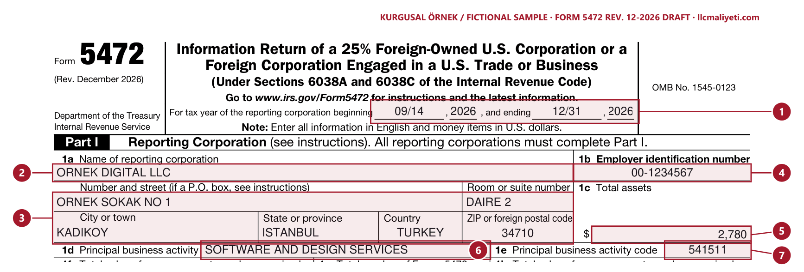
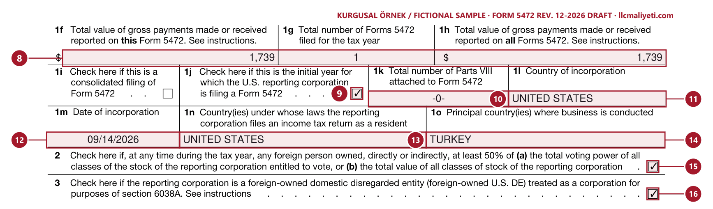
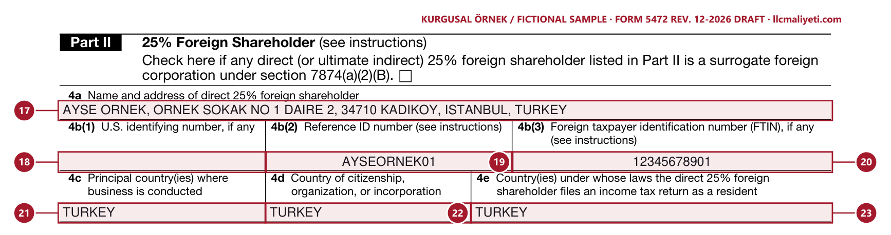
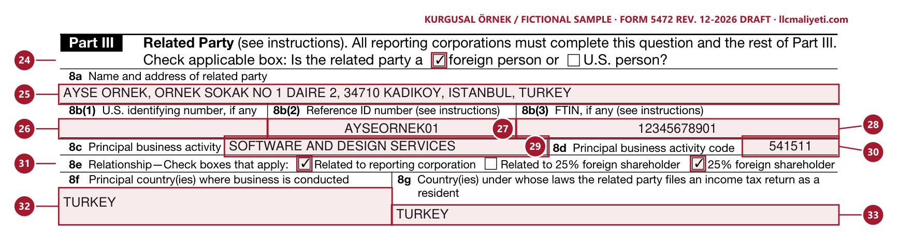
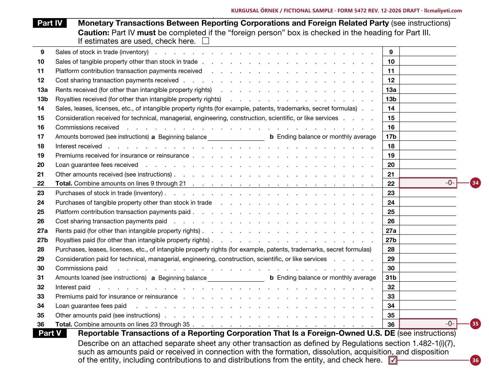
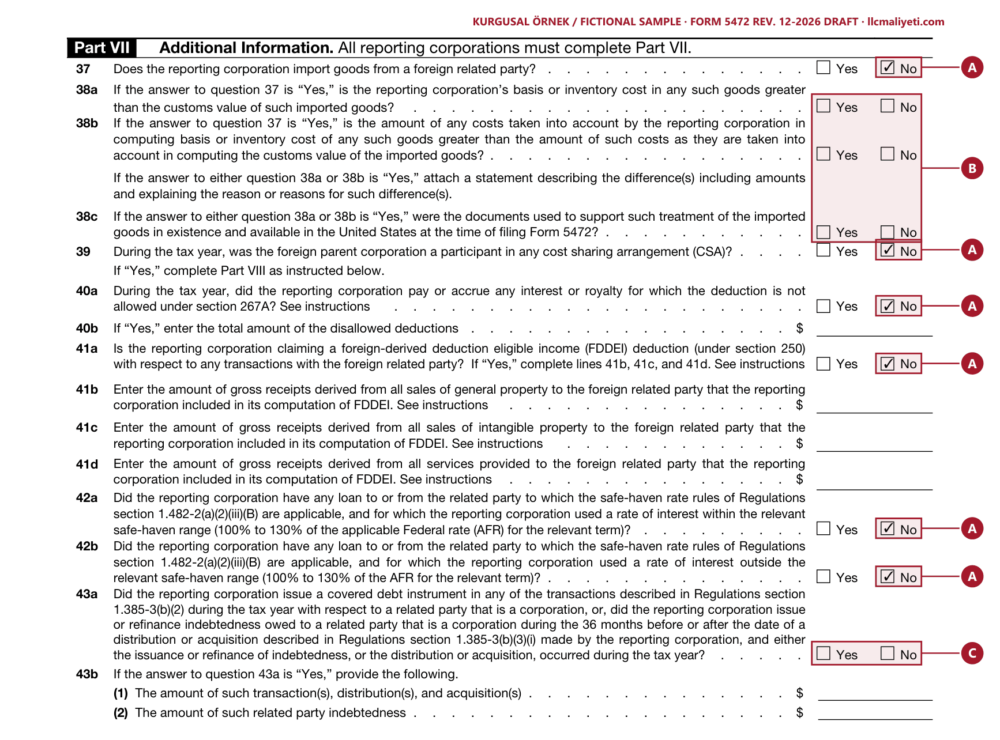
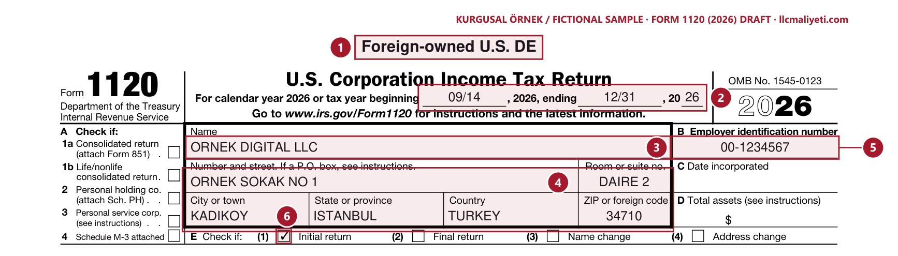
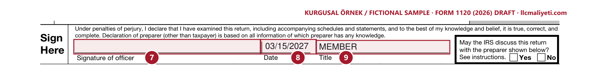
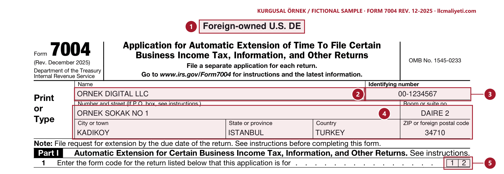
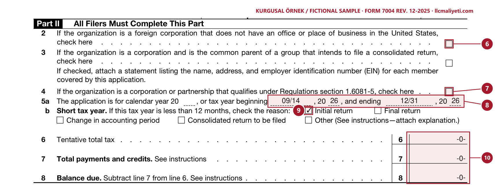

# Amerika Şirket Kuruluş Kiti · Tam İçerik

> Türkiye'den ABD LLC kurulumu, EIN, Mercury, Stripe, Apple Wallet ve uygulama mağazası şirket hesabı hattının uçtan uca kurulum kiti.
> **Veri damgası:** Tüm rakamlar ve adımlar 25 Ağustos 2026 itibarıyla doğrulandı. 7. bölüm 26 Ağustos 2026'da eklendi ve o gün doğrulandı. 3. bölümdeki SSN'li online yol 30 Ağustos 2026'da eklendi ve o gün doğrulandı. 2 Eylül 2026 taraması: 17 YouTube videosu ile IRS, Mercury, Stripe, Apple, Google ve Florida Sunbiz'in birincil kaynakları yeniden okundu; değişen satırlar Ek B'de. 8. bölümün Form 5472 kısmı 14 Eylül 2026'da IRS talimatları, formları, yönetmeliği ve iç el kitabı okunarak yeniden yazıldı. 24 Kasım 2026 ücret taraması: Wyoming, Delaware, Florida, Kansas, Louisiana ve New Jersey resmi kaynakları yeniden okundu; değişen satırlar Ek B'de. Northwest 39/125 rakamları bu geçişte birincil siteden okunamadı.
> **Sürüm:** v1.8 · **Sonraki tazeleme:** 3 Aralık 2026

---

## Bu kiti nasıl okumalısın

Bu kit yanında açık duracak bir kontrol listesi. Ekranın bir yanında kit, diğer yanında dolduracağın form duruyor. Her bölüm tek bir kapıya karşılık geliyor: kuruluş, vergi numarası, banka, ödeme altyapısı, cüzdan, uygulama mağazası, yıllık takvim.

ABD sistemini hiç bilmiyorsan hiçbir şey kaçırmıyorsun. Kitte geçen her yabancı terim ilk geçtiği yerde tek cümleyle açıklanıyor, hepsi bir arada bir sonraki bölümdeki sözlükte de duruyor. Form alanlarının adlarını İngilizce bıraktım, çünkü ekranda tam olarak o adları göreceksin. Yanlarındaki açıklama Türkçe ve "sen şimdi şunu yapacaksın" diliyle yazıldı.

Okuma sırası basit: sözlüğe bir kez göz gezdir, 1. bölümdeki takvimi kur, sonra 2. bölümden başlayıp sırayla ilerle. Sıra atlanmıyor, çünkü her kapı bir öncekinin çıktısını istiyor.

Üç etiket geçiyor, üçünün de anlamı sabit:

| Etiket | Anlamı |
|---|---|
| **Doğrulandı** | Birincil kaynaktan (IRS, eyalet sekreterliği, Mercury destek merkezi, Apple destek, Google Play yardım merkezi, Dun & Bradstreet) okundu. Tarih 25 Ağustos 2026, 7. bölüm için 26 Ağustos 2026; 2 Eylül 2026 taramasında yeniden okunan satırlar o tarihle işaretli. 8. bölümün Form 5472 kısmı 14 Eylül 2026'da okunan IRS kaynaklarına dayanıyor. Ücret tablosunun 24 Kasım 2026'da yeniden okunan satırları o tarihle işaretli. Ekranda göreceğin şey bu. |
| **Değişken** | Bu kalem servis tarafında ya da kuruma göre değişebiliyor. Ekranda farklı bir şey görürsen şaşırma, geçerli olan ekrandaki. Kesin rakam uydurmuyorum, güncel kaynağa yönlendiriyorum. |
| **Talimat net değil** | IRS talimatı bu noktayı açıkça yazmıyor. Örnekte bir cevap seçtim ve gerekçesini yanına yazdım; kendi beyanında bu noktayı muhasebecinle netleştir. |

Adımların içindeki bağlantılara tıklayarak doğrudan ilgili sayfaya gidebilirsin. Kaynakların tamamı Ek A'da toplu halde duruyor. Uyarı da kitin en altında, Ek D'de.

---

## Sözlük · Bu kitte geçen kelimeler

Bu listeyi bir kez okursan kitin geri kalanında hiçbir kelimede takılmazsın. Her terim ilk geçtiği bölümde tekrar açıklanıyor, buraya dönmen şart değil.

- **LLC (Limited Liability Company).** ABD'nin limited şirketi. Tek kişi kurabiliyor. Senin kuracağın yapı bu.
- **SSN (Social Security Number).** ABD vatandaşlarına ve ABD'de çalışma izni olanlara verilen kimlik numarası. Kitin ana hattı sende olmadığını varsayıyor ve olması da gerekmiyor. Formlarda SSN soran her yerde ikinci seçeneği işaretleyeceksin, nasıl yapacağını ilgili adımda tek tek gösteriyorum. Elinde SSN ya da ITIN varsa 3. bölümdeki SSN'li online yol başlığı sana kısayol veriyor.
- **ITIN (Individual Taxpayer Identification Number).** SSN alamayan yabancılara IRS'in verdiği vergi kimlik numarası. Bu kitteki hattın hiçbir adımında zorunlu değil. Yalnız PayPal isterse gündeme geliyor, o da 11. bölümde.
- **EIN (Employer Identification Number).** Şirketinin ABD vergi numarası. İnsanın SSN'i neyse şirketin EIN'i o. Banka da Stripe da bunu istiyor. **Ücretsiz** ve kendin alabilirsin, nasıl alacağını 3. bölümde satır satır anlatıyorum.
- **Registered agent (kayıtlı temsilci).** Şirketin adına eyaletten gelen resmi yazıları teslim alan, o eyalette adresi bulunan kişi ya da şirket. Kanunen zorunlu. Türkiye'de oturuyorsan bu işi bir servise yaptırıyorsun, Northwest tam olarak bunu satıyor.
- **Disregarded entity (dikkate alınmayan varlık).** IRS'in tek ortaklı LLC'ye verdiği vergi statüsü. Şirket federal vergide ayrı bir varlık sayılmıyor, sahibiyle birlikte değerlendiriliyor. SS-4 formunda bu kelimeyi elle yazacaksın.
- **SS-4.** EIN başvuru formunun adı. IRS'in tek sayfalık formu. 3. bölümde satır satır dolduruyoruz.
- **CP 575.** IRS'in EIN'i onayladığında gönderdiği resmi mektup. Şirketinin vergi numarası belgesi bu. Banka bunu istiyor.
- **147C.** CP 575'i kaybedersen IRS'ten isteyebileceğin, onun yerine geçen mektup. Banka bunu da kabul ediyor.
- **Form 5472.** Yabancı sahipli tek ortaklı LLC'nin IRS'e verdiği bilgi beyanı. Şirkete para koyduğun, şirketten para çektiğin ya da şirketin masrafını kendi kartınla ödediğin her yıl veriliyor; gelirin olmaması muafiyet sağlamıyor. Takvimi ve doldurulmuş örneği 8. bölümde.
- **Operating Agreement (işletme sözleşmesi).** Şirketin iç kurallarını yazan, ortakların imzaladığı belge. Tek kişilikte kendi kendine imzalanıyor. Eyalete verilmiyor, banka isteyebiliyor.
- **Articles of Organization / Certificate of Formation.** Eyaletin şirketini tescil ettiğini gösteren kuruluş belgesi. Northwest kurulum bitince panelinde sana veriyor.
- **BOI / FinCEN.** Şirket sahiplerinin ABD hazinesine bildirilmesi kuralıydı. 14 Ağustos 2026'dan itibaren ABD'de kurulan şirketler bu bildirimden muaf. Detayı 8. bölümde, internette hala göreceğin eski metinlerin neden bayat olduğuyla birlikte.
- **CMRA (Commercial Mail Receiving Agency).** Ticari posta kabul adresi. Posta kutusu, UPS Store adresi, sanal ofis adresi bu gruba giriyor. Mercury bu tip adresleri reddediyor, kitin en pahalı hatası burada.
- **Apple Pay ile Apple Card aynı şey değil.** Apple Pay, kartını telefona ekleyip temassız ödeme yapmandır. Apple Card ise Apple'ın kredi kartı ürünü ve SSN istiyor. Bu kit Apple Pay hattını kuruyor.
- **Faks.** Türkiye'de neredeyse unutuldu ama IRS hala en hızlı kanal olarak faksı kullanıyor. Faks makinesi almana gerek yok, tarayıcıdan gönderiyorsun. Nasıl yapacağın 3. bölümde.
- **D-U-N-S numarası (Data Universal Numbering System).** İşletmeleri tanımlayan dokuz haneli numara. Apple ve Google, geliştirici hesabını şirket adına açarken bu numarayla şirketinin gerçek olduğunu doğruluyor. **Ücretsiz.** Nasıl alınacağı 7. bölümde.
- **D&B (Dun & Bradstreet).** D-U-N-S numarasını veren ve şirket verisi tutan Amerikan şirketi. Devlet kurumu değil.
- **Tüzel kişilik (legal entity).** Kanunen sözleşme yapabilen, kendi adına hak sahibi olabilen yapı. Senin LLC'n bu tanıma giriyor ve Apple bunu kendi metninde açıkça sayıyor.
- **Organizasyon hesabı ile bireysel hesap.** Uygulama mağazalarındaki iki hesap türü. Bireyselde mağazada satıcı olarak kendi ad ve soyadın görünüyor ve D-U-N-S numarası istenmiyor. Organizasyonda şirketinin adı görünüyor ve D-U-N-S numarası zorunlu. Karşılaştırma tablosu 7. bölümde.
- **Legal entity name (yasal tüzel kişilik adı).** Şirketinin eyalet kaydındaki tam adı. Apple bunun yerine DBA, ticari ad ve kısaltma kabul etmiyor. Kuruluş belgendeki yazımla birebir aynı olacak.

---

## Bölüm 1 · Yol haritası: başvurudan Apple Pay'e gerçekçi takvim

Bu bölümde tek bir iş yapıyorsun: takvimini kuruyorsun. Aşağıdaki süreleri kendi takvim uygulamana yazarsan hangi kapının ne zaman açılacağını baştan bilirsin ve boşuna beklemezsin.

Sıra önemli. Her kapı bir öncekinin çıktısını istiyor: banka, kuruluş belgesi ve EIN belgesi olmadan hesap açmıyor. Stripe da EIN'i ve LLC adına açılmış ABD banka hesabını istiyor.

```
Kuruluş  →  EIN  →  Mercury  →  Sanal kart  →  Apple Wallet
                        ↓
                     Stripe (EIN elindeyken başvur; IRS eşleşmesi 3-4 hafta, paralel)
                        ↓
                  Fiziksel kart (TR'ye 2-3 hafta)
```

### Takvim tablosu

| Adım | Gerçekçi süre | Kaynak / durum |
|---|---|---|
| Northwest siparişi doldurma | 15-20 dakika | Canlı form okundu (25 Ağu 2026) · Doğrulandı |
| Eyalet dosyalaması onayı | Eyalete göre 1 gün ile 3 hafta: Wyoming online anında, Florida 2-5 iş günü, New Mexico birkaç iş günü (2026 yazında eyalet kuyruğu ~3 hafta), Delaware 2-3 hafta | **Değişken.** Northwest sipariş özetindeki `N days Processing` satırı + eyalet kaynakları, detay 2. bölümde |
| SS-4'ü doldurup fakslama | 1 saat | IRS SS-4 talimatları (Rev. Aralık 2025) · Doğrulandı |
| EIN dönüşü (faks, geri-faks numarası verilmişse) | IRS talimatı 4 iş günü diyor; IRS'in canlı işlem durumu sayfası 28 Ağustos 2026'da faks için 9 iş günü yazıyordu; 2025-2026 videolarındaki gerçek deneyim 2-4 hafta. Planını 4 haftaya göre kur | IRS SS-4 talimatı + IRS işlem durumu sayfası + IRM 21.7.13 (2 Eyl 2026) · **Değişken**, göndermeden önce durum sayfasına bak |
| EIN dönüşü (faks, geri-faks numarası verilmemişse) | ~2 hafta, onay mektubu postayla | IRM 21.7.13 (2 Eyl 2026) · Doğrulandı |
| EIN dönüşü (posta) | ~4 hafta; IRS işlem durumu sayfası 30 gün yazıyor | IRS talimatları + işlem durumu sayfası · Doğrulandı |
| Mercury başvuru incelemesi | Genelde 0-2 iş günü, uygulama içi çizelge 2-4 gün; ek belge isterlerse uzuyor | Mercury destek merkezi (2 Eyl 2026) · Doğrulandı |
| Sanal kart | Onayla birlikte hazır, hesaba para düşünce çalışıyor | Mercury destek merkezi · Doğrulandı |
| Apple Wallet'a ekleme | Aynı gün, 5 dakika | Mercury + Apple destek · Doğrulandı |
| Fiziksel kartın Türkiye'ye ulaşması | 2-3 hafta | Mercury destek merkezi · Doğrulandı |
| Stripe başvurusu | EIN elindeyken başvur; IRS eşleşmesi 3-4 hafta, paralel | Stripe destek sayfaları (2 Eyl 2026) · Doğrulandı |

### Toplam

**4 ile 8 hafta.** Alt sınır her kapının hızlı açılmasını, üst sınır IRS'in yoğun olmasını ve Mercury'nin ek belge istemesini varsayıyor. Takvimi belirleyen kalem EIN dönüşü: 2025-2026'da faksla başvuran kurucular çoğunlukla 2-4 hafta bekledi.

Hızlandırmanın tek gerçek yolu şu: SS-4'ü postayla değil faksla göndermek ve formun imza bloğuna faks alabilen kendi numaranı yazmak. O tek alan cevabın faksla mı yoksa postayla mı geleceğini belirliyor, 3. bölümde tekrar hatırlatıyorum.

Apple Pay'i sanal kartla kullanmaya Mercury onayından ve hesaba ilk para düştükten sonra başlayabilirsin. Fiziksel kartın Türkiye'ye ulaşmasını beklemene gerek yok.

**Değişken.** Takvimdeki gün sayıları kurum yoğunluğuna göre oynuyor. Kendi kurulumumun gerçek gün sayıları ölçüldükçe bu tabloya işleniyor, değişiklik günlüğü Ek B'de duruyor.

---

## Bölüm 2 · Northwest üzerinden kurulum: adım adım

Bu bölümde şirketini kuruyorsun. Sonunda elinde eyaletin verdiği kuruluş belgesi olacak ve 3. bölüme geçebileceksin.

### Önce eyalet kararını veriyorsun

ABD'de şirketi bir eyalette kuruyorsun ve o eyaletin harçlarını ödüyorsun. Dört eyalet gerçek aday. Rakamlar Northwest üzerinden kurulum içindir. Önerilen dört eyaletin resmi harçları 24 Kasım 2026'da yeniden okundu (New Mexico kuruluş harcı bu geçişte resmi siteden okunmadı, önceki damga duruyor). Northwest 39 dolarlık servis ücreti bu geçişte birincil siteden doğrulanamadı.

| Eyalet | Kurulum (39 servis + eyalet harcı) | Yıl 2 ve sonrası (agent 125 + eyalet + beyan 399) | Yıllık rapor vadesi |
|---|---|---|---|
| New Mexico | **89 USD** | **524 USD** | Yıllık rapor zorunluluğu yok |
| Wyoming | **139 USD** | **584 USD** | Kuruluş yıldönümü ayının ilk günü |
| Delaware | **149 USD** | **924 USD** | 1 Haziran (yıllık vergi) |
| Florida | **164 USD** | **662,75 USD** | 1 Mayıs |

Kararı verirken bilmen gerekenler:

- **Delaware rakamı 2026'da değişti.** House Bill 400 (21 Mayıs 2026 imzalı) LLC yıllık vergisini 300 dolardan 400 dolara çıkardı. 1 Haziran 2026'da ödenen tutar hala 2025 vergi yılına aitti ve 300 dolardı. Yeni 400 dolar ilk kez 1 Haziran 2027'de tahsil edilecek. İnternette gördüğün "Delaware 300 dolar" cümlelerinin hepsi bayat.
- **Florida'nın gecikme cezası sert.** 1 Mayıs'tan sonra 400 dolar ceza ekleniyor ve affedilmiyor. Eylül ayının üçüncü Cuma gününden sonra şirket idari olarak feshediliyor. Vadeyi takvime yazarsan bu satır seni hiç ilgilendirmez.
- **Kuruluş yılında eyalet yıllık raporu ödenmez.** Dört eyalette de ilk rapor, kuruluşu izleyen dönemde başlıyor.
- **Kuruluş eyaleti sonradan değiştirilemez.** Değiştirmek istersen kapatıp yeniden açman gerekiyor. Bu yüzden kararı burada net ver.

Tek kişilik, Türkiye'den yönetilen, ABD'de fiziki faaliyeti olmayan bir LLC için Delaware'in ekstra 400 doları karşılığında sana verdiği bir şey yok. Yatırım alacak bir yapı kurmuyorsan Wyoming ile New Mexico arasında karar ver. New Mexico yıllık yükü en düşük olan, Wyoming ise ekosistemi en tanıdık olan. Ben kendi LLC'mi Florida'da kurdum.

### Kurulum sayfasını açıyorsun

Kurulumu Northwest Registered Agent üzerinden yapıyorsun. Northwest hem eyalete dosyalamayı senin adına yapıyor hem de zorunlu olan registered agent (kayıtlı temsilci) hizmetini veriyor. Registered agent, şirketin adına eyaletten gelen resmi yazıları teslim alan ve o eyalette adresi bulunan taraf. Türkiye'de oturduğun için bu adres sende olamıyor ve bu hizmeti almak zorundasın.

Sipariş sayfasını aşağıdaki butonla açıyorsun.

[[northwest-kurulum]]

Sipariş formunu 25 Ağustos 2026'da ödemeye kadar açtım; ödeme sonrası ekranlar 2 Eylül 2026'da bir alıcının ekran görüntüleriyle eklendi (Adım 5). Sipariş akışında pasaport yükleme ekranı, kimlik yükleme ekranı ve SSN alanı **yok**. Pasaport ilk kez bankada isteniyor, yani 4. bölümde. YouTube'daki 2026 tarihli anlatım videolarında şirket amacı, adres ve üye ekranları ödemeden önce geliyor; Northwest bu alanları Ağustos 2026'dan beri ödeme sonrasındaki `Add State Filing Details` formunda soruyor, sorular ve cevaplar aynı, yalnız yerleri değişti.

### Northwest siparişi: 5 adım

**Adım 1 · Formation**

Burada ne kurduğunu ve nerede kurduğunu seçiyorsun.

- `Entity Type` alanında `LLC` seç.
- `Jurisdiction` alanında yukarıda karar verdiğin eyaleti seç.

**Adım 2 · Company Name**

Burada şirketinin adını belirliyorsun. Aklındaki adı yaz. Ad o eyalette başkası tarafından alınmışsa form seni uyarıyor, Northwest arama yapmanı sağlıyor. Adı önce eyaletin kendi kayıt sitesinde ara (New Mexico `enterprise.sos.nm.gov`, Wyoming `wyobiz.wyo.gov`, Florida `search.sunbiz.org`, Delaware `icis.corp.delaware.gov`); Northwest'in kutusu yalnız ön kontrol ve reddedilen ad dosyalamayı baştan başlatıyor.

- `Designator` alanı, adın sonuna gelen ekin biçimi. `LLC` ya da `L.L.C.` seçebilirsin, ikisi de geçerli.
- **EIN servisi seçimi.** Formda iki seçenek canlı duruyor ve burada bir karar veriyorsun:
  - `I have a U.S. Social Security Number (SSN)`
  - `I don't have a U.S. Social Security Number (SSN) - $200`
  - **Sen ne yapacaksın:** SSN, ABD vatandaşlarının kimlik numarası ve sende yok. Yani ikinci seçenek senin durumun. Ama bu seçeneği işaretlemek zorunda değilsin. EIN'i Northwest'e 200 dolar verip aldırabilirsin ya da kendin **ücretsiz** alabilirsin. Nasıl alacağını 3. bölümde satır satır anlatıyorum, oradaki rehberi izleyeceksen bu 200 dolarlık seçeneği alma. Uğraşmak istemiyorsan 200 dolar geçerli bir tercih, ama zorunlu değil ve işi hızlandırmıyor. İş yine IRS hızında yürüyor.
  - Piyasada "Northwest SSN'siz kişilere EIN almıyor" diyen 2026 tarihli incelemeler var. Bu bilgi yanlış, seçenek formda duruyor.

**Adım 3 · Account Creation**

Burada Northwest panelinde hesabını açıyorsun. Kuruluş belgeni sonra bu panelden indireceksin.

- Ad, soyad, cep telefonu, e-posta ve şifre yazıyorsun.
- Telefon numarası iki adımlı doğrulama için kullanılıyor. Türk cep telefonu numarası kabul ediliyor, `+90` ile gir.

**Adım 4 · Payment**

Burada ödemeyi yapıyorsun.

- Kart bilgisi ve fatura adresi giriyorsun.
- `Country` açılır listesinden **Türkiye** seçilebiliyor. Türk kartıyla ödeme geçiyor.

Ödeme geçince Northwest seni panele alıyor ve dosyalama henüz başlamıyor. Bir form daha var.

**Adım 5 · Add State Filing Details (ödemeden sonra)**

Panelde `Add State Filing Details` başlığıyla üç ekranlık bir form açılıyor: Business Details (içinde Addresses bloğu), People & Roles, Review & Submit. Eyalet dosyalaması bu form gönderilmeden başlamıyor. Kitin ilk sürümü bu ekranı görmedi, çünkü sipariş formu ödemeye kadar açılmıştı; 2 Eylül 2026'da bir alıcının New Mexico siparişinden gelen ekran görüntüleriyle eklendi. Diğer üç eyalette alan sırası küçük farklar gösterebilir, cevaplar aynı.

**Ekran 1 · Business Details**

- `Business Name`: Eyalet kaydında görünecek ad. Yeşil "available" kutusu Northwest'in ön kontrolü, kesin onay eyaletten dosyalamada geliyor.
- `Industry`: En yakın kategoriyi seç. Yazılım, danışmanlık ve tasarım işleri için `Professional, Scientific, and Technical Services`. Northwest bunu öneri motoru için kullanıyor, seni bağlamıyor.
- `Business Purpose`: `Use Generic Business Purpose` açık kalsın, metin `Any legal business purpose` olur. Dört eyalet de genel amaç kabul ediyor ve bu ifade seni hiçbir faaliyete kilitlemiyor. Banka, IRS, Amazon ve Etsy bu satıra bakmıyor. Yine de kendi amacını yazmak istersen (100 karakter sınırı) şu kalıp iş görüyor: `Software development, digital products and online services, and any other lawful business purpose`. Sondaki `any other lawful business purpose` ifadesini silme, seni o faaliyete kilitlemesin.
- `Effective Date`: `Upon Filing` açık kalsın. Tek istisna yıl sonu: Kasım-Aralık'ta kuruyorsan Delaware ve Florida'da şirket kurulduğu yılın yıllık yükümlülüğünü hemen doğuruyor, bir sonraki yılın 1 Ocak'ını seçmek o yılın yıllık raporunu (Florida 138,75 dolar) ya da franchise vergisini (Delaware 400 dolar, 2026 vergi yılından itibaren) kazandırıyor. Wyoming'de yıllık rapor kuruluş ayının yıldönümünde başladığı için fark bir ay, önemsiz. New Mexico'da yıllık rapor olmadığı için fark etmiyor. **Değişken:** yıl sonundaysan 8. bölümdeki tarihlerle karşılaştır.
- `Trade Name`: Boş bırak. Şirket adından farklı bir ticari adla satış yapmayacaksan gereksiz.
- `File EIN Paperwork For Me`: **Kapalı.** 50 ve 200 dolarlık EIN seçeneği burada çıkıyor (2. adımda da gördüysen aynı seçenek). EIN'i 3. bölümde kendin, ücretsiz alıyorsun.
- `File S Corp Paperwork For Me`: **Kapalı.** SSN istiyor ve S Corp hissedarı olmak için ABD vatandaşı ya da mukimi olmak gerekiyor. Türkiye'den kuran için bu seçenek zaten kapalı.

**Ekran 1 · Addresses (Business Details ekranının ikinci bloğu)**

- `Principal Address`: **`Registered Agent Address` (FREE).** Bu adres kamuya açık sicile yazılıyor. Northwest'in adresi ev adresini gizliyor ve sen taşınsan da değişmiyor. `Virtual Business Address` (ayda 20 dolardan başlıyor) alma: kuruluş için ek bir şey kazandırmıyor ve Mercury'de zaten fiziksel adres olarak geçmiyor (4. bölüm). Amazon için de işe yaramıyor: Amazon, ABD adresi yazana o adreste fiilen çalıştığını kanıtlatıyor (kira sözleşmesi, fatura ya da o adresli banka ekstresi), sanal adres bunu üretemiyor ve Amazon'un kendi çalışanı satıcı forumunda ülke listesinden kendi ülkeni seçmeni söylüyor; Amazon'un kartpostal doğrulaması 11. bölümdeki Amazon sorusunda. Etsy için kuruluş belgesindeki kayıtlı temsilci adresi şirketin ABD yasal adresi olarak yetiyor. **Değişken:** Etsy'nin adres türü ayrımı yaptığına dair kaynak yok, kayıt anında kontrol et; Etsy akışının tamamı 11. bölümde. Bu ücretli adres yalnız düz zarf posta için: Northwest paket kabul etmiyor ve fiziksel yönlendirmeyi ABD içindeki bir adrese yapıyor, iade paketi ya da ürün numunesi için işe yaramıyor. `Enter a Different Address` ile Türkiye adresi yazma: adresin kamuya açık olur, eyaletin postası Türkiye'ye gider.
- `Mailing Address`: `Same as Principal Address` **açık kalsın.** Eyaletten gelen her yazı Northwest'e düşüyor, taranıp panele konuyor, ücretsiz.

**Ekran 2 · People & Roles**

- `Would you like to list Managers or Members on State Record?`: **No.** Dört eyalette de zorunlu değil. `No` seçince adın eyalet sicilinde görünmüyor. Banka ve IRS sahipliği kuruluş belgesi ve operating agreement üzerinden doğruluyor, sicilden değil. Florida ayrı: yönetici ya da üye adı isteğe bağlı, unvan `MGR` (yönetici) ya da `AMBR` (yetkili üye); adres olarak kayıtlı temsilci adresi yeter, Florida adresi şartı yalnız registered agent için. Eyaletin kendi formu (Sunbiz CR2E047, 2 Eylül 2026'da okundu) çoğu geleneksel bankanın hesap açarken bu kaydı istediğini yazıyor. Mercury'nin belge listesinde sicil kaydı geçmiyor (4. bölüm); yine de Florida'yı seçtiysen ve bir gün fiziksel bankaya gitme ihtimalin varsa `Yes` deyip adını `AMBR` olarak yazdırmak seni sonradan Articles of Amendment dosyalamaktan kurtarır. **Değişken:** Mercury'nin Florida sicil kaydı istemediği bu taramada teyit edilmedi. `Yes` dediysen sorun değil: adın ve girdiğin adres eyalet sicilinde herkese görünür, kanunen bir yükümlülük doğurmaz, banka ve IRS tarafında hiçbir şey değişmez. Kaldırmak istersen Articles of Amendment dosyalanıyor (New Mexico'da 50 dolar eyalet harcı). Adres olarak kayıtlı temsilci adresini girdiysen ev adresin zaten görünmüyor.
- `Management Type`: **`Member Managed`.** Tek üyeli şirkette işi kendin yürütüyorsun. SS-4 imza bloğundaki `Member` unvanı ve Mercury başvurusundaki rolün buna göre.
- `Registered Agent`: Northwest'in adresi hazır geliyor, dokunma.

**Ekran 3 · Review & Submit**

Adı, eyaleti ve iki adresi son kez kontrol edip gönder. Eyalet dosyalaması bu andan sonra başlıyor.

Dosyalama süresi eyalete göre değişiyor ve Formation ekranındaki `<Eyalet> N days Processing` satırı Northwest'in o eyalet için verdiği süreyi gösteriyor. Wyoming'de online dosyalama aynı gün, Florida'da 2-5 iş günü, New Mexico'da birkaç iş günü, Delaware'de standart işlem 2-3 hafta. Delaware'de acelen varsa 24 saatlik hızlandırma seçeneği yaklaşık 100 dolar ek. **Değişken:** New Mexico'nun eyalet kuyruğu 2026 yazında üç haftaya kadar uzadı, güncel gecikmeyi `enterprise.sos.nm.gov` ana sayfası "işlenen tarih" olarak gösteriyor; eyalet süreleri ve Delaware hızlandırma ücreti ikincil kaynaklardan. Kuruluş belgen panelde `Documents` altında beliriyor. O belge elinde olduğunda 3. bölüme geç.

**Operating agreement şablonunu da buradan alıyorsun.** Northwest ücretsiz operating agreement şablonu veriyor, panelde `Legal Forms` başlığına bak. Kuruluş belgen geldiğinde şablonu aç, şirket adını, eyaleti ve kendi adını yaz, tek üye olarak imzala, PDF'i sakla. Eyalete gönderilmiyor. 4. bölümde banka bu belgeyi isteyebiliyor, o gün aramaya kalkma.

### 39 dolarlık pakete dahil olanlar

Formda listeli: ücretsiz alan adı, ücretsiz açık kaynak web sitesi, ücretsiz iş e-postası, ücretsiz telefon hattı, ücretsiz iş adresi, marka koruma, yıllık rapor hatırlatıcıları ve yenileme servisi (kendiliğinden açık geliyor, iptal etmezsen 100 dolar artı eyalet harcı).

**Yenileme servisi kendiliğinden açık geliyor.** Northwest seni yıllık rapor dosyalama servisine otomatik kaydediyor. Vadeden 90 gün önce panelde bildirim düşüyor, beş gün sonra raporu senin adına dosyalayıp kartından eyalet harcını ve 100 dolar servis ücretini çekiyor. Raporu kendin dosyalayacaksan ödeme biter bitmez panelde `Services` sekmesine gir, yıllık rapor satırını iptal et. İptal ücretsiz. New Mexico'da yıllık rapor olmadığı için bu satır seni ilgilendirmiyor. Delaware'de bu servis franchise vergisini de kapsıyor, iptal etmezsen 400 artı 100 dolar çekiliyor. Servisi bilerek açık bırakıyorsan 8. bölümdeki yıllık maliyetine 100 dolar ekle. **Değişken:** otomatik kayıt Northwest'in Ocak 2026 sipariş formundaki kendi metni; Eylül 2026 akışında varsayılanın hala açık olup olmadığı doğrulanmadı, panelde `Services` sekmesine bakınca kesinleşiyor.

Ücretsiz kalemler deneme süresi değil; formda "Not a trial. No gotchas." yazıyor ve kart bilgisi ayrıca istenmiyor. Ocak 2026'ya kadar aynı kalemler 90 günlük denemeydi ve sonrasında kalem başına ayda 9 dolardı; eski video ya da incelemede o rakamı görürsen bayat. **Değişken:** ücretsizlik registered agent hizmetin aktif olduğu sürece geçerli görünüyor, yani ikinci yıldan itibaren ödediğin 125 dolar bu kalemleri de taşıyor; bu bağ ikincil kaynaktan. Kullanmayacaksan aktive etmen de gerekmiyor.

Birinci yıl registered agent hizmeti de dahil. İkinci yıldan itibaren yıllık 125 dolar ödüyorsun. Bu fiyatın 20 yıldır sabit olduğu ve yenilemede artmadığı birden fazla bağımsız kaynakta geçiyor.

### En pahalı hata: ücretsiz iş adresini bankaya vermek

Bunu şimdi okuyup aklında tut, çünkü 4. bölümde karşına çıkacak.

Northwest'in verdiği ücretsiz iş adresi bir posta yönlendirme adresi. Mercury bu tip adresleri (registered agent adresi, posta kutusu, posta merkezi) kendi uygunluk sayfasında **açıkça reddediyor**. Banka başvurusunda "şirketin fiilen çalıştığı adres" alanına Türkiye'deki kendi adresini yazacaksın. Kurulumdan sonra "adresim var" diye Northwest adresini yazmak, red almanın en kısa yolu. Detay 4. bölümde.

### Northwest kullanmadan kurmak istersen

Eyalet sitesinden doğrudan da kurabilirsin. O zaman 39 dolarlık servis ücretini ödemezsin, ama eyalette bir registered agent adresi bulman gerekiyor (kanunen zorunlu) ve tüm yazışmaları kendin takip ediyorsun. Türkiye'den yönetiyorsan ticari bir registered agent almadan bu yol pratikte yürümüyor, ticari agent da yılda 100-300 dolar bandında oluyor. Yani 39 dolarlık servis ücreti bu tabloda büyük bir kalem değil.

**Değişken · ticari registered agent fiyatı.** Bu bant için ayrı bir kaynak künyesi yok, güncel fiyatı sağlayıcının kendi sitesinden teyit et.

**Değişken · Delaware kuruluş harcı.** 110 dolarlık harç iki ikincil kaynaktan alındı, eyaletin resmi PDF'i makine okumasına kapalı döndü. Delaware'i seçersen kuruluş gününde [Delaware Division of Corporations](https://corp.delaware.gov/) sayfasını açıp tutarı teyit et. HB 400 harç kalemlerini de değiştirmiş olabilir.

**Değişken · Northwest fiyatları.** 39 dolar ve 125 dolar rakamları dört bağımsız kaynaktan alındı. Northwest'in kendi sitesi otomatik istekleri reddediyor (2 Eylül 2026'da da 403), o yüzden sayfa okuması yok; buna karşılık Northwest'in kendi sipariş ekranındaki `$39.00 Basic Package` ve `Renews at $125/year` satırları Haziran 2026 tarihli form kaydında ve 25 Ağustos 2026'da görüldü, ödeme sonrası ekranlar da bir alıcının ekran görüntülerinden geliyor. Sipariş ekranındaki tutar bu rakamların üstünde geliyorsa ekranda gördüğün rakam geçerlidir.

---

## Bölüm 3 · EIN: SS-4 satır satır

Bu bölümde şirketinin ABD vergi numarasını alıyorsun. EIN (Employer Identification Number), insanın SSN'i neyse şirketin için o. Banka da Stripe da bu numarayı istiyor.

**EIN ücretsizdir.** IRS bunu kendi sayfasında açıkça yazıyor: EIN için ücret ödemek zorunda değilsin. 2. bölümde Northwest'in 200 dolarlık EIN servisini gördün, o seçeneği almadıysan doğru yerdesin. Aldıysan bu bölümü atlayıp 4. bölüme geçebilirsin.

### SSN'in ya da ITIN'in varsa: online yol

Bu bölümün faks anlatımı SSN'i olmayanlar için. Elinde SSN ya da ITIN varsa IRS'in online asistanını deneyebilirsin, onaylanırsa numara anında ekranda beliriyor. Başlamadan iki şeyi bil:

- IRS'in yazılı şartı şirketin ana faaliyet yerinin ABD'de olması. Online formun adres ekranında ülke alanı yok, ABD adresi ve ABD telefon numarası isteniyor. Yurt dışından yönetenler bu ekrana kayıtlı temsilcinin adresini yazıyor ve sistem ikamet doğrulaması yapmıyor. Kayıtlı temsilcinin adresi hukuken şirketin fiziksel yeri sayılmıyor, yani burası gri bir alan: uygulamada yaygın ve ABD'li LLC rehberleri de bunu öneriyor, ama garanti değil.
- Başvurunun sonunda "we are unable to provide you with an EIN through this online assistant. You must submit a Form SS-4 by fax or mail" ekranı çıkabiliyor. En sık sebep IRS'in şirket adını başka bir kayıtla fazla benzer bulması (referans 101) ya da ad ile SSN'in IRS kaydında eşleşmemesi (referans 102). Bu bir red değil, başvurunun bir IRS çalışanına düşmesi. Tekrar denemek genelde aynı ekranı veriyor, doğru hamle faks yoluna geçmek. (Doğrulandı: IRS "Get an EIN" sayfası, SS-4 talimatı ve IRM 21.7.13, 1 Eylül 2026.)

Online yol şöyle işliyor:

1. [IRS'in "Get an EIN" sayfasını](https://www.irs.gov/businesses/small-businesses-self-employed/get-an-employer-identification-number) aç ve online başvuruyu başlat.
2. Formu tek oturuşta doldur. Başvuru bittiğinde EIN anında ekranda beliriyor ve işlem ücretsiz.
3. Onay mektubu aynı ekranda PDF olarak veriliyor. Hemen indirip belge klasörüne koy, banka adımında bu belgeyi göstereceksin.

İki kural daha var: sistem hafta içi 06:00-01:00, cumartesi 06:00-21:00, pazar 18:00-00:00 (ET) saatlerinde açık. Günde sorumlu kişi başına bir EIN veriliyor, iki şirket kuruyorsan ikinci başvuruyu ertesi güne bırak.

**Online'da o ekranı gördüysen ya da hiç denemek istemiyorsan** yolun faks, yani bu bölümün geri kalanı. Anlatım sende de aynı işliyor, tek fark var: 7b satırına `Foreign` yazmayacaksın, kendi SSN'ini yazacaksın. Kuruluş belgeni (Articles of Organization) faksa her durumda ekliyorsun; online'da referans 101 aldıysan bu belge ayrıca şart, IRS isim kontrolü için istiyor.

Northwest'in SSN'li başvurular için 50 dolarlık bir EIN servisi de var, SS-4'ü senin yerine dolduruyor. Online yol sende çalışıyorsa hız avantajı yok, çünkü online başvuru zaten anında sonuçlanıyor. Faks yolundaysan da süreyi IRS belirliyor, servis yalnız formu senin yerine dolduruyor. (Doğrulandı: IRS "Get an EIN" sayfası, 30 Ağustos 2026.)

### Online başvuru sana çalışmaz

IRS'in online EIN aracı sorumlu kişiden SSN ya da ITIN istiyor ve ikisi olmadan başvuru başlamıyor. ITIN, SSN alamayan yabancılara IRS'in verdiği vergi kimlik numarası ve sende muhtemelen o da yok. Yani SSN'siz kurucu için online yol baştan kapalı. SSN'in varsa yukarıdaki başlık senin için.

Yani online formu aramakla vakit kaybetme. Senin yolun faks ya da posta; telefon hattı ABD'de kurulu LLC'ye yeni EIN vermiyor, aşağıdaki tabloda gerekçesi var.

### Hangi kanaldan göndereceksin

| Kanal | Numara / adres | Süre | Not |
|---|---|---|---|
| **Faks (birincil yol)** | ABD dışından: **+1 304-707-9471** · ABD içinden: 855-215-1627 | IRS talimatı geri-faks numarasıyla 4 iş günü diyor, numara yoksa onay mektubu postayla ~2 hafta. IRS'in işlem durumu sayfası 28 Ağustos 2026'da faks için 9 iş günü yazıyordu, 2025-2026 videolarındaki gerçek deneyim 2-4 hafta | Türkiye'den gönderiyorsan 304'lü numarayı kullan. Servise numarayı tiresiz ve `+1` ile yaz: `+13047079471`. |
| Telefon | **+1 267-941-1099**, Pzt-Cum 06:00-23:00 ET | Yeni EIN için sana kapalı | Hat yalnız ABD dışında kurulmuş şirketlere EIN veriyor. Senin LLC'n ABD'de kurulu, IRS bunu 8c'den okuyor ve seni faksa yönlendiriyor (IRM 21.7.13, Mart 2026 güncellemesi). Hattı iki iş için kullan: faks süresi dolduysa durum sorgusu, belge kaybolduysa 147C. |
| Posta | Internal Revenue Service, Attn: EIN International Operation, Cincinnati, OH 45999 | ~4 hafta; işlem durumu sayfası 30 gün yazıyor | En yavaş yol. |

Bir kural daha: **sorumlu kişi başına günde bir EIN.** İki şirket kuruyorsan aynı gün iki başvuru gönderme. Aynı formu "hızlansın" diye ikinci kez de fakslama: IRS aynı kişiden gelen ikinci başvuruyu günlük sınırdan geri çeviriyor ve kuyrukta çakışma üretiyor.

Göndermeden önce [IRS'in işlem durumu sayfasına](https://www.irs.gov/help/processing-status-for-tax-forms) bak; "Form SS-4" satırındaki gün sayısı o günkü gerçek süre. Planını 4 haftaya göre kur, 4 günde gelirse kazanç sende.

### Faks makinen yok, sorun değil

Türkiye'de faks neredeyse unutuldu, ama IRS hala bu kanalı kullanıyor ve en hızlı yol burası. Faks makinesi almana gerek yok. Online faks servisleri tarayıcıdan PDF yükleyip ABD numarasına gönderiyor.

Faks servisinden iki şey istiyorsun: gönderim ve senin adına faks alacak bir ABD numarası. IRS EIN'i bu numaraya geri fakslıyor; numaran yoksa cevap postayla geliyor ve iki haftayı buluyor. Ücretsiz plan yalnız gönderime yetiyor; FAX.PLUS'ın ücretsiz planı toplam 10 sayfa veriyor ve numara vermiyor. Alma için ücretli plan gerekiyor. FAX.PLUS'ta bu iki iş birlikte Basic planda: aylık 6,99 dolar (yıllık ödemede 83,99 dolar), ayda 200 sayfa, bir dedicated faks numarası ve faks alma dahil. Numara 40'tan fazla ülkeden seçiliyor ve ABD listede. Hesap aç, `Upgrade` de, ülke olarak United States seç, alan kodu random kalsın, numaran anında atanıyor; rastgele numara plana dahil. Numarayı `+1` ile başlayan haliyle kopyala, formun en altındaki `Applicant's fax number` alanına yaz. Rakamlar [FAX.PLUS'ın fiyat sayfasından](https://www.fax.plus/pricing), 2 Eylül 2026'da okundu; eski kayıtlardaki aylık 9 dolar bayat. iFax'te numara Plus planla geliyor ve ayda 24,99 dolar tutuyor. Abonelik her ay kendiliğinden yenileniyor; iptali hesap ayarlarından yapıyorsun. Aboneliği EIN elinde olana kadar iptal etme; cevap geldikten sonra kapat, ikinci ay ödeme yapma.

Arama kutusuna `online fax service` yazdığında çıkan servislerden biri işini görüyor. En bilinen iki isim FAX.PLUS ve eFax. Hangisini seçersen seç, kontrol edeceğin şeyler aynı:

- Uluslararası numaraya (`+1` ile başlayan ABD numarasına) gönderim yapıyor mu
- Sana faks ALABİLEN bir ABD numarası veriyor mu (ücretli plan açık mı)
- Gönderim onayı (fax confirmation) veriyor mu, o onayı sakla
- Yüklediğin PDF'in çözünürlüğü düşmüyor mu; IRS okunaksız formu yeni form isteyerek geri gönderiyor
- Alıcı numarayı tiresiz ve `+1` ile yaz: `+13047079471`, tireli yazınca servis hata veriyor
- Gönderim birkaç dakika sürüyor, sayfa başına yaklaşık bir dakika; servis "optimize for text" seçeneği sunuyorsa seç

### Formu nereden indireceksin

Formun adı SS-4. İki dosyaya ihtiyacın var:

- Doldurulacak form: [IRS Form SS-4 (Rev. Aralık 2025) PDF](https://www.irs.gov/pub/irs-pdf/fss4.pdf)
- Formun resmi talimat sayfası: [IRS, Instructions for Form SS-4](https://www.irs.gov/instructions/iss4)

PDF'i bilgisayarına indir, üstünde doldur ya da yazdırıp elle doldur. Sonra imzala, tara ve faksla. Aşağıdaki liste formun her satırında ne yazacağını ve neden yazacağını söylüyor.

Faksa iki dosya koy: SS-4 ve eyaletin dosyaladığı kuruluş belgesi (Articles of Organization). IRS zorunlu tutmuyor, ama aynı isimli başka bir LLC bulursa bu belgeyi istiyor ve başvuru bekliyor. Baştan eklersen o yazışmayı yaşamıyorsun. Northwest panelinde belge hazır duruyor.

### SS-4'ü satır satır dolduruyorsun

- **Satır 1 · Legal name of entity.** LLC'nin eyalette tescil edilen tam adını yazacaksın. Kuruluş belgesindeki yazımla harfi harfine aynı olmalı, çünkü IRS bu ismi eyalet kaydıyla eşleştiriyor. Formun tamamını Türkçe karakter kullanmadan yaz: ş yerine s, ğ yerine g, ı yerine i, ö yerine o, ü yerine u, ç yerine c. Adını pasaportundaki Latin yazımıyla yaz, banka da aynı yazımı isteyecek. Büyük harf okunurluğu artırıyor; IRS formu faks görüntüsünden okuyor ve okunaksız formu yeni form isteyerek geri gönderiyor.
- **Satır 2 · Trade name of business.** Farklı bir ticari ad kullanmıyorsan boş bırakacaksın. Şirket adından başka bir isimle satış yapmıyorsan bu satır seni ilgilendirmiyor.
- **Satır 3 · Executor, administrator, trustee, "care of" name.** Boş bırakacaksın. Bu satır vasi ve mirasçı yapıları için, senin durumun değil.
- **Satır 4a-4b · Mailing address.** Yazışma adresi. IRS, EIN onay mektubunu (CP 575) buraya gönderiyor. Buraya Northwest'in kayıtlı temsilci adresini yaz, kuruluş belgende yazan ABD adresi. CP 575 o adrese geliyor, Northwest tarayıp panele düşürüyor ve bu, yılda beş ücretsiz tarama hakkının içinde. Türkiye adresi yazarsan mektup uluslararası postayla haftalar sonra geliyor, kaybolursa 147C istemen gerekiyor. 8. bölümdeki pro-forma Form 1120'de (Form 5472'nin eklendiği, yalnız kimlik satırları doldurulan 1120) kural farklı: 1120 talimatı kayıtlı temsilci adresini yasaklıyor, oraya Türkiye adresini yazacaksın.
- **Satır 5a-5b · Street address.** Şirketin fiziksel adresi, yalnız 4a'dan farklıysa dolduruluyor. Türkiye'deki adresini yaz: sokak, ilçe, il, posta kodu ve ülke adı açık yazımla `Turkey`. IRS ülke adının kısaltılmasını kabul etmiyor, `TR` yazma. Yabancı adres ve ABD'de kurulu LLC birlikte sorun çıkarmıyor, IRS'in kendi el kitabı bu dosyayı yerli dosya olarak işliyor.
- **Satır 6 · County and state where principal business is located.** Kuruluş eyaletini ve o eyaletteki ilçeyi (county) yazacaksın. County çoğu zaman kuruluş belgesinde yazmıyor: kayıtlı temsilci adresini arama motoruna yaz, county çıkıyor. Boş bırakırsan IRS kendisi buluyor, ama yazmak yazışmayı önlüyor.
- **Satır 7a · Name of responsible party.** Kendi adını ve soyadını yazacaksın. Sorumlu kişi sensin, çünkü şirketi sen kontrol ediyorsun.
- **Satır 7b · SSN, ITIN or EIN.** Buraya **`Foreign`** yazacaksın. Kitin en kritik tek satırı bu. IRS talimatının birebir metni şunu söylüyor: sorumlu kişinin SSN ya da ITIN'i yoksa ve alma hakkı da yoksa bu satıra "foreign" ya da "N/A" yazılır. SSN sende yok, ITIN de yok, yani doğru cevap bu tek kelime. **SSN'in ya da ITIN'in varsa** bu satıra `Foreign` yazmayacaksın, kendi numaranı yazacaksın. Online'da red alıp faksa geçmiş olman bunu değiştirmiyor, numara formda geçerli.
- **Satır 8a · Is this application for a limited liability company (LLC) (or a foreign equivalent)?** `Yes` işaretleyeceksin. Kurduğun yapı LLC.
- **Satır 8b · Number of LLC members.** Tek kişilik kuruyorsan `1` yazacaksın.
- **Satır 8c · Was the LLC organized in the United States?** `Yes` işaretleyeceksin. Şirket ABD'de kuruldu, sahibinin nerede oturduğu bu soruyu değiştirmiyor.
- **Satır 9a · Type of entity.** `Other` kutusunu işaretleyip yanındaki boşluğa **`Foreign-owned U.S. disregarded entity-Form 5472`** yazacaksın. IRS talimatı, 5472 verecek yabancı sahipli tek üyeli LLC için birebir bu ifadeyi istiyor. Kısaca `disregarded entity` yazan da kabul ediliyor, IRS'in iç el kitabı üç yazımı da sayıyor; uzun hali başvurunu doğru kuyruğa sokuyor. Tek üyeli yabancı sahipli LLC, federal vergide ayrı bir varlık sayılmıyor. Sözlükte geçen "dikkate alınmayan varlık" statüsü tam olarak bu.
- **Satır 9b · State/foreign country.** Formun etiketi corporation için soruyor, ama IRS memuru şirketinin nerede kurulduğunu 8c ve 9b'den okuyor. `State` kutusuna kuruluş eyaletini yaz (`Wyoming`, `Delaware`, `New Mexico`, `Florida`). Boş bırakmak red sebebi değil, yazmak işini kolaylaştırıyor.
- **Satır 10 · Reason for applying.** `Started new business` kutusunu işaretleyip yanındaki boşluğa işinin türünü yazacaksın. Örnek: `Started new business - software and design services`. **`Banking purpose` kutusunu işaretlemeyeceksin.** IRS talimatı o kutuyu "yalnızca bankacılık amacıyla EIN istiyorsan" diye tanımlıyor ve örnek olarak bowling ligi ile yatırım kulübü veriyor. Seninle şirket arasında para hareketi olan her yıl LLC'n Form 5472 verecek (8. bölüm), yani EIN'i sadece banka için almıyorsun. Formun 2. sayfasındaki tablo da yabancı sahipli disregarded entity'yi 1-18 arası satırları dolduran gruba koyuyor. IRS talimatı bu satır için ikinci bir yol da veriyor: `Other` işaretleyip `Foreign-owned U.S. disregarded entity filing Form 5472` yazmak. İkisi de kabul ediliyor; bu kit `Started new business` diyor, çünkü yeni kurulan şirket için doğru kutu bu ve 2025-2026'daki dört rehberin dördü de bunu kullandı.
- **Satır 11 · Date business started or acquired.** Eyaletin kuruluş belgesindeki tarihi yazacaksın. Kendi kafandan bir tarih uydurma, belgede yazan gün geçerli. Tarihi Amerikan sırasıyla yaz: ay/gün/yıl. 25 Mayıs 2026 için `05/25/2026`. Gün/ay/yıl yazarsan IRS başka bir tarihi okur ve düzeltme yazışması başlar. IRS talimatı yabancı başvuran için bu satırı "ABD'de işe başladığın tarih" diye tanımlıyor, LLC'n için bu kuruluş belgesindeki gün.
- **Satır 12 · Closing month of accounting year.** `December` yazacaksın. Takvim yılını seçmek 5472 takvimini basitleştiriyor. 8. bölümdeki 15 Nisan son günü buradan geliyor.
- **Satır 13 · Highest number of employees expected in the next 12 months.** Çalışan almayacaksan üç kutuya da `-0-` yazacaksın. Satırın üç kutusu var: Agricultural, Household, Other. Form sıfırı düz `0` olarak değil, tire arasında `-0-` biçiminde istiyor. Üçünü de boş bırakma, çünkü boş kutu "cevaplanmadı" sayılıyor.
- **Satır 14 · Form 944 tercihi (yıllık beyan kutusu).** Boş bırakacaksın. Formun kendisi "çalışan beklemiyorsan 14. satırı atla" diyor.
- **Satır 15 · First date wages were paid.** `N/A` yazacaksın. Maaş ödemediğin için tarih yok.
- **Satır 16 · Principal activity.** İşine uyan kutuyu işaretleyeceksin, uyan kutu yoksa `Other` işaretleyip kısa bir açıklama yazacaksın. Örnek: `Other - software and design services`.
- **Satır 17 · Principal line of merchandise or services.** Ne sattığını bir cümleyle yazacaksın. Örnek: `Web design and software development services`. Ne kadar somut yazarsan o kadar iyi.
- **Satır 18 · Has the applicant ever applied for and received an EIN?** Daha önce EIN almadıysan `No` işaretleyeceksin.
- **Third Party Designee bloğu.** Boş bırakacaksın. Bu blok, senin adına birinin EIN almasına izin vermek için. Formu kendin gönderiyorsan gerek yok.
- **İmza bloğu.** Adını, unvanını (`Member` ya da `Owner`), telefonunu (ülke koduyla, `+90` ile başlayan kendi numaran) ve **geri-faks numaranı** yazıp imzalayacaksın. Geri-faks numarası, IRS'in EIN'i sana geri fakslayacağı numara; yazmazsan cevap postayla geliyor ve ~2 hafta sürüyor. Faks servisinden aldığın, faks alabilen ABD numarasını yaz. İmzayı elle at: kağıda imzala ve tara ya da PDF editörünün çizim aracıyla çiz, yazı fontuyla "imza" yazma; kendi başvurunda imza eksikliği red sebebi değil, ama Third Party Designee kullanırsan IRS yalnız el yazısı imzayı kabul ediyor. İmzanın yanındaki `Date` alanına faksı gönderdiğin günü yine ay/gün/yıl yaz. İstersen 1. sayfanın üst boşluğuna `Please fax back to +1XXXXXXXXXX` yaz, memurun gözüne ilk o çarpıyor. Faksı Türkiye saatiyle akşam 8'den önce gönder; IRS, doğu saatiyle 13:00'ten sonra gelen faksı ertesi iş günü almış sayıyor.

**Satır numaraları doğrulandı (SS-4 Rev. Aralık 2025 PDF ile birebir karşılaştırıldı, 25 Ağustos 2026).** Yukarıdaki listenin 1-18 arası bütün satır numaraları ve alan adları formun güncel halindeki adlarla eşleşiyor, eksik ya da fazla satır yok. Karşılaştırmada üç düzeltme yapıldı: 10. satırda `Banking purpose` yerine `Started new business` doğru kutu, 13. satırda sıfır `-0-` biçiminde ve üç ayrı kutuya yazılıyor, 14. satır bir Form 944 tercih kutusu. Formun künyesi: `Form SS-4 (Rev. 12-2025)`, Cat. No. 16055N.

Doldurulmuş gerçek form örneği (kişisel bilgileri karartılmış hali) bir sonraki güncellemede bu bölüme ekleniyor. Değişiklik günlüğü Ek B'de duruyor.

### Faks göndermeden önce kontrol listesi

Bunları tek tek gözden geçir, sonra gönder.

- [ ] Şirket adı kuruluş belgesiyle harfi harfine aynı mı
- [ ] Formda Türkçe karakter var mı (ş, ğ, ı, ö, ü, ç yok)
- [ ] 7b satırında `Foreign` yazıyor mu
- [ ] 9a `Other` işaretli ve boşlukta `Foreign-owned U.S. disregarded entity-Form 5472` yazıyor mu
- [ ] 10. satırda `Started new business` işaretli mi (`Banking purpose` DEĞİL)
- [ ] 10, 16 ve 17 dolu mu (IRS boş bırakılanı geri gönderiyor)
- [ ] 11. satır ve imza tarihi ay/gün/yıl mı
- [ ] 12. satır `December` mi
- [ ] 13. satırın üç kutusunda da `-0-` var mı
- [ ] İmza ve tarih atıldı mı (IRS talimatı "sign and date" diyor; kendi başvurunda imza eksikliği red sebebi değil, Third Party Designee kullanıyorsan el yazısı imza şart)
- [ ] Geri-faks numarası yazıldı mı ve o numara faks ALABİLİYOR mu (ücretli plan açık mı)
- [ ] Alıcı numara `+13047079471` biçiminde mi
- [ ] Kuruluş belgesi ikinci dosya olarak eklendi mi
- [ ] Sayfalar tam gitti mi (IRS yarım sayfayı "partial page" diye geri gönderiyor)
- [ ] Aynı gün aynı sorumlu kişiyle ikinci SS-4 gönderilmedi
- [ ] Gönderilen sayfa okunaklı mı (IRS okunaksız formu yeni form isteyerek geri gönderiyor)

### Faks gittikten sonra ne oluyor

**Süreyi gerçekçi tut.** IRS'in iç hedefi 4 iş günü, ama yayımladığı güncel işlem süresi 28 Ağustos 2026'da 9 iş günüydü ve 2025-2026'da Türkiye'den fakslayan kurucular çoğunlukla 2 ile 4 hafta bekledi. Planını 4 haftaya göre kur. 3 hafta geçtiyse ve faks gelmediyse +1 267-941-1099'u ara; sorumlu kişi sensin, kimliğini doğrulayıp EIN'i sözlü verebiliyorlar. IRS'in işlem durumu sayfasındaki süre dolmadan ararsan "süre dolunca tekrar ara" diyorlar. Aynı formu bu arada ikinci kez fakslama.

Faksla gelen şey bir IRS kapak sayfası, üstünde EIN yazıyor. Bu sayfayı indir ve sakla. IRS ayrıca **CP 575** mektubunu gönderiyor. Bu, şirketinin vergi numarası belgesi ve banka bunu istiyor. CP 575 ayrı, 4a'daki adrese postayla geliyor; 4a'ya kayıtlı temsilci adresini yazdıysan Northwest mektubu tarayıp panele düşürüyor.

Belgeyi kaybedersen IRS'ten **147C** mektubunu talep edebilirsin, banka onu da kabul ediyor; postayla 10-14 iş günü sürüyor. Kabul edilen üçüncü belge, IRS tarafından damgalanmış SS-4. **Sadece kendi başvuru kopyanı gönderirsen kabul edilmiyor**, çünkü o belgede IRS'in onayı yok.

Mercury başvurusuna belge elinde olduktan sonra başla, hangi belgeyle gideceğin 4. bölümde.

---

## Bölüm 4 · Mercury başvurusu

Bu bölümde şirketinin ABD banka hesabını açıyorsun. Mercury bir fintech bankacılık platformu ve başvuruyu tamamen online yapıyorsun, ABD'ye gitmen gerekmiyor.

Başvuru [mercury.com](https://mercury.com) adresinden başlıyor. Ama formu açmadan önce bu bölümü sonuna kadar oku, çünkü red sebeplerinin tamamı hazırlıkla kapanıyor.

Mercury'nin yasaklı ülke listesinde **Türkiye yok**. Listeyi 25 Ağustos 2026'da baştan sona okudum; liste sık değişiyor, 2 Eylül 2026'da yeniden düzenlendi ve Türkiye yine yoktu. Başvurmadan önce listeyi kendin aç: [Mercury yasaklı ülkeler](https://support.mercury.com/hc/en-us/articles/28771710754580). ABD vatandaşı ya da mukimi olmak da gerekmiyor, Mercury bunu kendi uygunluk sayfasında yazıyor.

### Uygunluk şartları (Mercury'nin kendi metni)

1. Şirket ABD'de ya da ABD toprağında kurulmuş olmalı.
2. ABD'de mevcut ya da planlanan faaliyeti olmalı.
3. Ana faaliyet yeri için ABD ya da uluslararası bir adresi olmalı.

Üçüncü madde piyasada yanlış anlatılıyor. Üçüncü taraf 2026 rehberlerinin çoğu "ABD'de gerçek operasyonel adres şart" diyor. Mercury'nin kendi uygunluk sayfası bunun tersini yazıyor: uluslararası adres olabiliyor ve **konut adresleri kabul ediliyor**.

### Adres kuralı: kitin en değerli maddesi

Mercury iki ayrı adres tutuyor. İkisini karıştırmayacaksın, çünkü karıştırmak doğrudan red demek.

| Form alanı | Sen ne yazacaksın | Ne yazmayacaksın |
|---|---|---|
| **Company legal address** | Kuruluş belgesindeki ABD fiziksel adresini | Posta kutusu olamaz |
| **Company physical address** | **Fiilen çalıştığın yeri. Türkiye'deki ev adresin geçerli.** | Registered agent adresi, posta kutusu, sanal adres, CMRA, posta merkezi, UPS Store adresi |

2. bölümde Northwest'in verdiği **ücretsiz iş adresini hatırlıyorsun**. O adres bu alana yazılmıyor, çünkü bir posta yönlendirme adresi ve Mercury'nin reddettiği kategoriye giriyor. Kurulumdan sonra "bende ABD adresi var" diye o adresi yazmak, red almanın en kısa yolu.

Legal address alanına Northwest'in kuruluş belgene yazdığı adresi yaz. Bu bir registered agent adresi olduğu için Mercury physical address'ini belgeyle doğrulatıyor; aşağıdaki listeden bir belgeyi elinin altında tut.

Türkiye'deki ev adresini yaz. Doğrulama isterlerse aşağıdaki belgelerden biriyle kanıtlıyorsun.

### Adres doğrulama belgeleri (Mercury'nin kabul ettikleri)

- Devlet tarafından verilmiş kimlik
- İmzalı kira sözleşmesi
- Son 60 günlük fatura ya da konut kredisi ekstresi
- Son 60 günlük banka ya da kredi kartı ekstresi (Mercury'den olamaz)
- Ortak çalışma alanı kira sözleşmesi ya da faturası
- Son 60 günlük abonelik faturası
- Son yıla ait vergi belgesi
- Son döneme ait maaş bordrosu

Mercury'nin yardım sayfası 90 gün diyor, formun kendisi 60 gün istiyor. 60 günden yeni belge hazırla, iki kuralı da geçer.

### Başvurudan önce hazırlayacağın belgeler

Bunları bir klasöre koy, çünkü başvuruyu tek oturuşta bitirmek istiyorsun.

1. **Eyalet tarafından dosyalanmış kuruluş belgesi** (Articles of Organization ya da Certificate of Formation). Northwest bunu sana panelde veriyor, 2. bölümün çıktısı.
2. **IRS'in verdiği EIN belgesi.** CP 575, 147C ya da IRS tarafından damgalanmış SS-4. 3. bölümün çıktısı. Kendi başvuru kopyan yeterli değil.
3. **Pasaportun.** Yüzde 25 ve üzeri paya sahip her kişi için ve operasyonel kontrolü olan en az bir kişi için kimlik isteniyor. Uluslararası başvuranlar pasaport verebiliyor. Şirkette senin dışında yüzde 25 ve üzeri payı olan biri varsa onun da bildirilmesi zorunlu.
4. **Operating Agreement (imzalı).** Şirketin iç kurallarını yazan belge. Her başvuruda istenmiyor ama istendiğinde beklemek istemezsin, elinin altında dursun. Şablonu Northwest panelinden ücretsiz indiriyorsun (2. bölüm).
5. **Son 60 gün içinde alınmış, kendi adına banka hesap ekstresi.** Form "ilk para nereden gelecek" diye soruyor: Investors, Revenue ya da Self. Türkiye'den ilk parayı sen yatıracağın için Self seçiyorsun ve o anda ekstre yüklemen gerekiyor. Ekstredeki ad pasaportundaki Latin yazımla birebir aynı olsun. Vadesiz ya da döviz hesabı ekstresi ver, kredi kartı ekstresi bu alan için uygun değil. Revenue seçersen mağazanın ya da platform hesabının kanıtını isteyebiliyorlar.

**Ownership details ekranı.** Citizenship status olarak `Non-Resident` seçiyorsun, telefonu `+90` ile yazıyorsun. Kimlik doğrulama telefondan: ekrandaki QR'ı okutup pasaportunun fotoğrafını ve selfie'ni çekiyorsun. `Professional social media exposure` alanı isteğe bağlı yazıyor, LinkedIn profilini yine de gir; Mercury'nin onay sonrası istediği belgelerden biri.

### Başvuru formundaki açık uçlu sorular

Mercury sana serbest metin soruları soruyor. Aşağıdaki şablonlar bir iskelet: cevabın hangi bilgiyi taşıması gerektiğini gösteriyorlar. Kopyalayıp yapıştırma, kendi gerçeğini yaz ve abartma. Yanlış beyan hesabın kapatılma sebebi.

**"What does your company do?"** (Şirketin ne yapıyor?)

> [Şirket adı] provides [hizmet: örneğin web design and software development] services to clients. Our clients are located in [gerçek müşteri coğrafyan: örneğin the United States and Europe]. Revenue comes from [gelir modeli: örneğin project-based invoices and monthly retainers].

Somut yaz. "Consulting" tek başına zayıf bir cevap. Ne sattığını, kime sattığını ve parayı nasıl aldığını üç bilgide ver.

**"Do you currently have employees, investors, customers, suppliers or locations in the US?"** (ABD'de çalışanın, yatırımcın, müşterin, tedarikçin ya da lokasyonun var mı?)

Bu soru serbest metin değil, üç seçenekli bir kutu: `Yes` / `No, but I plan to in the next 6 months` / `No, I don't plan to`. ABD'li müşterin yoksa ikinciyi seç, sonra açılan kutulardan `Customers` ve `Suppliers`'ı işaretle. Bu alan Mercury'nin uygunluk şartlarından biri; Türkiye'den yönetilen tek kişilik bir LLC'de altı ay sonra neyin denetlendiği hiçbir kaynakta yazmıyor. Doğru bilgi ver ve abartma. **Değişken:** seçenek metni Ekim 2025 ekranından, Temmuz 2026'da bir kullanıcı "next 12 months" diye okudu.

**"How do you usually receive payments and what other types of transactions do you expect to flow through this account?"** (Ödemeleri nasıl alıyorsun ve hesaptan başka hangi işlemler geçecek?)

> We invoice U.S. clients and collect payments through U.S. payment processors. Our banking and payment infrastructure will be based in the U.S. [ABD'de müşterin, tedarikçin ya da platform hesabın varsa buraya yaz.]

Parayı nereden alacağını ve hesabı neye harcayacağını üç cümlede yaz. Bazı başvurularda `Who are your target customers?` sorusu da çıkıyor, aynı somutlukta cevapla.

**"Please provide example links to the types of products you're selling or intend to sell"** (Sattığın ürünlere örnek linkler)

Sitendeki ürün ya da hizmet sayfalarının linklerini koy.

**"Expected activity"** (Beklenen aktivite)

Uluslararası transfer sorusuna `Yes`, ilk üç para birimini ve aylık hacim dilimini seç. Gerçekçi bir aralık ver. Şişirilmiş rakam ek inceleme çekiyor, sıfır yazmak da "faaliyet yok" sinyali veriyor. **Değişken:** dilimler ekranda `$0 - 10K` ile başlıyor, üst dilimlerin tam metni bu taramada okunamadı.

**"Website"** (Web sitesi)

Çalışan bir site linki ver. Northwest paketindeki ücretsiz site bile boş bir alandan iyi. Sitede ne yaptığın ve iletişim bilgin görünsün. Mercury'nin kendi ifadesi: site zorunlu değil ama onay ekibinin işini çok kolaylaştırıyor ve işletmeye bağlı olması gerekiyor. Site açılmıyorsa başvurma; Temmuz 2026'da bir kurucu üç red aldı, sebep çalışmayan site ve banka ekstresindeki adın pasaportla birebir eşleşmemesiydi.

### Onay ihtimalini yükselten notlar

- EIN belgesi elinde olmadan başvurma. Eksik belge en yaygın gecikme sebebi.
- Physical address alanına registered agent ya da sanal posta adresi yazma.
- Şirket adını her yerde birebir aynı yaz. Kuruluş belgesi, EIN belgesi ve başvuru formu arasında tek harflik fark bile sorgu üretiyor.
- Web sitesi ve iş açıklaması birbirini tutsun. Formda "yazılım hizmeti" yazıp sitede e-ticaret göstermek çelişki üretiyor.
- Formdaki site linkinin sana ait olduğunu kanıtlamanı isteyebiliyorlar: domain faturasının adın ve domain birlikte görünen ekran görüntüsü yeter. Şirketin LinkedIn sayfası da isteniyor, bir tane açık olsun.
- Başvuruyu bir oturuşta bitir. Yarım bırakabilirsin, girişte kaldığın yerden devam ediyor; ama göndermediğin başvuru incelemeye girmiyor, belgeleri toplayıp tek seferde bitirmek en kısa yol.

### İnceleme süresi

Mercury'nin kendi sayfası "genelde 0-2 iş günü" diyor (2 Eylül 2026'da okundu), uygulama içi çizelge 2-4 gün gösteriyor. Ek belge isterlerse süre uzuyor. 7 iş günü geçtiyse önce spam klasörüne bak, Mercury senden belge bekliyor olabilir.

Gönderdikten sonra "You're nearly there!" ekranı çıkıyor. `Connect your bank account` adımı incelemeyi hızlandırmak için, yalnız Plaid (ABD bankalarını doğrudan bağlayan servis) destekli ABD bankalarıyla çalışıyor, Türkiye'den atla. Aynı ekranda sanal kartını seçiyorsun ve iki adımlı doğrulamayı açıyorsun; 2FA her Mercury hesabında zorunlu, Google Authenticator ya da Authy yeter. "We need to get to know you better" kutusu çıkarsa ek belge istiyorlar, aynı ekrandan yükle.

Onayla birlikte sanal kartın hazır oluyor (başvuru sırasında `Set up cards` adımında seçtiysen; seçmediysen `Cards` sayfasından bir dakikada açıyorsun) ve 6. bölüme geçebiliyorsun. Kart hazır ama hesap sıfır. Onaydan sonra önce para yatırıyorsun: Türkiye'deki bankandan SWIFT ile USD gönderiyorsun, 3 ile 9 iş günü sürüyor, Mercury tarafında gelen USD transfer ücretsiz. Wise hesabın varsa oradan ACH ile göndermek daha hızlı. Para düşmeden kartla ödeme geçmiyor.

### Yedek yol: Relay

Relay ikinci bir ABD işletme bankacılığı seçeneği. Şartlarını 25 Ağustos 2026'da Relay'in kendi destek sayfasından okudum, sayfanın son güncellenme tarihi 11 Ağustos 2026. Üç madde önemli:

**SSN zorunlu değil.** Relay hissedar kimliği için "Social Security Number (SSN) or passport number" diyor, yani pasaport numarası kabul ediliyor. SSN şartı yalnızca şahıs şirketi (sole proprietor) başvurularında geçerli, LLC'de değil. Başka kaynaklarda okuyacağın "Relay SSN istiyor" bilgisi LLC için yanlış.

**Yabancı sahiplik kabul ediliyor, ama ABD'de faaliyet şartıyla.** Relay'in kendi ifadesi: ABD'de tescil edilmiş ve ABD dışı kişilerce sahip olunan şirketleri kabul ediyor, şirketin ABD'de bir faaliyet varlığı olması kaydıyla.

**Asıl engel adres.** Relay fiziksel bir ABD işyeri adresi ve telefonu istiyor, posta kutusu kabul etmiyor. Yasal adresin registered agent adresiyse üstüne gerçek faaliyetin yürüdüğü ayrı bir operasyonel adres vermen gerekiyor ve o adres de başka bir registered agent adresi olamıyor.

Türkiye'den yönetilen ve ABD'de fiziksel varlığı olmayan bir LLC için tıkanma noktası burası. Relay'i birincil yol olarak kurgulama. Mercury reddederse ve ABD'de gerçek bir adresin varsa denenecek yedek olarak dursun. Bankaların başvuru şartları sık değişiyor, başvurmadan önce [Relay'in kendi belge listesini](https://relayfi.com/hc/en-us/articles/38049251551636-Required-Documents-and-Organization-Details-to-Open-a-Relay-Account-by-Entity-Type/) kendin aç.

### İkinci yedek: Wise Business

Türkiye'den pratikte daha açık olan yedek Wise Business. Wise'ın kendi sayfası ABD'de kayıtlı şirketleri destekliyor. Türkiye kısıtlarını hesabın kayıtlı adresine göre ve kişisel ile işletme hesabı için ayrı ayrı uyguluyor: kayıtlı adresi ABD'de olan işletme hesabı kısıt dışında kalıyor, Türkiye adresli kişisel hesap kısıtta kalıyor ([Wise Türkiye kısıt sayfası](https://wise.com/help/articles/18ewShSmFf7tJ7mm2Zp6H7/restrictions-for-customers-based-in-turkiye), 2 Eylül 2026'da okundu). Wise'da `Business account` + ülke `United States` seçip LLC'ni EIN ile kaydediyorsun. `Trading address` alanına Türkiye'deki adresini yazıyorsun, doğrulama bu adres için banka ekstresi ya da fatura istiyor. SSN alanında `I'm not a US citizen` seçeneği var. Kimlik: selfie + kimlik, QR ile telefondan. ABD hesap detayları tek seferlik 31 dolar; karşılığında ACH ve wire routing numarası, hesap numarası ve SWIFT geliyor, ACH ile alma ücretsiz, wire ile alma 6,11 dolar (Wise ABD işletme fiyat sayfası, 2 Eylül 2026). Stripe bu detayları ödeme çıkışı hesabı olarak kabul ediyor: Stripe'ın kendi dokümanı Wise, N26 ve Revolut gibi sanal banka hesaplarını sayıyor, bu hesaplarda ödeme çıkışı hatasının daha sık görülebildiğini de ekliyor. Kart tarafı net: Wise, Türkiye'de yaşayan kişiye kart vermiyor, Türkiye kart ülke listesinde yok. ABD işletme kartı var, ama Wise ABD kartlarını yalnız ABD içindeki adrese gönderiyor. Yani Wise'la Türkiye'ye fiziksel kart gelmiyor, Apple Wallet hattı Wise'la kurulmuyor (Wise kart ülke ve teslimat sayfaları, Ek A, 2 Eylül 2026). **Değişken:** Wise'ın sayfası işletmeye dijital kart da veriyor, Türkiye'de oturan kart sahibine açılıp açılmadığını yazmıyor; hesabı açınca `Cards` sayfasına bak. Form adımları 2025-2026 kullanıcı kayıtlarından.

---

## Bölüm 5 · Stripe bağlama

Bu bölümde online tahsilat altyapını kuruyorsun. Stripe, kartla ödeme almanı sağlayan altyapı. Türkiye, Stripe'ın desteklenen ülkeler listesinde yok. ABD LLC artı EIN artı ABD banka hesabı, bu kapıyı açan yol.

### Sıra

1. LLC kuruluş onayı (2. bölüm)
2. EIN elinde: CP 575, 147C ya da faks kapak sayfası (3. bölüm)
3. Mercury hesabı açık ve doğrulanmış (4. bölüm)
4. Canlı bir web sitesi (aşağıda)
5. Stripe başvurusu: [Stripe hesap aktivasyonu rehberi](https://docs.stripe.com/get-started/account/activate)

Operating Agreement zorunlu bir adım değil; Stripe'ın belge listesinde yok ve 2025-2026 kayıtlarındaki hiçbir başvuruda istenmedi. Yine de elinin altında olsun, inceleme aşamasında kuruluş belgesi isteyebiliyorlar.

### EIN doğrulaması nasıl işliyor

EIN mektubun elindeyse Stripe'a hemen başvurabilirsin, bekleme adımı yok. Stripe EIN'i IRS veritabanıyla eşleştiriyor ve IRS yeni numaraları ortalama 3-4 haftada işliyor. Eşleşme olmazsa hesap reddedilmiyor; Dashboard'da vergi numarası hatası görüyorsun. O noktada CP 575 ya da 147C mektubunu yükle. 30 gün içinde doğrulanmazsa ödeme çıkışı duruyor, o yüzden mektubu bekletme. Şirket adını mektubun ilk satırındaki yazımla, aynı büyük harf ve noktalamayla gir. **Değişken:** 30 günlük eşik Stripe'ın bağlı hesaplar için yayımladığı gereklilik verisinden, standart Dashboard hesabı için ayrı bir rakam yazılmıyor.

### Web sitesi ve ürün açıklaması

Stripe başvuruda canlı bir web sitesi istiyor. Site şifresiz açılmalı, LLC adın ve ne sattığın görünmeli. Sitede iletişim bilgisi, iade ve itiraz politikası, varsa iptal koşulları bulunmalı. Politika metinlerine LLC adını tam haliyle yaz. Sitesiz başvurursan ürün açıklaması yazıyorsun; en az 10 karakter olmalı ve site adresinden farklı olmalı. Ürün açıklamasını her durumda uzun yaz: ne satıyorsun, kime, teslimat ne zaman, ödemeyi ne zaman alıyorsun; red en çok bu alandan çıkıyor. **Değişken:** site 14 gün içinde doğrulanmazsa ödeme çıkışı duruyor, bu eşik de bağlı hesap verisinden.

Müşterinin ekstresinde görünecek `statement descriptor` en az 5 karakter olmalı ve marka adına ya da sitene benzemeli. Destek adresi olarak Northwest adresini yazabilirsin.

### SSN soruluyor mu

Form soruyor, sen geçiyorsun. Stripe temsilci ekranında önce `Last 4 digits of Social Security number` kutusu geliyor. Kutunun altındaki `Provide a government-issued ID number instead` bağlantısına tıkla. Açılan kutunun solundaki ülke seçiciden Türkiye'yi seç. Alanın adı `Personal Tax Identification Number (TIN)` olur. Ad soyadını pasaportundaki yazımla gir, Stripe kimliği bununla eşleştiriyor. Stripe'ın kendi metni ABD dışı temsilciden yerel vergi kimliğini ve bunu destekleyen belgeyi bekliyor, SSN ya da ITIN istemiyor; şartın tamamı [Stripe'ın temsilci vergi kimliği sayfasında](https://support.stripe.com/questions/business-rep-owner-tax-id-requirements-for-us-companies) yazıyor. **Değişken:** alana TC kimlik numarası mı yoksa vergi kimlik numarası mı girileceği bu taramada teyit edilmedi; Stripe'ın metni "local tax ID" diyor, Türkiye'de gerçek kişinin vergi kimlik numarası TC kimlik numarası, ekrandaki yönlendirmeyi esas al.

Hesap ömür boyu 500.000 dolar hacme ulaşınca Stripe sahiplerden vergi kimliği teyidi istiyor. ABD dışı sahip için hangi belgeyi kabul ettiği yazılı değil. O eşiğe yaklaşmadan ITIN başvurusunu başlatmak seni korur.

### İki adres, iki telefon kuralı

Stripe iki adres soruyor. İşletme adresi olarak Northwest'ten aldığın ABD adresini yaz. Stripe'ın kendi notu şöyle: şirketin ABD'de kayıtlıysa ama başka ülkeden yönetiyorsan ABD'deki kayıtlı adresini ver. Posta kutusu kabul edilmiyor. Temsilci ev adresi kısmına Türkiye'deki gerçek adresini yaz, Stripe bunu kabul ediyor.

Telefon alanına Türkiye numaranı yazabilirsin, Stripe yabancı numara kabul ediyor. ABD numarası almak Stripe için şart değil.

### Onay sonrası doğrulama turu

Başvuru 1-3 iş günü incelemede kalıyor (**Değişken:** 2025-2026 başvuru kayıtlarından, Stripe'ın kendi sayfası kesin süre yazmıyor). Sonra üç şey gelebilir: kimlik belgesi (Dashboard'da kırmızı uyarı, QR ile telefondan pasaportun ön ve arka yüzü ve selfie), adres kanıtı (Northwest'in kira belgesi ya da Mercury ekstresi) ve iş modeli açıklaması. Hepsini Dashboard'dan yüklüyorsun. Çözülene kadar ödeme alma ya da ödeme çıkışı durabilir.

### Ödeme çıkışı ve ücretler

İlk ödeme çıkışı, banka hesabını ekleyip ilk ödemeyi aldıktan 7 gün sonra geliyor ve bu süre kısaltılamıyor. Sonrasında takvimi Dashboard'dan otomatik ya da manuel yapabilirsin.

Stripe ABD'de yerli kartlarda yüzde 2,9 + 0,30 dolar kesiyor. Uluslararası kartta yüzde 1,5, kur çevrimi gerekirse yüzde 1 daha ekleniyor. Türkiye'den ödeme alacaksan bu ikisini fiyatına kat.

Stripe'ın [yasaklı işler listesi](https://stripe.com/legal/restricted-businesses) 13 Mayıs 2026'da güncellendi: az emekle yüksek getiri vaat eden şemalar, kripto madenciliği, kumar ve yetişkin içerik yasak, koçluk ya da kurs satıyorsan sitende kazanç vaadi dili kullanma ve Stripe verdiği onayı her an geri çekebiliyor.

### İki kalıcı kısıt

- **Ülke değiştirilemez.** Canlı hesapta bir servis aktive edildikten sonra işletmenin menşe ülkesi değiştirilemiyor. Farklı ülke için yeni hesap açman gerekiyor. Yani ABD hesabını doğru bilgiyle aç.
- **Ödeme çıkışı ABD banka hesabına yapılır.** Kişisel hesap ya da yurt dışı banka hesabı bağlanamıyor. Mercury bu yüzden Stripe'tan önce geliyor.

### Türkiye'den giriş yapmak

VPN kullanma. Stripe'ın kendi formu "şirketin ABD'de kayıtlı, sen başka ülkeden yönetiyorsun" durumunu tanıyor ve ABD'deki kayıtlı adresini istiyor. Ev adresine Türkiye yazıp ABD IP'siyle girmek tutarsızlık yaratır. Gerçek bilgiyle, kendi bağlantından başvur; Kasım 2025'te Türkiye'den VPN'siz başvuran bir kurucu onay aldı.

**Bu bölüm araştırmaya dayalı.** Adımlar Stripe'ın kendi destek sayfalarından ve 2025-2026'da Türkiye ve Hollanda'dan başvuran kurucuların ekran kayıtlarından çıkarıldı (2 Eylül 2026). Kendi başvuru ekranlarım açıldığında bölüm ekran görüntüleriyle genişliyor, değişiklik günlüğü Ek B'de duruyor.

---

## Bölüm 6 · Apple Wallet: kartı ekleme

Bu bölümde Mercury kartını telefonuna ekliyorsun ve Türkiye'deki temassız POS'larda kullanmaya başlıyorsun. İşlem beş dakika sürüyor.

### Önce dürüst çerçeve

Apple Pay Türkiye'de **resmi olarak yok.** Apple'ın [kendi desteklenen ülkeler listesinde](https://support.apple.com/en-us/102775) Türkiye geçmiyor. Apple Pay, kartı ihraç eden bankanın ve o bankanın ülkesinin katılımına bağlı çalışıyor. ABD'de ihraç edilmiş bir kart Apple Wallet'a eklenebiliyor ve Türkiye'deki temassız POS'larda kabul görüyor.

Bu Apple'ın garantisi değil. Benim kurulumumda çalışıyor. İşyerinin terminaline göre farklı sonuç alabilirsin.

Bir de sık karıştırılan iki ürün var: **Apple Pay** kartını telefona eklemendir, **Apple Card** ise Apple'ın kredi kartı ürünü ve SSN istiyor. Bu bölüm Apple Pay hattını kuruyor, Apple Card LLC ile alınmıyor.

### Sanal kartla başlıyorsun

Mercury onayıyla birlikte sanal kartın hazır oluyor ve hesaba para düşünce kullanılabiliyor. Apple Wallet için fiziksel kartı beklemene gerek yok. Fiziksel kart ertesi iş günü gönderiliyor ve uluslararası adreslere 2-3 haftada ulaşıyor.

Türkiye, Mercury'nin kart ihraç kısıtlı ülkeler listesinde de, kartların kullanılamayacağı ülkeler listesinde de yok. Fiziksel kart Türkiye'ye gönderiliyor ve Türkiye'deki işyerlerinde çalışıyor. Kartlar beyaz zarfla geliyor, arkasında küçük bir Mercury logosu olabilir; gönderici adresi New Jersey ya da Polonya. Kart Deutsche Post ile geliyor ve takip numarası yok.

Fiziksel kartın adresini İngilizce klavyeyle yaz: ş, ğ, ı, İ, ö, ü, ç yok, nokta ve virgül yok, her satır 35 karakterin altında. Mercury üç adres tutuyor: legal, physical ve mailing. Mailing adresini `Company Profile` altından ayrıca doldur.

Türkiye'deki POS'ta TL ile ödediğin her işlemde Mercury yüzde 3 kur dönüşüm ücreti kesiyor, ATM'den TL çekişte de aynı. İşlem iade olsa bile bu ücret geri gelmiyor. Kartı ABD dolarıyla ödediğin dijital abonelikler ve tedarikçiler için kullan, Türkiye'de günlük harcamayı Türk kartınla yap. İşlem listesinde `Intl. Transaction fee` satırı olarak görünüyor.

### Ekleme: iki yol

**Yol A (daha kısa)**

1. Mercury uygulamasına gir.
2. `Cards` bölümüne git.
3. Eklemek istediğin kartı seç.
4. `Apple Wallet` butonuna bas ve çıkan onayı ver.

**Yol B**

1. Wallet uygulamasını aç.
2. Sağ üstteki `+` işaretine bas.
3. Listeden `Debit or Credit Card` seç.
4. Fiziksel karttaysan kartın fotoğrafını çekmen isteniyor. Sanal karttaysan `Enter Card Details Manually` seçip numarayı elle giriyorsun. Kart numarasını Mercury'de göstermeden önce Wallet'ın numarayı istemesini bekle, sıra bu.
5. Doğrulama yöntemi olarak Mercury uygulamasını ya da e-posta kodunu seç ve onayla.

**Android'de** aynı işi Google Wallet yapıyor: Mercury uygulamasında `Cards`, kartı seç, `Google Pay`; ya da Google Pay uygulamasında `Payment`, `Add`, kart bilgilerini gir, Mercury uygulaması ya da e-posta koduyla onayla. Türkiye'de bu yol kapalı: Google'ın [Google Wallet ve temassız ödeme ülke listesinde](https://support.google.com/wallet/answer/12060037) Türkiye yok ve Google'ın kendi cümlesi listede olmayan ülkede Google Cüzdan'ın henüz kullanılamadığını söylüyor (2 Eylül 2026'da okundu). Mercury'nin kendi sayfası adımları anlatıyor, ülke kısıtı yazmıyor. Android kullanıyorsan temassız ödeme için fiziksel kartı bekle ya da kartı bir iPhone'daki Apple Wallet'a ekle.

Adımların ekran görüntüleri bir sonraki güncellemede bu bölüme ekleniyor. Doğrulama yöntemi bankaya ve karta göre değişebiliyor, ekranda hangisi çıkarsa o geçerli.

Fiziksel kart gelince kendiliğinden açılmıyor, `app.mercury.com/activate` adresinden açıyorsun. Online alışverişte "billing address" sorulursa Mercury'de kart detayının altındaki ABD adresini gir; Türkiye adresi orada geçmiyor.

---

## Bölüm 7 · App Store ve Google Play'de şirket hesabı: D-U-N-S numarası

Bu bölümü bitirdiğinde uygulaman App Store ve Google Play'de senin adınla değil şirketinin adıyla duruyor. Somut olarak şu üç şey değişiyor:

- **Mağazada satıcı adı şirketin oluyor.** Uygulamayı indiren kişi uygulamanın altında senin ad ve soyadını değil şirketinin yasal adını okuyor. Apple bunu kendi metninde yazıyor: şirketinin adı App Store'da satıcı adı olarak gösteriliyor.
- **Gelir şirketine gidiyor.** Uygulamadan para almaya başladığında mağaza banka bilgisi istiyor ve oraya 4. bölümde açtığın şirket hesabını yazıyorsun.
- **Kişisel adın mağaza sayfasında yayınlanmıyor.** Görünen taraf sen değil şirketin oluyor.

Apple ve Google bu üçünü açmak için aynı tek şeyi istiyor: D-U-N-S numarası. Dokuz haneli bir işletme numarası ve alması **ücretsiz**. Bu bölüm numarayı nasıl alacağını ve iki mağazada da şirket hesabını nasıl açacağını adım adım anlatıyor.

**Bu bölüm resmi kaynaklara dayanıyor.** Adımlar Apple'ın geliştirici yardım sayfalarından, Google Play Console yardım merkezinden ve Dun & Bradstreet'in kendi sayfalarından 26 Ağustos 2026'da okundu. Kendi organizasyon başvuru ekranlarım açıldığında bölüm ekran görüntüleriyle genişliyor, değişiklik günlüğü Ek B'de duruyor.

### Şu an bireysel hesapta ne oluyor

**Bu başlığı okuyunca:** neyi değiştirmen gerektiğini biliyorsun.

Bireysel hesapla da uygulama yayınlayabilir ve para kazanabilirsin. O yolda D-U-N-S numarası da istenmiyor. Tek farkı şu: App Store'da satıcı adı olarak kendi ad ve soyadın görünüyor. Apple bunu kendi metninde yazıyor, kişisel yasal adın uygulamalarının satıcı adı olarak gösteriliyor. Hesap da senin kendi adına açık kalıyor. Google'da bir fark daha var: bireysel hesapla açıyorsan ilk uygulaman için kapalı test şartı var, 14 gün boyunca kesintisiz 12 testçi, sonra production başvurusu. Organizasyon hesabında bu kapı yok, uygulamayı doğrudan production'a gönderiyorsun (Google Play yardım sayfası 14151465, 2 Eylül 2026'da okundu; şart yalnız 13 Kasım 2023'ten sonra açılan bireysel hesaplar için).

Şirketinin adının görünmesini istiyorsan hesap türünü değiştiriyorsun. Apple'ın formunda kurum tipi etiketi `Company / Organization`, Google'ın kayıt ekranında `An organisation` altında `A company or business`. İki mağaza da tam bu noktada aynı şeyi soruyor: D-U-N-S numarası.

### Üç adımlık plan

**Bu planı bitirince:** uygulaman mağazada şirketinin adıyla yayında oluyor.

| Adım | Ne yapıyorsun | Bitince ne oluyor |
|---|---|---|
| 1 | D-U-N-S numarasını alıyorsun | Elinde dokuz haneli numara oluyor. Ücreti yok. |
| 2 | Mağaza hesabını organizasyona geçiriyorsun | Apple ve Google hesabı şirketinin adına açılıyor. |
| 3 | Uygulamayı şirket adına yayınlıyorsun | Mağazada satıcı olarak şirketinin adı görünüyor. |

Sıra bu. 1. adımı bir kez yapıyorsun, aynı numarayı iki mağazada da kullanıyorsun. 2. adımı Apple ve Google için ayrı ayrı yapıyorsun, çünkü her mağazanın kendi kayıt formu var.

Numaranın gelmesi için bekleyeceğin bir süre var ve resmi kaynaklar bu sürede birbirini tutmuyor. Üç rakamı da Apple adımlarındaki süre tablosunda gösteriyorum. Pratik sonuç şu: 1. adımı kuruluş belgen eline geçer geçmez başlat, beklerken uygulamayı geliştirmeye devam et.

Bölümün geri kalanı bu üç adımın detayı. Aşağıda önce numaranın ne olduğu, sonra Apple ve Google formlarının satır satır dökümü, en sonda da takıldığın yerler ve maliyet tablosu duruyor.

### D-U-N-S numarası nedir · teknik not

**Bu başlığı atlayabilirsin:** planı uygulamak için gerekmiyor, numaranın arkasında ne olduğunu merak edersen burada duruyor.

D-U-N-S numarası, işletmeleri tanımlayan dokuz haneli bir numara. Apple'ın kendi tanımı şu: adres bazında iş varlıklarını tanımlayan, dokuz haneli benzersiz bir numara. Numarayı **Dun & Bradstreet** veriyor. D&B, işletme verisi toplayan ve şirketlere bu kimlik numarasını atayan bir Amerikan şirketi. Devlet kurumu değil, özel bir şirket.

Apple ve Google, ekranda şirket yazan bir hesabın arkasında gerçekten bir şirket olduğunu bu numara üzerinden doğruluyor. Apple'ın ifadesi net: numaran, organizasyonunun kimliğini ve tüzel kişilik durumunu doğrulamak için kullanılıyor.

**Tüzel kişilik (legal entity)**, kanunen sözleşme yapabilen ve kendi adına hak sahibi olabilen yapı. Kendi adına fatura kesen, kendi adına taahhüt altına girebilen taraf. Senin LLC'n tam olarak bu. Apple bunu açıkça yazıyor: işletmenin, Apple sözleşmelerinin altına girebilmesi için tüzel kişilik olarak tanınması gerekiyor ve örnek olarak corporation, limited partnership ve **limited liability company** sayılıyor. Yani ABD LLC'si bu şartı karşılıyor.

**Numara ücretsiz.** D&B kendi sayfasında yazıyor: D-U-N-S numarasını istemenin ve almanın bir bedeli yok. Ücret isteyen aracılar var, hiçbiri zorunlu değil.

### Bireysel hesap ile şirket hesabı arasındaki fark

**Bu tabloyu okuyunca:** şirket hesabının senden ne istediğini tek bakışta görüyorsun.

| | Bireysel hesap | Şirket hesabı |
|---|---|---|
| Apple'daki adı | `Individual / Sole Proprietor` | `Company / Organization` |
| Google'daki adı | `Personal` (ekranda `Yourself`) | `Organization` (ekranda `A company or business`) |
| Mağazada görünen satıcı adı | Kendi ad ve soyadın | Şirketinin yasal adı |
| D-U-N-S numarası | Gerekmiyor | **Zorunlu** |
| Şirket web sitesi | Gerekmiyor | Apple istiyor, Google sahipliğini doğrulatıyor |
| Alan adına bağlı iş e-postası | Gerekmiyor | Apple istiyor |
| Google'da ilk uygulama için kapalı test (12 testçi, 14 gün) | Var | Yok |

Tablonun son dört satırı planın 2. adımında senden ne isteneceğini gösteriyor. Numaraya ek olarak çalışır bir web sitesi ve o sitenin alan adında bir iş e-postası da Apple tarafında zorunlu oluyor. İkisini de ek para ödemeden nasıl karşılayacağını aşağıda gösteriyorum. Google tarafında web sitesi alanı formda duruyor ve 2026 akışında sitenin sahipliği ayrı bir görev olarak doğrulanıyor (**Değişken**, aşağıda Google Adım 2'de); iş e-postası şartı ise Apple'a özel.

### Apple: organizasyon hesabı adım adım

**Bu başlığı bitirince:** Apple Developer Program hesabın şirketinin adına açık oluyor ve App Store'da satıcı adı olarak şirketin görünüyor.

**Adım 1 · Numaran var mı diye Apple'ın aracına bakıyorsun**

Bu adım bitince şirketinin D&B kayıtlarında zaten bir numarası olup olmadığını biliyorsun, yoksa başvurun gitmiş oluyor.

Apple, D-U-N-S sorgulama ve başvuru işini kendi sitesinde topluyor. Araç burada: [Apple D-U-N-S sorgulama aracı](https://developer.apple.com/enroll/duns-lookup/)

Sayfayı 26 Ağustos 2026'da açtım, canlı. Açar açmaz seni Apple hesabı girişine yönlendiriyor, yani önce Apple hesabınla giriş yapıyorsun. Hesabında iki adımlı doğrulamanın (two-factor authentication) açık olması gerekiyor, Apple bunu kayıt şartlarında yazıyor.

Araç iki iş yapıyor: şirketin D&B kayıtlarında zaten varsa numarasını buluyor, yoksa başvurunu D&B'ye iletiyor. Apple'ın kendi ifadesi şu: D&B organizasyonuna ücretsiz bir D-U-N-S numarası zaten atamış olabilir.

Sorgulama formunda istenen alanlar, Apple'ın kendi listesi:

- `Legal entity name` · Şirketinin yasal adı. Eyalet kaydındaki yazımla birebir aynı olacak.
- `Headquarters address` · Merkez adresi.
- `Mailing address` · Yazışma adresi.
- `Your work contact information` · Kendi iş iletişim bilgilerin.

Apple bir uyarı daha veriyor: D&B doğrulama sürecinde seni doğrudan arayabiliyor ve işletme türü ya da çalışan sayısı gibi bilgileri sorabiliyor. Kuruluş belgeni yanında bulundur, 2. bölümün çıktısı olan belge tam olarak bu.

**Adım 2 · Numaranın gelmesini bekliyorsun**

Bu adım bitince elinde dokuz haneli numara oluyor ve iki mağazanın da formunu doldurabiliyorsun.

Süre konusunda resmi kaynaklar birbirini tutmuyor. Üçünü de yazıyorum, çünkü hepsi kendi sayfasında duruyor.

| Kaynak | Söylediği |
|---|---|
| Apple | Başvurudan sonra numaranın D&B'den gelmesi için 5 iş gününe kadar süre tanı. Numara eline geçtikten sonra bilginin Apple'a ulaşması için 2 iş günü daha var. |
| Apple, gecikme durumu | Başvurun iki haftadan uzun sürdüyse D&B'ye e-posta at. |
| Dun & Bradstreet | Çoğu durumda numaranı 30 iş günü içinde alıyorsun. Ücretli hızlandırma alırsan 8 iş günü. |
| Apple, hızlandırma | Apple aracından başvurduysan D&B'nin ücretli hızlandırması bu bekleme süresini kısaltmıyor; Apple bunu kendi sayfasında yazıyor. |
| Google Play | Bu süreç 30 güne kadar sürebiliyor, planını ona göre yap. |

**Değişken.** Apple'ın 5 iş günü rakamı kendi sorgulama aracından yapılan başvurular için yazılı, D&B'nin 30 iş günü rakamı ise genel başvuru yolu için. Planını uzun rakama göre kur, kısa çıkarsa kazanç sende kalır.

Apple aracından başvurduysan D&B'nin ücretli hızlandırmasını alma. Numara e-postana gelince hemen kayda koşma, Apple'ın D&B'den bilgiyi alması 2 iş günü sürüyor; formu erken doldurursan "D-U-N-S bulunamadı" alıyorsun.

**Adım 3 · Apple Developer Program'a organizasyon olarak kaydoluyorsun**

Bu adım bitince Apple'ın şirketini tanıması için gereken bilgileri vermiş oluyorsun.

Kayıt sayfası burada: [Apple Developer Program kaydı](https://developer.apple.com/programs/enroll/)

Kaydı kişisel Apple hesabınla yapma. Şirket alan adındaki iş e-postasıyla yeni bir Apple hesabı aç, iki adımlı doğrulamayı aç; üyelik, sertifikalar ve App Store Connect kalıcı olarak bu hesaba bağlanıyor. İlk ekran kimliğindeki adını ve adresini istiyor, adı sonradan değiştiremiyorsun.

Organizasyon kaydı web üzerinden yapılıyor, Apple Developer uygulamasından değil. Apple'ın kayıt şartlarında istediği altı şey:

1. **Apple hesabı ve iki adımlı doğrulama.** Hesabında two-factor authentication açık olacak.
2. **İmza yetkisi (legal binding authority).** Kaydı yapan kişi hesap sahibi oluyor ve organizasyonu sözleşmenin altına sokma yetkisi olması gerekiyor. Apple bu kişiyi şöyle tanımlıyor: sahip, kurucu, yönetim ekibi üyesi, kıdemli proje lideri ya da kıdemli bir çalışan tarafından yetkilendirilmiş çalışan. Tek kişilik LLC'de bu kişi sensin, çünkü şirketin sahibi sensin.
3. **Yasal tüzel kişilik adı ve durumu.** Apple'ın kendi cümlesi: DBA, hayali işletme adı, ticari ad ve şube kabul edilmiyor. Şirketinin adı App Store'da satıcı adı olarak görünüyor.
4. **D-U-N-S numarası.** Devlet kurumları dışındaki her organizasyon için zorunlu.
5. **İş e-postası.** Apple'ın cümlesi: iş e-posta adresinin, organizasyonunun alan adıyla ilişkili olması gerekiyor. Yani `gmail.com` adresi bu alanı geçmiyor, kendi alan adına bağlı bir adres gerekiyor.
6. **Web sitesi.** Apple'ın cümlesi: organizasyonunun web sitesi herkese açık ve çalışır durumda olacak, alan adı da organizasyonunla ilişkili olacak. Sosyal medya sayfasına giden linkler, içeriği çok az olan siteler ve alan adı sağlayıcısının hazır sayfası kabul edilmiyor.

Formun ekran sırası (Temmuz 2026 kaydı, etiketler ekrandaki haliyle):

1. `Confirm your personal information` · kimlikteki ad ve adres; ad bu ekrandan sonra değişmiyor
2. Kurum tipi · `Company / Organization`
3. `Legal Entity Name` · D&B'de nasıl yazıyorsa öyle
4. `D-U-N-S Number` + CAPTCHA
5. Adres ve web sitesi · site D&B kaydından otomatik dolabiliyor
6. Telefon
7. İmza yetkisi · `I am the owner/founder and have the authority to bind my organization to legal agreements`
8. İş e-postası · o adrese gelen tek kullanımlık kod
9. Gönderim · ekranda `Your enrollment is being processed` ve bir Enrollment ID; numarayı sakla, Apple destekle yazışırken istiyor

**Adım 4 · Önce doğrulama, sonra ödeme**

Bu adım bitince Apple tarafı kapanıyor: hesabın şirketinin adına açılmış oluyor.

Sıralama burada ters işliyor ve bunu bilmek işine yarıyor. Apple'ın kendi ifadesi şu: organizasyonlar, Apple Developer Support kayıt bilgilerini doğrulayıp sonraki adımları içeren bir e-posta gönderdikten sonra lisans sözleşmesini inceleyip üyeliği satın alabiliyor. Yani parayı en sonda ödüyorsun.

Gönderdikten sonra iki şeyden biri oluyor: onay e-postası gelir, girip 99 doları ödersin; ya da Apple ek doğrulama ister: yetki teyidi, belge, bazen "şirketin sahibi sen misin" diye telefon araması. Spam klasörü dahil iş e-postanı her gün kontrol et. Ödemeden sonra 24 saat içinde üyelik onayı gelmezse Enrollment ID ile Apple Developer Support'a yaz.

İki not daha:

- Şirketin sahibi ya da kurucusu değilsen, çalışan olduğunu ve yetkin olduğunu teyit edecek bir referans kişi vermen isteniyor. Tek kişilik LLC'de bu madde seni ilgilendirmiyor.
- Apple noter onaylı işletme belgesi isteyebiliyor. Kendi metninde yazıyor: verdiğin kopyanın aslının doğru kopyası olduğunu belgelemek için noter onayı istenebiliyor.

**Ücret.** Apple Developer Program yıllık **99 USD**. Apple bunu kendi kayıt sayfasında yazıyor ve fiyatın bölgeye göre değişebileceğini, kayıt sırasında yerel para biriminde görüneceğini ekliyor. Bu yıllık bir ücret, tek seferlik değil.

### Google Play: organizasyon hesabı adım adım

**Bu başlığı bitirince:** Google Play Console hesabın şirketinin adına açık ve doğrulanmış oluyor, uygulamanı gönderebiliyorsun.

**Adım 1 · Hesap türünü seçiyorsun**

Bu adım bitince hesabın şirketin adına açılıyor.

Google Play Console iki hesap türü sunuyor: `Personal` ve `Organization`. Google'ın kendi cümlesi ikisinin de aynı işlevlere sahip olduğunu ve ikisinin de Google Play üzerinden para kazanabildiğini söylüyor. Fark, hesabın kimin adına açıldığı.

Şirketinin adına açacaksan `Organization` seçiyorsun ve D-U-N-S numarası burada zorunlu hale geliyor. Google'ın cümlesi kesin: bir organizasyon için geliştirici hesabını numarasız oluşturamıyorsun.

Konsol burada: [Google Play Console kaydı](https://play.google.com/console/signup)

Bu adres de Apple'ın aracı gibi önce giriş istiyor, Google hesabınla giriş yaptıktan sonra kayıt akışı açılıyor. 26 Ağustos 2026'da kontrol ettim, canlı.

Play Console'a girmeden Google hesabında iki adımlı doğrulamayı aç, Google bunu zorunlu tutuyor. Hesabı şirket alan adındaki Google Workspace kullanıcısıyla aç; web sitesi doğrulaması da aynı hesapta olduğu için tek adımda geçiyor.

**Adım 2 · Organizasyon formunun istediği bilgiler**

Bu adım bitince formu tek oturumda doldurup gönderiyorsun, çünkü hangi bilginin isteneceğini önceden biliyorsun.

Google'ın kendi listesi:

- `Developer name` · Mağazada görünecek geliştirici adı. Yasal addan farklı olabiliyor.
- `D-U-N-S number` · Dokuz haneli numara.
- `Organization name` · Şirketin yasal adı.
- `Organization address` · Şirket adresi.
- `Organization phone number` · Şirket telefonu.
- `Organization website` · Şirket web sitesi. Mağazada gösterilmiyor.
- `Number of employees` · Tek kişilik LLC'de en küçük dilimi seç.
- `Contact name` · İletişim kişisinin adı.
- `Contact email address` ve `Contact phone number` · Google'ın sana ulaşacağı bilgiler.
- `Developer email address` ve `Developer phone number` · Mağazada kullanıcıya görünen iletişim bilgileri; oraya destek için kullanacağın adresi yaz.

D-U-N-S numarasını doğrudan forma değil, kayıt sırasında şirket adına açtığın Google ödeme profiline giriyorsun. Ödeme profilindeki yasal ad ve adres D&B kaydıyla birebir aynı olacak; tek harf fark belgelerin otomatik reddi demek.

Web siteni yazmakla bitmiyor, sahipliğini de doğruluyorsun. Siteyi Play Console'a girdiğin Google hesabıyla önce Google Search Console'a (Google'ın site sahipliği doğrulama aracı) ekle; Play Console'dan doğrulama isteği gönderince aynı hesap olduğu için otomatik onaylanıyor. Alan adı Northwest paketinden geldiği için DNS kaydını sen ekleyebiliyorsun, beş dakikalık iş. **Değişken:** bu görev Ağustos 2026 kayıt ekranında `Verify your organisation's website` başlığıyla duruyor, Google'ın yardım sayfasında karşılığı bulunamadı.

Numaran yoksa Google da aynı yere yönlendiriyor: Dun & Bradstreet'ten ücretsiz isteyebiliyorsun. Google'ın süre uyarısı yukarıdaki tabloda duruyor. Bir de dar bir istisna tanıyor: D&B senin bölgeni desteklemiyorsa destek ekibine başvurup alternatif bir doğrulama yolu isteyebiliyorsun.

**Adım 3 · Kayıt ücretini ödüyorsun**

Bu adım bitince geliştirici hesabın aktif oluyor.

Google Play geliştirici kaydı **tek seferlik 25 USD**. Google'ın kendi cümlesi 25 ABD doları tutarında tek seferlik bir kayıt ücreti olduğunu söylüyor. Ödeme kredi ya da banka kartıyla yapılıyor, ön ödemeli kartlar kabul edilmiyor. Apple'ın aksine bu ücret her yıl tekrarlamıyor.

Organizasyon hesabında ödeme profili şirket adına açıldığı için 4. bölümde çıkardığın Mercury kartını kullan. Google kimlik belgeyi ve kartı yasal ad altında istiyor; kişisel kartla ödeyip şirket adına profil açmaya çalışma.

**Adım 4 · Kimlik doğrulamasını tamamlıyorsun**

Bu adım bitince uygulamanı Google Play'e gönderme kapısı açılıyor.

Google, hesabı açtıktan sonra ayrı bir doğrulama adımı işletiyor. Organizasyon hesapları için istediği üç şey:

- D-U-N-S numarası, bilinen bir devlet kurumu değilsen
- `Official government identity document` · resmi devlet kimlik belgesi
- `Official organization document` · resmi organizasyon belgesi, kuruluş belgen bu alana giriyor

Ağustos 2026 ekranında doğrulama görevleri dört başlık: `identity`, `organisation`, `organisation's website`, `phone numbers`. Telefon ve e-posta 6 haneli kodla doğrulanıyor.

Google kimlik doğrulamasında seni telefona yönlendiriyor: Play Console uygulamasını Android 10 ve üstü gerçek bir telefona kur, ekrandaki QR'ı okut, kimlik belgeni oradan tara. iPhone kullanıyorsan başvuruya başlamadan bir Android telefon bul. **Değişken:** Google bu şartı yeni bireysel hesaplar için yazıyor, Ağustos 2026'daki organizasyon kaydında da aynı ekran çıktı ve `try another way` seçeneği vardı.

Google'ın kuralı net: hesabını doğrulamadan uygulamanı Google Play'e gönderemiyorsun. Doğrulama tamamlanmazsa geliştirici görünürlüğün ve uygulamaların mağazadan kaldırılabiliyor ve doğrulama bitene kadar yeniden yayınlayamıyorsun.

### Türkiye'den kurulmuş bir LLC ile başvururken takıldığın yerler

**Bu başlığı okuyunca:** başvuruyu durduran altı noktayı önceden kapatmış oluyorsun, formu bir kez doldurup geçiyorsun.

Aşağıdaki maddeler resmi şartların doğrudan sonucu. Her biri hangi kuraldan çıktığıyla birlikte yazılı.

**1. Şirket adı üç yerde birebir aynı olacak.**

Eyalet kaydı, D&B kaydı ve mağaza başvurusu arasındaki tek harflik fark bile doğrulamayı durduruyor. Apple DBA, ticari ad ve şube kabul etmiyor, yani kısaltılmış ya da güzelleştirilmiş bir isim yazamıyorsun.

Buradaki en sık hata 2. bölümde seçtiğin `Designator` alanından geliyor. Northwest siparişinde `LLC` mi `L.L.C.` mi seçtiysen kuruluş belgende o yazıyor ve D-U-N-S başvurusuna da mağaza formuna da o yazılıyor. Noktalı ile noktasız hali aynı isim sayılmıyor.

- [ ] Kuruluş belgeni aç, şirket adını harf harf kopyala, üç forma da o metni yapıştır

Google'da adın aynı olması gereken yer dört: eyalet kaydı, D&B, Google ödeme profili, Play Console.

**2. Adres üç yerde tutarlı olacak.**

D&B sorgulama formu iki adres istiyor: `Headquarters address` ve `Mailing address`. Google `Organization address` ve fiziksel adres kanıtı istiyor. Apple ise bireysel kayıtta posta kutusu kabul etmediğini açıkça yazıyor.

4. bölümde Mercury için verdiğin karar burada da geçerli: kayıtlı temsilci adresi ve posta kutusu tipi adresler kırılgan. Kanıtlayabildiğin gerçek bir adres kullan ve aynı adresi üç yere de yaz. Adres kanıtı olarak kullanabileceğin belgelerin listesi 4. bölümde duruyor.

**Değişken.** Türkiye'deki ev adresinin D&B ve mağaza doğrulamasından geçip geçmeyeceği resmi belgelerde tanımlı değil. Apple ve Google kendi metinlerinde adresin hangi ülkede olacağına dair bir şart yazmıyor, yalnız posta kutusunu ve doğrulanamayan adresi eliyor.

**3. Telefon numarası açılacak.**

D&B doğrulama sürecinde arayabiliyor, Apple bunu kendi sayfasında yazıyor. Forma yazdığın numara senin gerçekten açtığın bir numara olacak ve arandığında şirketi teyit edebilecek biri çıkacak. Tek kişilik LLC'de o kişi sensin.

- [ ] Kendi cep telefonunu yaz, İngilizce bir arama gelebileceğini aklında tut

Google forma yazdığın telefonu ve e-postayı 6 haneli kodla doğruluyor ve hesap açık kaldığı sürece bu numaranın çalışır kalmasını şart koşuyor. Geçici ya da sanal numara yazma.

**4. Alan adı ve kurumsal e-posta hazır olacak.**

Apple hem çalışır bir web sitesi hem de o sitenin alan adında bir iş e-postası istiyor. Bu iki kalem çoğu kişinin gözden kaçırdığı yer, çünkü Gmail adresiyle yapılan başvuru burada duruyor.

İyi haber şu: 2. bölümde anlattığım 39 dolarlık Northwest paketi ücretsiz alan adı, ücretsiz açık kaynak web sitesi ve ücretsiz iş e-postası içeriyor. Yani bu şartı ek maliyet çıkarmadan karşılayabiliyorsun. Sitede ne yaptığın ve iletişim bilgin görünsün, Apple içeriği çok az olan siteyi kabul etmediğini yazıyor.

- [ ] Sitede şirket adı, ne yaptığın ve iletişim bilgin görünüyor mu
- [ ] E-posta adresin site alan adıyla aynı mı

**5. Şirketinin zaten bir D-U-N-S numarası olabilir.**

D&B şirketleri kendi topladığı veriyle kayda geçiriyor, yani sen başvurmadan da bir numaran atanmış olabilir. Yeni kurulmuş bir LLC'de bu ihtimal düşük ama sıfır değil. Apple'ın sorgulama aracı zaten önce bunu kontrol ediyor, o yüzden ilk adım her zaman sorgulama oluyor.

Numaran var ama üstündeki bilgiler eskiyse, örneğin adres ya da ad değişmişse, D&B profilini güncellemen gerekiyor. Apple bunun için doğrudan bir kanal veriyor: [D&B Apple geliştirici destek kanalı](https://support.dnb.com/?CUST=APPLEDEV). Apple bir de süre uyarısı ekliyor, güncellenen bilginin D&B'den Apple'a ulaşması iki iş günü sürüyor.

**6. Süre beklentini uzun rakama göre kur.**

Yukarıdaki süre tablosunda üç farklı rakam var ve hepsi resmi kaynaktan. Uygulamanın yayın tarihini D-U-N-S numarasına bağlamıyorsan sorun yok. Bağlıyorsan mağaza tarafını kuruluş belgen eline geçer geçmez başlat ve numarayı beklerken uygulamayı geliştirmeye devam et.

### EIN, banka hesabı ve bu bölümün ilişkisi

**Bu başlığı okuyunca:** hangi işi beklemeden başlatabileceğini biliyorsun ve boşuna sıra beklemiyorsun.

Üç soru sık geliyor, üçünün de cevabı burada.

**D-U-N-S numarası için EIN gerekiyor mu?** D&B'nin kendi istediği bilgi listesinde EIN geçmiyor. Liste şu: işletmenin yasal adı, işletme adresi, işletme telefonu, sahibinin ya da yöneticisinin adı, işletmenin hukuki yapısı, kuruluş yılı, ana faaliyet alanı ve çalışan sayısı. Yani D-U-N-S numarasını EIN'in gelmesini beklemeden isteyebiliyorsun ve iki süreci paralel yürütebiliyorsun. EIN'i nasıl alacağın 3. bölümde.

**Mağaza kaydı için banka hesabı gerekiyor mu?** Apple'ın kayıt şartları listesinde de Google'ın organizasyon bilgi listesinde de banka bilgisi geçmiyor. Banka bilgisi, uygulamadan para almaya başladığında ayrı bir ekranda isteniyor. O aşamaya geldiğinde 4. bölümde açtığın Mercury hesabı devreye giriyor. Bir ayrıntı: Google kayıt anında şirket adına bir Google ödeme profili açıyor, 25 dolar oradan ödeniyor ve D-U-N-S oraya giriliyor; profil adı ve adresi D&B ile birebir aynı olacak.

**Değişken.** Apple ve Google'ın ödeme tarafında hangi banka bilgilerini ve hangi vergi formlarını istediği bu sürümün kapsamında doğrulanmadı. Ödeme kurulumuna geldiğinde ekrandaki listeyi esas al.

**Uygulama yayınlamak için LLC şart mı?** Değil. Bireysel hesapla da uygulama yayınlayabilir ve para kazanabilirsin, o yolda D-U-N-S numarası da istenmiyor. LLC'nin açtığı şey şu: mağazada satıcı olarak şirket adının görünmesi, gelirin şirket hesabına inmesi ve kişisel adının mağaza sayfasında yayınlanmaması. Google'da bir kazanım daha var: bireysel hesapta ilk uygulama için 14 gün boyunca kesintisiz 12 testçi ve production başvurusu şartı var, organizasyon hesabında bu kapı yok.

### Bölüm sonu kontrol listesi

**Bu listeyi bitirince:** başvuruyu geri çevirecek bir eksiğin kalmıyor.

- [ ] Kuruluş belgen elinde, 2. bölümün çıktısı
- [ ] Şirket adını belgeden harf harf kopyaladın
- [ ] Alan adın ve o alan adında bir iş e-postan var
- [ ] Web siten açık ve şirketi anlatıyor
- [ ] Gerçekten açtığın bir telefon numarası yazdın
- [ ] Apple'ın sorgulama aracından mevcut numara kontrolünü yaptın
- [ ] D-U-N-S başvurusunu gönderdin ve tarihini not ettin
- [ ] Apple hesabında iki adımlı doğrulama açık
- [ ] Google tarafında kimlik belgen ve kuruluş belgen hazır

### Maliyet özeti

**Bu tabloyu görünce:** şirket adına yayın yapmanın toplam bedelini biliyorsun.

| Kalem | Tutar | Sıklık |
|---|---|---|
| D-U-N-S numarası | **0 USD** | Tek sefer |
| D-U-N-S hızlandırma, opsiyonel | Ücretli · **Değişken**, tutarı D&B'nin kendi sayfasından teyit et; Apple aracıyla başvurduysan alma, süreyi kısaltmıyor | Tek sefer |
| Apple Developer Program | **99 USD** | Yıllık |
| Google Play geliştirici kaydı | **25 USD** | Tek sefer |

İki mağazada da yayınlayacaksan ilk yıl 124 dolar, sonraki yıllar 99 dolar ödüyorsun. D-U-N-S numarası bu tablonun ücretsiz kalemi ve iki mağazada da aynı numarayı kullanıyorsun.

### 2026'da değişenler

30 Eylül 2026'dan itibaren Google, organizasyon hesabındaki bilgilerin D&B profilinle tutarlı olmasını şart koşuyor ve doğrulanmış bilgileri mağazada gösteriyor. Ayrı bir program olan Android geliştirici doğrulaması aynı gün dört ülkede başlıyor (Brezilya, Endonezya, Singapur, Tayland), 2027'de dünya geneline yayılıyor. Play Console'a girdiğin şirket bilgisi bu doğrulamada da kullanılıyor; uygulamanın paket adının Play Console ana sayfasında kayıtlı göründüğünü kontrol et. Apple tarafında 2026'da ücret ya da şart değişikliği yok, 2 Eylül 2026'da kayıt sayfası yeniden okundu.

---

## Bölüm 8 · Yıllık yükümlülük takvimi

Şirketi kurunca her yıl tekrar eden yükümlülükler başlıyor. Bu bölümde iki iş var. Önce aşağıdaki araçla yıllık son günleri tek dosyayla telefon takvimine ekliyorsun; her kayıt yıllık tekrar ediyor ve son günden 30 ve 7 gün önce hatırlatıyor. Mart'ta hatırlatma gelince Form 5472 paketini bölümün devamındaki doldurulmuş örnekle satır satır hazırlıyorsun.

[[takvim-ekle]]

### Ana takvim tablosu

| Tarih | Ne | Tutar | Kime | Kaçırırsan |
|---|---|---|---|---|
| **15 Nisan** | Form 5472 + pro-forma Form 1120 (önceki takvim yılı için; sahiple şirket arasında işlem olan yıl) | Hazırlık: 0 (kendin) ya da ~199-899 USD (bantlar aşağıda) | IRS, faks ya da posta (aşağıda) | **Her vergi yılı ve her ilişkili taraf için 25.000 USD.** IRS ihbarından 90 gün sonra her 30 günlük dönem için ek 25.000 USD, üst sınır yok. |
| **15 Nisan** | Form 7004 (uzatma isteyeceksen, en geç bu tarihte verilmeli) | 0 | IRS, 5472 ile aynı faks numarası ya da posta adresi | Uzatma hakkını kaybedersin |
| **15 Ekim** | Uzatılmış 5472 son günü (7004 verildiyse) | | IRS | Aynı ceza |
| **1 Mayıs** | Florida yıllık raporu | 138,75 USD | Florida Sunbiz | 400 USD ceza (affedilmiyor). Eylül'ün üçüncü Cuma gününden sonra idari fesih. |
| **1 Haziran** | Delaware yıllık LLC vergisi | 400 USD (2026 vergi yılından itibaren, ilk tahsilat 1 Haziran 2027) | Delaware | 200 USD ceza + aylık yüzde 1,5 faiz |
| **Kuruluş yıldönümü ayının 1'i** | Wyoming yıllık rapor lisans vergisi | 60 USD (ya da WY varlıklarının dolar başına 0,0002'si, hangisi büyükse) | Wyoming SoS | Şirket iyi durumdan çıkar |
| **New Mexico** | Yıllık eyalet raporu yok | 0 | | |
| **Kuruluş yıldönümü** | Registered agent yenileme | 125 USD (Northwest) | Northwest | Agent düşerse eyalette uyumsuz duruma düşersin |

Eyalet raporunu nereden vereceğin: Florida için [Sunbiz yıllık rapor sayfası](https://efile.sunbiz.org/llc_ar_help.html), Delaware için [Delaware yıllık vergi talimatları](https://corp.delaware.gov/alt-entitytaxinstructions/), Wyoming için [Wyoming SoS sık sorulan sorular](https://sos.wyo.gov/faqs.aspx?root=BUS).

### Form 5472 kimi, hangi yıl bağlıyor

Form 5472, yabancı sahipli tek ortaklı LLC'nin IRS'e verdiği bilgi beyanı. Formda vergi hesabı yok. Şirketle sahibi arasındaki para hareketleri bu formla IRS'e bildiriliyor. IRS bu LLC'yi yalnız bu bildirim için yerli şirket (domestic corporation) sayıyor, bu yüzden 5472, yalnız kimlik satırları doldurulan bir Form 1120'ye (pro-forma 1120) eklenip gidiyor. Talimatın tamamı [IRS Form 5472 talimat sayfasında](https://www.irs.gov/instructions/i5472) duruyor.

Yükümlülüğü sahiple şirket arasındaki işlem doğuruyor. Yıl içinde bunlardan biri olduysa o yılın paketi veriliyor:

- Kendi hesabından şirkete para koymak
- Şirketten kendi hesabına para çekmek
- Şirketin bir masrafını kendi kartınla ödemek (Northwest ve eyalet kuruluş ücreti dahil)
- Şirkete borç vermek ya da şirketten borç almak

Stripe'tan gelen müşteri ödemeleri, şirketin kendi hesabından ilişkisiz tedarikçilere ödediği yazılım ve hizmet ücretleri ve banka bakiyesi 5472'ye girmiyor. Talimat yalnız ilişkili tarafla, yani seninle yapılan işlemlerin raporlanmasını istiyor.

Gelirin olmaması muafiyet sağlamıyor: IRS yönetmeliği bu bilginin vergi tutarını etkilemese bile verileceğini yazıyor. İstisna tek durumda doğuyor. Yıl boyunca sahiple şirket arasında raporlanacak hiçbir işlem olmadıysa o yıl 5472 verilmiyor. İlk yılda kuruluş ücretini kendin ödediğin için bu istisna oluşmuyor. Sonraki bir yılda şirkete para koymadıysan, şirketten para çekmediysen ve şirketin masrafını kendi kartınla ödemediysen istisnayı yıl sonunda muhasebecinle değerlendir.

### Ceza ve kayıt tutma

- **Paket son güne kadar gitmezse:** her vergi yılı ve her ilişkili taraf için 25.000 USD. Tek sahipli LLC'de ilişkili taraf sen olduğun için bu, yıl başına 25.000 USD ediyor.
- **İhbardan sonra da gitmezse:** IRS ihbarı postaladıktan 90 gün sonra her 30 günlük dönem ve kesri için ek 25.000 USD işliyor. Bu devam cezasının üst sınırı yok.
- **Eksik form:** önemli ölçüde eksik doldurulmuş form, verilmemiş form sayılıyor. Aşağıdaki örnekte doldurulması gereken her satır bu yüzden dolu.
- **Kayıt tutmamak:** cezası yine 25.000 USD. Yabancı sahipli LLC, küçük şirketlere tanınan kayıt istisnalarından yararlanamıyor. Kayıtlar ABD'de tutuluyor ya da IRS istediğinde 60 gün içinde teslim ediliyor.
- **Af:** ilk kez ceza affı (first-time abatement) 5472'ye uygulanmıyor. IRS'in geç 5472 karar tablosu "yükümlülüğü bilmiyordum" gerekçesini reddediyor. Makul sebep başvurusu, yalan beyan cezası altında imzalanan yazılı bir açıklamayla yapılıyor.
- **İhbar:** geç ya da eksik paket için ceza ihbarı CP215 adıyla postayla geliyor, son tarih ihbarın üstünde yazıyor. IRS temasların çoğunu normal postayla başlatıyor; e-postayla ya da telefonla gelen ceza mesajına ödeme yapmadan önce IRS'in resmi sayfasından doğrula.

Kayıt klasöründe tutacağın belgeler:

- Mercury ekstreleri ve Stripe raporları
- Northwest ve eyalet makbuzları
- Şirkete para koyduğun ve şirketten para çektiğin transferlerin dekontları
- Sahip işlemlerini tarih, tutar ve açıklamayla listeleyen bir tablo (Part V ek beyanı bu tablodan çıkıyor)
- Kuruluş belgesi ve EIN mektubu
- Gönderdiğin 1120, 5472 ve ek beyanın kopyası, faks gönderim raporu ya da posta takip kaydı

Kayıtları ilgili işlem vergi açısından önem taşıdığı sürece ve en az IRS'in vergiyi inceleyip tahsil edebildiği süre (zamanaşımı) dolana kadar sakla.

### Doldurulmuş örnek: ORNEK DIGITAL LLC

Aşağıdaki görseller IRS'in resmi PDF formlarının kurgusal bir şirketin verileriyle doldurulmuş hali. Şirket, kişi, adres ve numaraların hepsi uydurma: EIN `00-1234567` ve vergi kimlik numarası `12345678901` geçersiz örnek numaralar. Her görselde kırmızı daireli işaretler var (Part VII sayfasında harf, diğerlerinde numara); altındaki listede aynı işaretle satırın ne istediğini, örnekte ne yazdığını ve nedenini okuyorsun. Formlara Türkçe karakter girmiyor ve tutarlar dolar olarak yazılıyor. Sıfır olan tutar ve sayılara örnek her yerde `-0-` yazıyor; SS-4, 1120 ve 7004 talimatları sıfırı bu biçimde istiyor. Örnek, ülke satırlarına ülke adını kısaltmadan yazıyor. Videolarda iki harfli IRS ülke kodları da kullanılıyor; 5472 talimatı kod kuralı koymuyor ve adreslerde ülke adının kısaltılmamasını istiyor. Ülke kodu kullanacaksan Türkiye için IRS kodu `TU`; `TR` IRS listesinde Türkiye'nin kodu değil.

**Form sürümleri.** Form 5472 görselleri IRS'in 2 Haziran 2026'da yayımladığı Rev. December 2026 taslağıyla, Form 1120 görselleri 2026 taslağıyla basıldı; görselin üstündeki DRAFT etiketi bunu gösteriyor. Form 7004 güncel final sürüm (Rev. December 2025). IRS taslak formla dosyalamayı kabul etmiyor: gönderim günü formları IRS sitesinden indir ve o gün hangi sürüm güncelse onu kullan. Final Rev. December 2023 Form 5472'de adres tek satır, taslakta altı alana bölündü; satırların anlamı aynı. Final sürümler yayımlanınca görselleri yeniliyorum ve değişiklik Ek B'ye yazılıyor.

Senaryo: Ayşe Örnek İstanbul'da oturuyor ve 14 Eylül 2026'da Wyoming'de ORNEK DIGITAL LLC'yi kurdu. Şirketin ilk vergi yılı 14 Eylül-31 Aralık 2026 arası. Yıl içindeki hareketler:

| # | Hareket | Tutar | 5472'de nerede |
|---|---|---|---|
| 1 | Ayşe, Northwest (39 USD) ve Wyoming (100 USD) kuruluş ücretini kendi kartıyla ödedi | 139 USD | Part V |
| 2 | Ayşe Türkiye'deki dolar hesabından şirketin Mercury hesabına para gönderdi | 1.000 USD | Part V |
| 3 | Şirket ilişkisiz müşterilerden Stripe ile tahsilat yaptı | 2.500 USD | Girmiyor |
| 4 | Şirket ilişkisiz tedarikçilere yazılım aboneliği ödedi | 120 USD | Girmiyor |
| 5 | Ayşe şirketten kendi hesabına para çekti | 600 USD | Part V |
| 6 | Yıl sonu Mercury bakiyesi | 2.780 USD | Yalnız satır 1c, işlem sayılmıyor |

Part V toplamı 139 + 1.000 + 600 = 1.739 USD. Konulan ve çekilen para netleştirilmeden toplanıyor. Yıl sonu bakiyesinin sağlaması: 1.000 + 2.500 - 120 - 600 = 2.780 USD.

#### Form 5472, sayfa 1: vergi yılı ve şirket bilgileri



- **1 · Vergi yılı.** `09/14`, `2026`, `12/31`, `2026`. İlk vergi yılı kuruluş gününde başlıyor ve 31 Aralık'ta bitiyor. Sahibin ABD'de vergi beyanı olmadığı için şirketin vergi yılı takvim yılı. Sonraki yıllarda `01/01` ve `12/31` yazıyorsun.
- **2 · Satır 1a · Name of reporting corporation.** `ORNEK DIGITAL LLC`. Kuruluş belgesindeki adın harfi harfine aynısı.
- **3 · Satır 1a · Adres alanları.** `ORNEK SOKAK NO 1`, `DAIRE 2`, `KADIKOY`, `ISTANBUL`, `TURKEY`, `34710`. Şirketi yönettiğin gerçek adres, yani Türkiye'deki adresin. Northwest'in kayıtlı temsilci adresini yazma: pro-forma 1120 talimatı bu adresi yasaklıyor ve iki formda aynı adres duruyor. Ülke adını kısaltma. IRS mektupları beyanda yazan adrese gidiyor. Mektupların ABD'de bir adrese düşmesini istiyorsan 1120 talimatı üçüncü kişi adresine izin veriyor: sokak satırına `C/O` yazıyorsun, arkasına posta hizmetini aldığın kişinin ya da şirketin adını ve adresini koyuyorsun. Bu yolda da kayıtlı temsilci adresi kullanılmıyor ve hizmeti kendin kuruyorsun. 9. bölümdeki 14. soru bu konuyu muhasebecine ve 5472 hazırlayıcısına taşıyor.
- **4 · Satır 1b · Employer identification number.** Şirketin EIN'i, CP 575 mektubundaki numara.
- **5 · Satır 1c · Total assets.** `2,780`. Yıl sonunda şirketin elindeki varlıkların toplamı; örnekte tek varlık Mercury bakiyesi. **Talimat net değil:** talimat bu rakamı 1120'nin D kutusundan almanı söylüyor, pro-forma 1120'de D kutusu zorunlu değil. Örnek yıl sonu bakiyesini yazıyor. Yıl sonunda varlık yoksa `-0-` yaz.
- **6 · Satır 1d · Principal business activity.** `SOFTWARE AND DESIGN SERVICES`. SS-4'teki faaliyet tanımınla aynı.
- **7 · Satır 1e · Principal business activity code.** `541511`. Form 1120 talimatının sonundaki listeden işine uyan altı haneli kod; 541511 özel yazılım geliştirme hizmetlerinin kodu.

#### Form 5472, sayfa 1: toplamlar ve Part I'in kalanı



- **8 · Satır 1f, 1g, 1h · Toplam tutar ve form sayısı.** 1f `1,739`, 1g `1`, 1h `1,739`. 1f bu formda raporlanan ilişkili taraf işlemlerinin brüt toplamı ve yabancı sahipli LLC'de Part V'teki işlemler bu toplama giriyor. İlişkili taraf tek kişi olduğu için şirket tek 5472 veriyor: 1g `1`, 1h ile 1f aynı.
- **9 · Satır 1j · Initial year.** İşaretli. Şirketin 5472 verdiği ilk yıl. Sonraki yıllarda boş.
- **10 · Satır 1k · Total number of Parts VIII attached.** `-0-`. Part VIII maliyet paylaşım anlaşmaları (CSA) için; örnekte yok.
- **11 · Satır 1l · Country of incorporation.** `UNITED STATES`. Şirket Wyoming'de kuruldu.
- **12 · Satır 1m · Date of incorporation.** `09/14/2026`. Kuruluş belgesindeki tarih, ay/gün/yıl.
- **13 · Satır 1n · Country(ies) under whose laws the reporting corporation files an income tax return as a resident.** `UNITED STATES`. **Talimat net değil:** LLC'nin kendi gelir vergisi beyanı yok, ama IRS onu bu bildirim için yerli şirket sayıyor ve pro-forma 1120 ABD'ye gidiyor. Örnek bu kurguya uyan cevabı yazıyor. İncelediğim videoların bir kısmı bu satırı boş bırakıyor, bir kısmı ABD, bir kısmı da sahibin ülkesini yazıyor. 9. bölümdeki 12. soru bu satır için.
- **14 · Satır 1o · Principal country(ies) where business is conducted.** `TURKEY`. İşi Türkiye'den yürütüyorsun. Talimat bu satıra "worldwide" yazılmasını yasaklıyor, ülke adını yazıyorsun. Bu cevabın Türkiye tarafında nasıl okunacağı da 12. sorunun içinde.
- **15 · Satır 2 · 50% ownership.** İşaretli. Şirketin yüzde 100'ü yabancı bir kişiye ait.
- **16 · Satır 3 · Foreign-owned U.S. DE.** İşaretli. Bu kutu şirketin yabancı sahipli disregarded entity olduğunu söylüyor; Part V bu yüzden senin formunda dolu.

#### Form 5472, sayfa 1: Part II, sahip bilgileri



Part II'de LLC'nin sahibi "direct 25% foreign shareholder" satırlarına yazılıyor. 5a-7e arası satırlar ikinci ortak ve dolaylı sahipler için, tek ortaklı LLC'de boş kalıyor.

- **17 · Satır 4a · Name and address of direct 25% foreign shareholder.** `AYSE ORNEK` ve Türkiye adresi. Kendi adın ve oturduğun adres.
- **18 · Satır 4b(1) · U.S. identifying number, if any.** Boş. Bu satır sahibin SSN ya da ITIN'i için; şirketin EIN'i buraya yazılmıyor. Bazı videolarda bu satıra `FOREIGNUS` yazılıyor; bu ifade talimat metninde geçmiyor, örnek satırı boş bırakıyor.
- **19 · Satır 4b(2) · Reference ID number.** `AYSEORNEK01`. SSN ya da ITIN yoksa zorunlu. Bu numarayı IRS vermiyor, sen belirliyorsun ve IRS'ten izin almıyorsun. Yalnız harf ve rakam kullan, boşluk ve özel karakter koyma; numara en fazla 50 karakter olabilir. Aynı numarayı her yıl ve Part III'teki 8b(2)'de de aynen kullan.
- **20 · Satır 4b(3) · FTIN.** `12345678901`. Türkiye'deki vergi kimlik numaran (şahıslarda TC kimlik numarası). FTIN reference ID'nin yerine geçmiyor; iki satırı da dolduruyorsun.
- **21 · Satır 4c · Principal country(ies) where business is conducted.** `TURKEY`.
- **22 · Satır 4d · Country of citizenship, organization, or incorporation.** `TURKEY`. Vatandaşlığın.
- **23 · Satır 4e · Country(ies) under whose laws the direct 25% foreign shareholder files an income tax return as a resident.** `TURKEY`. Örnekte Ayşe Türkiye'de vergi mukimi. Türkiye'de beyanname vermiyorsan bu satırı muhasebecinle konuş.

#### Form 5472, sayfa 2: Part III, ilişkili taraf



Part III'e aynı kişiyi, yani kendini, bir kez daha yazıyorsun. Talimat, Part II'de yazılı olsa bile her beyan sahibinin Part III'ü doldurmasını istiyor.

- **24 · Foreign person / U.S. person.** `foreign person` işaretli. Bu işaret Part IV'ü doldurulması zorunlu bölüm yapıyor (34 ve 35).
- **25 · Satır 8a · Name and address of related party.** 4a ile aynı ad ve adres.
- **26 · Satır 8b(1) · U.S. identifying number, if any.** Boş.
- **27 · Satır 8b(2) · Reference ID number.** `AYSEORNEK01`, 4b(2) ile harfi harfine aynı.
- **28 · Satır 8b(3) · FTIN.** `12345678901`, 4b(3) ile aynı.
- **29 · Satır 8c · Principal business activity.** `SOFTWARE AND DESIGN SERVICES`. **Talimat net değil:** kişi sahip için faaliyet tanımı talimatta yok. İşini şirket üzerinden yürüttüğün için örnek şirketin tanımını tekrarlıyor.
- **30 · Satır 8d · Principal business activity code.** `541511`, aynı gerekçeyle.
- **31 · Satır 8e · Relationship.** `Related to reporting corporation` ve `25% foreign shareholder` işaretli. Şirketin yüzde 50'den fazlasına sahip olan kişi kanunda şirketle ilişkili kişi sayılıyor ve aynı zamanda yüzde 25 yabancı hissedar. `Related to 25% foreign shareholder` boş, çünkü kişi kendisiyle ilişkili sayılmıyor. **Talimat net değil:** talimat kutuların birlikte işaretlenmesini ayrıca açıklamıyor; örnek doğru olan iki ilişkiyi de işaretliyor.
- **32 · Satır 8f · Principal country(ies) where business is conducted.** `TURKEY`.
- **33 · Satır 8g · Country(ies) under whose laws the related party files an income tax return as a resident.** `TURKEY`, 4e ile aynı not.

#### Form 5472, sayfa 2: Part IV ve Part V



- **34 · Satır 22 · Amounts received.** `-0-`. Part IV, ilişkili tarafla satış, kira, hizmet bedeli ve borç gibi parasal işlemler için. Şirkete koyduğun sermaye ve şirketten çektiğin para buraya girmiyor, yabancı sahipli LLC'de yerleri Part V.
- **35 · Satır 36 · Amounts paid.** `-0-`. Şirket sana borç ödediyse ya da senden hizmet satın aldıysa tutar Part IV'ün ilgili satırına gidiyor ve bu toplam değişiyor. **Talimat net değil:** toplamlara `-0-` yazmak talimatın açık kuralı değil. Part III'te `foreign person` işaretliyken form Part IV'ün doldurulmasını istiyor; örnek bölümü atlamadığını sıfırla gösteriyor.
- **36 · Part V kutusu.** İşaretli. Kuruluş masrafı, sermaye koyma ve para çekme bu bölüme giriyor. Kutu tek başına yetmiyor: işlemleri ayrı bir sayfada tek tek yazıyorsun, örnek sayfa aşağıda.

Part VI (bedelsiz ya da eksik bedelli işlemler) örnekte boş. **Talimat net değil:** talimat ve yönetmelik tek sahibin kendi şirketindeki ücretsiz emeğini ayrıca ele almıyor, incelediğim videoların üçü bu emeği Part VI'da raporluyor. 9. bölümdeki 13. soru bunun için.

#### Form 5472, sayfa 3: Part VII



Part VII'yi her beyan sahibi dolduruyor. Önceki sayfaların işaretleri 36'da bitiyor ve bu sayfanın soruları da 37'den başlıyor; karışmasın diye işaretler harfle gösteriliyor.

- **A · Soru 37, 39, 40a, 41a, 42a, 42b.** Altısında da `No`. Sorulardan 37 ilişkili taraftan mal ithalatını, 39 yabancı ana şirketin maliyet paylaşım anlaşmasını, 40a section 267A kapsamında indirilmeyen faiz ya da royalty'yi, 41a FDDEI indirimini, 42a ve 42b safe-haven faiz kuralına bağlı ilişkili taraf borcunu soruyor. Örnek şirkette hiçbiri yok.
- **B · Soru 38a, 38b, 38c.** Boş. Bu sorular yalnız 37. sorunun cevabı `Yes` ise dolduruluyor.
- **C · Soru 43a.** Boş. Form bu satırın yabancı sahipli disregarded entity tarafından doldurulmamasını yazıyor.

Part VIII (maliyet paylaşım anlaşması) ve Part IX (base erosion ödemeleri) örnekte boş.

#### Part V ek beyanı

Part V kutusunu işaretlediğin için işlemleri ayrı bir sayfada yazıyorsun. Talimat biçim vermiyor, işlemlerin tanımlanmasını istiyor. 1120 talimatı her ek sayfanın üstüne şirketin adının ve EIN'inin yazılmasını istiyor. Örnek sayfa:

```
ORNEK DIGITAL LLC                                   EIN 00-1234567
Form 5472, Part V - Attached Statement
Tax year beginning 09/14/2026 and ending 12/31/2026
Related party: AYSE ORNEK, Reference ID AYSEORNEK01, FTIN 12345678901

1. 09/14/2026  Formation costs of the entity paid by its foreign owner
               on behalf of the entity (registered agent and formation
               service USD 39; Wyoming Secretary of State filing fee
               USD 100). Contribution to the entity in connection with
               its formation.                                USD   139
2. 10/19/2026  Capital contribution by wire transfer from the owner
               to the entity's U.S. bank account.            USD 1,000
3. 12/15/2026  Distribution from the entity to the owner.    USD   600

Total contributions USD 1,139. Total distributions USD 600.
Total Part V transactions USD 1,739.
All amounts were paid and received in U.S. dollars; no currency
conversion was used.
```

- Tarih olarak paranın hesaptan çıktığı ya da hesaba girdiği günü yaz. **Talimat net değil:** kuruluştan birkaç gün önce ödenen kuruluş masrafının hangi yıla yazılacağını talimat söylemiyor; örnek bu ödemeyi ilk yılın beyanına alıyor.
- Bir işlem dolar dışında bir parayla yapıldıysa dolar tutarını ve kullanılan kuru tarihiyle yaz. Talimat kullanılan kurları gösteren bir tablo istiyor, kurun hangi günden alınacağını yazmıyor; bankanın dekontundaki kuru kullan.
- Sayfadaki toplam, 1f'deki rakamla aynı olmalı.

#### Pro-forma Form 1120



5472 tek başına gitmiyor, 2026 Form 1120'nin ilk sayfasına eklenip gidiyor. Kısa ilk yıl 2026'da başlayıp 2026'da bittiği için 2026 formu kullanılıyor. 1120'nin gelir, gider ve vergi satırlarının hiçbiri doldurulmuyor.

- **1 · Formun üstü.** `Foreign-owned U.S. DE`. Talimat bu ifadenin 1120'nin üstüne yazılmasını istiyor. Elle ya da PDF editörüyle yaz.
- **2 · Vergi yılı.** `09/14`, `12/31`, `26`. Kısa dönem beyanında formun başındaki vergi yılı alanı dolduruluyor. Tam takvim yılı olan sonraki yıllarda bu alan boş kalıyor.
- **3 · Name.** `ORNEK DIGITAL LLC`.
- **4 · Adres.** 5472'deki adresin aynısı. **Kayıtlı temsilci adresini yazma.** 1120 talimatı şirketin ana ofis ya da iş adresini istiyor ve kuruluş eyaletindeki kayıtlı temsilcinin adresini açıkça yasaklıyor. SS-4'ün 4a satırına Northwest adresini yazmıştın (3. bölüm); o satır EIN mektubunun nereye geleceğini belirliyordu, 1120'nin adres kuralı ayrı. Videoların çoğu bu satıra ABD adresi yazıyor, en az biri bunun kayıtlı temsilci adresi olduğunu da söylüyor; talimat tam olarak bu adresi yasaklıyor.
- **5 · B · Employer identification number.** Şirketin EIN'i.
- **6 · E(1) · Initial return.** İşaretli, çünkü şirketin ilk beyanı. Sonraki yıllarda E boş kalıyor; adresin değiştiyse `Address change` kutusu işaretleniyor.



- **7 · Signature of officer.** Elle imza. **Talimat net değil:** 5472 talimatı pro-forma 1120 imzasından söz etmiyor. 1120'nin imza beyanı ekli formları da kapsıyor, bu yüzden örnek imzalamayı seçiyor. İmzayı yazı fontuyla atma: kağıda imzalayıp tara ya da PDF editörünün çizim aracıyla çiz.
- **8 · Date.** Gönderdiğin gün, ay/gün/yıl. Örnekte `03/15/2027`.
- **9 · Title.** `MEMBER`. SS-4 imza bloğundaki unvanla aynı.

Formu kendin hazırlıyorsan `Paid Preparer Use Only` bölümü boş kalıyor.

### Paketi gönderme

Paket sırası: pro-forma 1120, arkasından Form 5472'nin üç sayfası, en sonda Part V ek beyanı. Hepsini tek PDF yap, faks servisinde tek iş olarak gitsin. 5472 elektronik olarak dosyalanmıyor, iki kanal var.

- **Faks:** numarayı servise `+1 855 887 7737` olarak yaz. Bu numara 3. bölümdeki EIN faks numarasından farklı. Talimat 300 DPI ve üstü çözünürlük istiyor; gönderimde servisin en yüksek çözünürlük ayarını seç. **Değişken:** servislerin gerçek gönderim çözünürlüğü bu kit için doğrulanmadı. Paket en az beş sayfa; FAX.PLUS'ın ücretsiz hesabı toplam 10 sayfayla sınırlı, 3. bölümdeki ücretli planın bir ayı paketi ve olası 7004'ü taşıyor.
- **Posta:** Internal Revenue Service, 1973 Rulon White Blvd, M/S 6112, Attn: PIN Unit, Ogden, UT 84201. Talimat bu adresi yabancı sahipli LLC'lere ayırıyor ve 1120 talimatındaki genel adresin kullanılmamasını istiyor. İzli gönderi kullan.

**Talimat net değil:** 1120'nin boş kalan sayfalarının pakete girip girmediğini talimat yazmıyor. İncelediğim videoların üçü yalnız birinci sayfayı, ikisi formun tamamını gönderiyor. Örnek paket 1120'nin yalnız birinci sayfasını içeriyor, çünkü zorunlu alanların ve imzanın hepsi orada. Emin olmak istersen formun tamamını gönder; faksta yalnız sayfa sayısı artıyor.

Uygulayıcı kaynaklarına göre başarılı gönderimden sonra IRS'ten yazı gelmiyor ve incelediğim kaynakların hiçbiri bir alındı yazısı göstermiyor. Gönderimin kanıtı faks gönderim raporu ya da posta takip kaydı; hangisini kullandıysan onu paketin kopyasıyla birlikte sakla.

Son gün 15 Nisan; örnekteki kısa ilk yılın son günü 15 Nisan 2027, Perşembe. Göndermeden önce:

- [ ] 1120'nin üstünde `Foreign-owned U.S. DE` yazıyor mu
- [ ] 1120'de ad, adres, B ve E dolu mu; kısa yılsa vergi yılı da dolu mu
- [ ] 1120 elle imzalı, tarihli ve unvanlı mı
- [ ] 5472'de Part I, II, III ve VII dolu, Part IV toplamlarında `-0-` var mı
- [ ] Reference ID 4b(2) ve 8b(2)'de harfi harfine aynı mı
- [ ] Part V kutusu işaretli, ek beyan paketin sonunda ve toplamı 1f ile aynı mı
- [ ] Formlarda Türkçe karakter yok ve tutarlar dolar mı
- [ ] Faks raporu ya da posta takip kaydı ve paketin kopyası kayıt klasöründe mi

### Form 7004 ile 6 ay uzatma

15 Nisan'a kadar hazır olamayacaksan Form 7004 ile otomatik 6 aylık uzatma istiyorsun. Yabancı sahipli LLC'de 7004 de 15 Nisan'a kadar ve 5472 ile aynı faks numarasına ya da posta adresine gidiyor; 7004 talimatındaki genel adresler bu durumda kullanılmıyor. Formda imza yok. IRS uzatmayı onaylayan bir yazı göndermiyor, yalnız reddederse bildiriyor; faks raporunu ya da posta takip kaydını sakla. Örnekte yeni son gün 15 Ekim 2027, Cuma.



- **1 · Formun üstü.** `Foreign-owned U.S. DE`. 5472 talimatı bu ifadeyi 7004'ün üstüne de istiyor.
- **2 · Name.** `ORNEK DIGITAL LLC`.
- **3 · Identifying number.** Şirketin EIN'i.
- **4 · Adres.** 1120'deki adresin aynısı.
- **5 · Satır 1 · Form code.** `12`. Uzatma istenen beyan pro-forma Form 1120 olduğu için tablodaki 1120 kodu.



- **6 · Satır 2.** Boş. Bu satır ABD'de ofisi olmayan yabancı şirket için; LLC'n bu bildirim için yerli şirket sayılıyor.
- **7 · Satır 4.** Boş. Bu satır defterini ABD dışında tutan yerli şirkete ek süre tanıyor. 5472 talimatı bu yolu yabancı sahipli LLC için anmıyor; örnek buna güvenmiyor ve uzatmayı 15 Nisan'a kadar istiyor.
- **8 · Satır 5a · Tax year.** `09/14`, `26`, `12/31`, `26`. Kısa ilk yıl. Takvim yılı olan sonraki yıllarda bu satır boş.
- **9 · Satır 5b · Initial return.** İşaretli. Vergi yılının 12 aydan kısa olma sebebi şirketin ilk yılı.
- **10 · Satır 6, 7, 8.** `-0-`. Tahmini vergi, ödemeler ve kalan borç sıfır.

### Sık yapılan beş hata

İncelediğim videolarda ve uygulayıcı yazılarında en sık geçen hatalar:

1. **Gelir yoksa beyan da yok sanmak.** Kuruluş ücretini ya da registered agent yenilemesini kendi kartınla ödemen bile raporlanacak işlem, bu yüzden çoğu yıl paket veriliyor.
2. **Gönderim kaydını saklamamak.** IRS'ten alındı yazısı gelmediği için faks raporu ya da posta takip kaydı elindeki tek kanıt.
3. **Küçük işlemleri atlamak.** Şirket için kendi kartınla yaptığın her harcama ve şirketten çektiğin her tutar Part V ek beyanına giriyor.
4. **7004'ü son güne bırakıp kaçırmak.** 15 Nisan geçince uzatma istenemiyor.
5. **Yanlış adrese göndermek ya da elektronik dosyalamaya çalışmak.** Paket yalnız 5472 faks numarasına ya da Ogden PIN Unit adresine gidiyor; 1120 talimatındaki genel adresler bu paket için geçerli değil.

### Hazırlığı birine yaptırmak

Hazırlığı birine yaptırmak istersen fiyatlar aşağıdaki bantlarda. **Değişken:** bu hizmet standartlaşmış değil. Bantlar 14 Eylül 2026'da okunan 16 hazırlayıcı ve servisin 2025-2026 fiyatlarına dayanıyor. Aynı fiyat noktasında CPA (ABD'de lisanslı mali müşavir) ile çalışan ve çalışmayan servisler yan yana duruyor; CPA imzası istiyorsan ayrıca sor.

| Bant | Tutar | Ne alırsın |
|---|---|---|
| Kendin yap | 0 USD + faks | Yukarıdaki örnekle formları kendin dolduruyorsun. Sorumluluk sende. |
| Düşük | ~199 USD | Yazılım tabanlı servisler ve serbest çalışan hazırlayıcılar. IRS'e gönderim ve gönderim kanıtı bazen ayrı ücretli. |
| Orta | ~399 USD (299-399 bandı) | Standart hazırlık servisleri. Nişin en yaygın fiyat noktası. |
| Yüksek | ~700 USD (500-899 bandı) | CPA firmalarının rutin hazırlığı |
| Yıllık paket | 1.100-2.000 USD | Registered agent, eyalet ve IRS işlerini birlikte yürüten paketler ya da premium CPA hizmeti |
| Gecikmiş yıl | 500-3.000 USD ve üstü | Geç dosyalama, makul sebep yazısı ve ceza ihbarına cevap |

### BOI/FinCEN: bu konu kapandı

BOI, şirket sahiplerinin ABD hazinesine (FinCEN) bildirilmesi kuralıydı. FinCEN 11 Ağustos 2026'da nihai kuralı yayımladı ve kural 14 Ağustos 2026'da yürürlüğe girdi. **ABD'de kurulan tüm şirketler BOI bildiriminden muaf.** Yalnızca yabancı ülkede kurulup ABD'de faaliyet için kayıt olan şirketler bildiriyor.

Türk sahipli bir ABD LLC'si, ABD şirketi sayıldığı için muaf. Yani senin yapacağın bir işlem yok. Bu tarihten önce yazılmış her içerik (30 gün içinde bildir, ceza şu kadar gibi) bu konuda bayat, internette hala o metinleri göreceksin.

### Yıllık gerçek maliyet (özet)

Beyan hazırlığı orta bant (399 USD) alındığında ve opsiyonel kalemler hariç:

| Eyalet | Yıl 2 ve sonrası |
|---|---|
| New Mexico | **524 USD** |
| Wyoming | **584 USD** |
| Florida | **662,75 USD** |
| Delaware | **924 USD** |

Beyanı kendin dosyalarsan aynı sırayla 125 / 185 / 263,75 / 525 USD.

---

## Bölüm 9 · Muhasebecine soracağın 14 soru

Bu bölüm cevap vermiyor. Kit vergi danışmanlığı yapmıyor ve Türkiye tarafındaki hiçbir konuda hüküm kurmuyor. Aşağıdaki on dört soruyu bir mali müşavire (SMMM ya da YMM) götürüyorsun ve cevapları kendi durumuna göre alıyorsun. Son üç soru ABD tarafındaki Form 5472 paketi için; 5472 hazırlayıcısına da sorabilirsin.

Neden soru listesi: bu konularda internetteki içeriklerin çoğu kesin dille yazılmış ve birbirini tutmuyor, kaynaklar arasında oran farkları bile var. Yanlış bilgiyle hareket etmenin maliyeti, bir saatlik muhasebeci görüşmesinden büyük.

1. **ABD LLC'sini Türkiye vergi mevzuatı hangi statüde görüyor?** Şeffaf yapı olarak mı, kurum olarak mı değerlendiriliyor ve bu ayrım benim beyanımı nasıl değiştiriyor?

2. **LLC'den kendime aktardığım kar Türkiye'de menkul sermaye iradı olarak mı beyan edilir?** (Menkul sermaye iradı, sermayeden elde edilen gelirin vergi mevzuatındaki adı.) Beyan eşiği benim durumumda ne, hangi oran uygulanır?

3. **GVK 22 istisnası benim yapıma uygulanıyor mu?** Karı beyanname süresi içinde Türkiye'ye transfer edersem istisna oranı ne kadar? (Kaynaklarda bu oran yüzde 40 ve yüzde 50 olarak farklı geçiyor, kesin cevabı senden almam gerekiyor.)

4. **"İş merkezi" riski benim için ne düzeyde?** Şirketi fiilen Türkiye'den yönetiyorum. Bu durumda LLC Türkiye'de tam mükellef sayılıp kurumlar vergisine muhatap olur mu, olmaması için nelere dikkat etmeliyim?

5. **Stripe ya da Mercury üzerinden gelen geliri Türkiye'de hiç göstermemek ne tür bir risk üretir?** Beyan etmem gereken kalem tam olarak hangisi ve hangi dönemde?

6. **Türkiye-ABD çifte vergilendirmeyi önleme anlaşması benim durumumda nasıl işliyor?** ABD'de vergi ödemiyorsam mahsup edecek bir şey olmuyor, bu Türkiye tarafını nasıl etkiliyor?

7. **KEYK (kontrol edilen yabancı kurum) hükümleri gerçek kişi ortak olarak beni kapsıyor mu?** Kapsamıyorsa hangi durumda kapsamaya girer?

8. **Şahıs şirketim varsa ya da açarsam, ABD LLC ile ilişkisi ne olmalı?** İkisi arasında fatura kesmem gereken bir durum doğuyor mu?

9. **Hangi kayıtları tutmam gerekiyor ve ne kadar süre saklamalıyım?** Mercury ekstreleri, Stripe raporları, 5472 kopyaları için pratik bir arşiv düzeni önerir misin?

10. **Yıllık maliyetim yaklaşık (kendi rakamını yaz) dolar.** Benim gelir seviyemde bu yapı vergi ve operasyon açısından anlamlı mı, yoksa daha basit bir kurgu mu önerirsin?

11. **Stripe, Etsy ve uygulama mağazası ödeme kurulumunda benden W-9 mu W-8BEN-E mi isteniyor?** Yabancı sahipli disregarded LLC için hangisi doğru, yanlış form seçersem ne olur? (Kit hüküm kurmuyor.)

12. **Form 5472'deki ülke satırlarına ne yazmalıyım?** 8. bölümdeki örnek 1n satırına `UNITED STATES`, 1o, 4c ve 8f satırlarına `TURKEY` yazıyor. İşi Türkiye'den yürüttüğümü ABD formunda beyan etmem 4. sorudaki iş merkezi değerlendirmesini etkiler mi?

13. **Şirket için ücretsiz çalışmam Form 5472'de bir işlem sayılır mı?** Part VI bedelsiz ya da eksik bedelli işlemleri soruyor. Kendi şirketimdeki emeğim bu tanıma giriyor mu, giriyorsa hangi tutarla yazılıyor?

14. **Pro-forma 1120'ye yazdığım Türkiye adresi IRS'in bana mektup gönderdiği adresi değiştirir mi?** SS-4'te Northwest'in adresini yazdım, 1120 talimatı kayıtlı temsilci adresini yasaklıyor. IRS mektuplarının hangi adrese geleceğini nasıl yönetmeliyim?

Görüşmeye kuruluş belgeni, EIN belgeni, 8. bölümdeki sahip işlemleri tablonu ve tahmini yıllık gelirinin tutarını, para birimini ve hangi ülkelerdeki müşterilerden geldiğini gösteren bir not götür.

**Bu bölüm bilerek soru listesi.** Türkiye tarafında hüküm kurmuyor, çünkü cevaplar kişinin gelir yapısına ve ikametine göre değişiyor. Cevapları mali müşavirinden alacaksın.

---

## Bölüm 10 · Kur ve gelir: zamanlama haritası

Bu bölüm yapının hangi noktada kendini taşıdığını gösteriyor. Aritmetik açık, kararı kendi rakamlarınla veriyorsun.

### Zamanlama haritası

```
Gelirin hangi para biriminde?

├─ TL (Türkiye'deki müşteriler, TL ile fatura)
│   └─ Yıllık sabit maliyet 524-924 dolar, gideri dolar cinsinden.
│      Dolar geliri açıldığında gider ve gelir aynı para biriminde
│      buluşuyor ve kur hareketi hesabın dışında kalıyor.
│      → SIRA: önce dolar geliri hattı, sonra yapı.
│
├─ USD ya da EUR (global müşteri, yurt dışı ödeme)
│   ├─ Yıllık dolar gelirin 3.000 doların altında mı?
│   │   └─ Sabit maliyet gelirin içinde belirgin bir pay tutuyor.
│   │      → EŞİĞE YAKLAŞTIKÇA HESAP RAHATLIYOR.
│   │
│   └─ Yıllık dolar gelirin 3.000-5.000 doların üstünde mi?
│       ├─ Stripe gerekiyor mu (SaaS, dijital ürün, abonelik)?
│       │   └─ Türkiye'den Stripe açılmıyor. → TAM ZAMANI.
│       └─ Yalnız havale ile mi çalışıyorsun?
│           └─ Bu hacimde iki seçenek de çalışıyor.
│              → SINIRDA. Kendi hesabını yap.
│
└─ Karışık (hem TL hem USD)
    └─ Yalnız USD kısmını hesaba kat. TL geliri bu kararın dışında.
```

### Eşik neden 3.000-5.000 dolar

Burada tavsiye vermiyorum, aritmetik bir karşılaştırma yapıyorum. Yıllık sabit maliyet en düşük eyalette 524, en yüksekte 924 dolar. Sabit maliyet gelirin yüzde 10'unun altına indiğinde yapının bedeli, sağladığı kolaylığın yanında küçük kalıyor. 524 doların yüzde 10 olduğu gelir yaklaşık 5.240 dolar. Beyanı kendin dosyalarsan (8. bölümdeki "kendin yap" bandı) eşik ciddi biçimde aşağı iniyor.

### Kur kaybı itirazının dürüst cevabı

Maliyeti üreten şey çevrim sayısı. Her para birimi dönüşünde bir kesinti veriyorsun.

- **Gelirin USD ise:** Para USD'de kalıyor. TL değer kaybı ortamında bu senin lehine. Türkiye'ye çekmen gerektiğinde Wise gibi araçlar piyasa kuruna yakın ve düşük ücretli transfer yapıyor.
- **Gelirin TL ise:** TL'yi USD'ye çevirip ABD'de tutup tekrar TL'ye çevirmek her adımda maliyet üretiyor. Üstüne yılda 524-924 dolar sabit gider biniyor. Dolar tarafında bir gelir kalemi açıldığında bu çevrim sayısı düşüyor ve hesap yerine oturuyor.

### Üçüncü taraf çözümler hakkında

Üçüncü taraf kart çözümleriyle Apple Pay kullanan insanlar var ve çalışıyor. Kırılgan olan tarafı şu: o çözüm üçüncü bir şirketin politikasına bağlı ve o politika bir gecede değişebiliyor. LLC ise senin sahip olduğun bir altyapı.

İkisi bir arada da yürüyor: küçük hacim üçüncü taraf çözümde kalırken, ana tahsilat hattı kendi yapının üstünde durur.

---

## Bölüm 11 · Sık sorulan sorular

**Pasaport gerekiyor mu?**
Kuruluş adımında gerekmiyor. Northwest sipariş formunda kimlik yükleme, pasaport ya da SSN alanı yok. Pasaport ilk kez Mercury başvurusunda isteniyor, yani 4. bölümde.

**SSN olmadan EIN alınır mı?**
Alınır. SSN, ABD vatandaşlarının kimlik numarası ve sende yok. SS-4'ün 7b satırına `Foreign` yazıyorsun. IRS'in kendi talimat metni bunu açıkça söylüyor, adımın tamamı 3. bölümde.

**EIN için para ödemem gerekiyor mu?**
Hayır. IRS bunu kendi sayfasında yazıyor. EIN'i Northwest'e 200 dolar verip aldırabilirsin ya da kendin ücretsiz alabilirsin, başka aracılar da 50-200 dolar bandında istiyor. Hepsi kolaylık ücreti. Kendin nasıl alacağın 3. bölümde satır satır yazıyor.

**DUNS numarası nasıl alınıyor, kitte var mı?**
Var, 7. bölümün tamamı bu iş. D-U-N-S numarası dokuz haneli bir işletme kimlik numarası ve Dun & Bradstreet veriyor. **Ücretsiz.** Apple'ın kendi sorgulama aracından hem mevcut numaranı arıyorsun hem de yoksa başvurunu gönderiyorsun. Sorgulama formunun alanları, Apple'ın organizasyon kaydında istediği altı kalem, Google Play'in organizasyon formu ve LLC ile başvururken takıldığın altı yer bölümün içinde adım adım yazılı.

**Uygulamamı şirket adına yayınlamak için ne gerekiyor?**
App Store için Apple Developer Program organizasyon hesabı, Google Play için organizasyon tipi geliştirici hesabı. İkisi de D-U-N-S numarası istiyor. Apple ayrıca kendi alan adında bir iş e-postası ve çalışır bir şirket web sitesi istiyor. Ücretler: Apple yılda 99 dolar, Google tek seferlik 25 dolar. Hepsi 7. bölümde.

**Bireysel hesapla uygulama yayınlayamaz mıyım?**
Yayınlarsın ve o yolda D-U-N-S numarası da istenmiyor. Tek fark şu: mağazada satıcı adı olarak kendi ad ve soyadın görünüyor. Şirket adının görünmesini ve gelirin şirket hesabına inmesini istiyorsan organizasyon hesabına geçiyorsun. Karşılaştırma tablosu 7. bölümde.

**Apple Card alabilir miyim?**
Hayır. Apple Card ayrı bir ürün ve SSN, ABD kredi geçmişi ve ABD adresi istiyor. LLC ile alınmıyor. Apple Pay ile karıştırılıyor, ikisi ayrı şey. Bu kitin kurduğu hat Apple Pay hattı.

**Apple Pay Türkiye'de resmi olarak var mı?**
Yok. Apple'ın kendi desteklenen ülkeler listesinde Türkiye geçmiyor. ABD'de ihraç edilmiş bir kart Wallet'a eklenip Türkiye'deki temassız POS'larda kullanılabiliyor. Benim kurulumumda çalışıyor. Apple bunu garanti etmiyor ve işyerinin terminaline göre sonuç değişebiliyor.

**Hangi eyalet?**
Tek kişilik ve Türkiye'den yönetilen bir yapı için gerçek yarış New Mexico ile Wyoming arasında. New Mexico'da yıllık eyalet yükü sıfır. Wyoming 60 dolar rapor istiyor ve ekosistemi daha tanıdık. Delaware yıllık 400 dolar vergi çıkarıyor ve asıl avantajını yatırım alacak yapılarda gösteriyor. Florida'da vade takvime yazılırsa 138,75 dolarla kapanıyor, gecikmede 400 dolar sabit ceza ekleniyor. Karşılaştırma tablosu 2. bölümde.

**Kuruluş eyaletini sonradan değiştirebilir miyim?**
Değiştirilemiyor. Kapatıp yeniden kurmak gerekiyor. Eyalet kararını baştan netleştirmek en ucuz yol, 2. bölümdeki tablo bu iş için var.

**Federal vergi öder miyim?**
İş Türkiye'den yapılıyorsa ve ABD'de ticari faaliyet ya da ABD kaynaklı etkin bağlantılı gelir yoksa federal vergi çıkmayabiliyor. **Bu bir hüküm değil.** Hizmet gelirinde kaynak testi işin hangi ülkede yapıldığına bakıyor. Kendi durumunu muhasebecine göster; 9. bölümdeki soru listesi bunun için. Vergi çıkmaması Form 5472'yi kaldırmıyor: seninle şirket arasında para hareketi olan her yıl paket veriliyor (8. bölüm).

**BOI bildirimi yapmam gerekiyor mu?**
Hayır. FinCEN'in 11 Ağustos 2026'da yayımladığı ve 14 Ağustos 2026'da yürürlüğe giren nihai kuralı ile ABD'de kurulan tüm şirketler BOI bildiriminden muaf. İnternette hala eski metinleri göreceksin, o metinler bayat.

**PayPal açabilir miyim?**
PayPal Business hesabı EIN ile açılıyor, açılışta ITIN sorulmuyor. Zorluk sonra başlıyor: PayPal hacim eşiğine yaklaşınca ya da inceleme açınca ABD vergi mükellefi durumunu doğrulamanı istiyor. Tek üyeli LLC'de şirketin değil sahibin vergi numarasını soruyor. Vergi bilgisi eksik kalırsa PayPal ödemelerden yüzde 24 stopaj kesiyor. **Değişken:** elinde ITIN yoksa yabancı statü beyanı (W-8) seçeneği var ama PayPal'ın ABD LLC hesabında bunu kabul edip etmediği net değil. ITIN, SSN alamayan yabancılara IRS'in verdiği vergi kimlik numarası ve süreci 3-4 ay. PayPal ana gelir kapınsa ITIN başvurusunu hesabı açar açmaz başlat.

**ITIN almam gerekiyor mu?**
Bu kitteki hattın hiçbir adımında gerekmiyor: EIN, Mercury, Stripe, Apple Wallet, D-U-N-S ve Etsy, EIN ve pasaport ya da TC kimlikle geçiyor. İki yerde gündeme geliyor: PayPal (yukarıdaki soru) ve muhasebecin ABD'de kişisel beyan (1040-NR) gerektiğini söylerse. "İleride ITIN gerekecek" diyen içerikler hangi kapı için gerektiğini söylemiyor.

**Etsy hesabı açabilir miyim?**
İki yoldan açılıyor. Türkiye, Etsy Payments'ın ülke listesinde Payoneer şartı olmadan duruyor; mağazayı Türkiye'den, Amerika şirketi kurmadan da açabiliyorsun ([Etsy Payments ülkeleri](https://help.etsy.com/hc/en-us/articles/115015710408), 13 Eylül 2026'da okundu). PayPal Türkiye'de çalışmadığı için Türkiye'deki mağaza PayPal ile ödeme alamıyor. Mağazayı Amerika şirketi adına açmak istiyorsan sıra kitin sırası: ABD LLC, EIN ve ABD banka hesabı; Mercury hesabın açık olmadan Etsy'nin banka adımını geçemiyorsun. Beş alan seni durduruyor: `Shop Country` alanına Amerika seç, bu alan sonradan değişmiyor. "For tax purposes" sorusunda tek üyeli LLC için de `Incorporated business` seç. `Registered business address` alanına kuruluş belgendeki şirket adresini yaz. `Business registration number` her eyalette farklı adla geçiyor: Wyoming'de belgedeki `Original ID`, Florida'da `Document Number`. `Shop owner home address` alanına Türkiye adresini ve `+90` numaranı yaz. Kimlik doğrulaması Persona üzerinden, TC kimlik kartı ya da pasaport + selfie. Türk kredi kartı geçiyor; kart hesap sahibinin adına ve yurt dışı alışverişe açık olacak, Mercury sanal kartıyla da ödeyebiliyorsun. Etsy'nin kendi sayfası şirket kaydında şunları istiyor: belgedeki şirket adı, legal business address, EIN, business identification number, kayıt eyaleti ve yüzde 25 üstü pay sahipleri. Adres sorulursa vergi adresin olacak, posta kutusu kabul edilmiyor ([Etsy satıcı bilgisi teyidi](https://help.etsy.com/hc/en-us/articles/14553858116759), 2 Eylül 2026'da okundu). Kurulum ücreti Etsy'nin sayfasında tek seferlik ve iade edilmez; tutar ülkeye göre değişiyor ve kurulum ekranında gösteriliyor, Şubat 2026 tarihli Türkçe kayıtta 29 dolardı. Telefon iki adımlı doğrulama için; kod authenticator uygulaması, SMS ya da aramayla geliyor, telefon numarası girilemezse Etsy authenticator uygulamasına yönlendiriyor. **Değişken:** Northwest'te principal adresi kayıtlı temsilci adresi olarak seçtiysen kuruluş belgesindeki adres zaten o; Etsy'nin sayfaları kayıtlı temsilci ya da sanal adresi ayrı bir kural olarak anmıyor, yalnız posta kutusunu eliyor. Sonradan açılan doğrulamada telefon istenebiliyor, ülke şartı yazmıyor. Form alanları Şubat 2026 tarihli bir Türkçe ekran kaydından.

**Amazon hesabı açabilir miyim?**
Amazon için sanal adres alma (2. bölüm): Amazon, ABD adresi yazana o adreste fiilen çalıştığını kanıtlatıyor ve kendi çalışanı ülke listesinden kendi ülkeni seçmeni söylüyor. Adres doğrulamasında iş adresine kodlu bir kartpostal (OTP) da gönderebiliyor. Adres kayıtlı temsilci adresindeyse Northwest kartpostalı tarayıp panele düşürüyor ve bu, yılda beş ücretsiz tarama hakkının içinde. **Değişken:** kartpostalın kayıtlı temsilci adresinde kabul edilip edilmediği eyalete göre değişiyor; Mayıs 2024 tarihli bir kayıtta Northwest'in kabul listesi sınırlıydı ve New Mexico listede yoktu, güncel listeyi Northwest'in posta yönlendirme sayfasından (Ek A) oku. Türkiye adresini vermek bu sorunu kaldırıyor, kartpostal Türkiye'ye geliyor.

**Shopify'da ödeme nasıl alırım?**
Shopify Payments Türkiye'de yok; mağazanın ödeme sağlayıcısı olarak Stripe'ı seçip bu kitle açtığın hesabı bağlıyorsun, ödeme Mercury'ye düşüyor. Amazon için Stripe gerekmiyor, Amazon kendi ödeme altyapısını kullanıyor. **Değişken:** Shopify Payments ülke listesi Shopify'ın kendi sayfasından.

**ABD telefon numarası gerekiyor mu?**
Hattın ana kapılarında hayır. Hangi kapı ne istiyor:

| Kapı | ABD numarası |
|---|---|
| Northwest siparişi | Hayır, `+90` geçiyor |
| IRS online EIN asistanı (yalnız SSN'liler) | Evet, ABD adresi ve telefonu istiyor |
| IRS faks yolu | Hayır, imza bloğuna `+90` numaran yazılıyor |
| Mercury | Hayır, `+90` geçiyor |
| Stripe | Hayır, yabancı numara kabul ediliyor |
| Apple Developer | Hayır, ülke kısıtı görülmedi; D&B arayabilir, kendi cep numaranı yaz |
| Google Play | Hayır, ülke kodlu benzersiz bir numara ve 6 haneli kod doğrulaması |
| Relay | Evet, ABD işyeri telefonu istiyor |
| Etsy | Açılışta hayır; 2FA kodu authenticator uygulaması, SMS ya da aramayla geliyor. Sonraki doğrulamada telefon istenebiliyor, ülke şartı Etsy'nin sayfasında yazmıyor, **Değişken** |

ABD numarası gerekirse önce Northwest'in 39 dolarlık paketindeki ücretsiz telefon hattını dene (2. bölüm). **Değişken:** tablo 2025-2026 kullanıcı kayıtlarına ve kurumların kendi sayfalarına dayanıyor, ekranda ne çıkarsa o geçerli.

**Stripe Atlas ile kursam olmaz mı?**
Stripe Atlas 500 dolara Delaware LLC kuruyor, yıllık 100 dolar registered agent alıyor. SSN'siz kurucuda EIN 15-50 iş günü sürüyor ama Atlas EIN gelmeden Stripe kart ödemelerini açıyor ve 100.000 dolara kadar çıkış yaptırıyor. Delaware'in yıllık maliyeti Wyoming ve New Mexico'dan yüksek (2. bölüm tablosu); bu kitin hattı Northwest.

**1099-K nedir, beni ilgilendiriyor mu?**
Stripe ve PayPal, yılda 20.000 dolar ve 200 işlemi aşan hesaplar için IRS'e 1099-K formu gönderiyor. Stripe'tan gelen müşteri tahsilatı Form 5472'ye girmiyor, 5472 yalnız seninle şirket arasındaki işlemleri raporluyor (8. bölüm). **Değişken:** eşik 2025 vergi yılı için Stripe ve PayPal'ın kendi sayfalarından, önceki yıllarda defalarca değişti.

**Şirketi kapatmak istersem ne olur?**
Kapanış da bir süreç ve eyalete göre değişiyor. Kapatmadan bıraktığın bir LLC yıllık yükümlülükleri üretmeye devam ediyor. **Kapanış (dissolution) adımları bu sürümün kapsamı dışında**, bir sonraki güncellemeye alınıyor.

**Kit ne sıklıkla güncelleniyor?**
Fiyatlar aylık kontrol ediliyor, süreç değişikliklerinde kit güncelleniyor.

---

## Ek A · Kaynaklar

Kitteki her rakamın ve adımın dayanağı burada. Bölüm içindeki bağlantılar da bu listenin kısayolları.

**IRS ve federal kaynaklar**

- [IRS, Form SS-4 (Rev. Aralık 2025) resmi PDF](https://www.irs.gov/pub/irs-pdf/fss4.pdf) · 3. bölümdeki satır satır karşılaştırmanın dayanağı
- [IRS, Instructions for Form SS-4](https://www.irs.gov/instructions/iss4)
- [IRS, Employer Identification Number](https://www.irs.gov/businesses/employer-identification-number)
- [IRS, Apply for an EIN online](https://www.irs.gov/businesses/small-businesses-self-employed/apply-for-an-employer-identification-number-ein-online) · EIN'in ücretsiz olduğu uyarısı burada
- [IRS, Get an EIN](https://www.irs.gov/businesses/small-businesses-self-employed/get-an-employer-identification-number) · SSN'li online yolun şartları, saat penceresi ve günde bir EIN kuralı · 30 Ağu 2026'da okundu
- [IRS, işlem durumu sayfası](https://www.irs.gov/help/processing-status-for-tax-forms) · SS-4 faks ve kağıt için o günkü gerçek işlem süresi · 2 Eyl 2026'da okundu (faks 9 iş günü, kağıt 30 gün)
- [IRS, IRM 21.7.13 Assigning Employer Identification Numbers](https://www.irs.gov/irm/part21/irm_21-007-013r) · faks dönüşü kapak sayfası, numara yoksa 2 hafta posta, 13:00 ET kuralı, telefon hattının yerli dosya kuralı, 9a kabul edilen yazımlar · 2 Eyl 2026'da okundu
- [IRS, Where to file Form SS-4](https://www.irs.gov/filing/where-to-file-your-taxes-for-form-ss-4) · faks numaraları · 2 Eyl 2026'da okundu
- [IRS, Instructions for Form 5472](https://www.irs.gov/instructions/i5472) · Rev. Aralık 2024; kim veriyor, istisnalar, Part II-VII, Part V ek beyanı, reference ID, faks (300 DPI) ve posta adresi, 7004, ceza · 14 Eyl 2026'da okundu
- [IRS, Form 5472 (Rev. Aralık 2023) resmi PDF](https://www.irs.gov/pub/irs-pdf/f5472.pdf) · güncel final form · 14 Eyl 2026'da okundu
- [IRS, Form 5472 taslağı (Rev. Aralık 2026)](https://www.irs.gov/pub/irs-dft/f5472--dft.pdf) · 8. bölüm görsellerinin basıldığı taslak, 2 Haz 2026'da yayımlandı · 14 Eyl 2026'da okundu
- [IRS, Instructions for Form 1120](https://www.irs.gov/instructions/i1120) · 2025 talimatı; kısa dönem ve hangi yılın formu, adres ve kayıtlı temsilci adresi yasağı, imza, ek sayfa sırası, faaliyet kodları · 14 Eyl 2026'da okundu
- [IRS, Form 1120 taslağı (2026)](https://www.irs.gov/pub/irs-dft/f1120--dft.pdf) · 8. bölüm görsellerinin basıldığı taslak · 14 Eyl 2026'da okundu
- [IRS, Form 7004 (Rev. Aralık 2025) resmi PDF](https://www.irs.gov/pub/irs-pdf/f7004.pdf) · form kodu 12 · 14 Eyl 2026'da okundu
- [IRS, Instructions for Form 7004](https://www.irs.gov/instructions/i7004) · 6 aylık otomatik uzatma, imza yok, onay yazısı yok · 14 Eyl 2026'da okundu
- [26 U.S.C. §6038A (GovInfo)](https://www.govinfo.gov/content/pkg/USCODE-2024-title26/html/USCODE-2024-title26-subtitleF-chap61-subchapA-partIII-subpartA-sec6038A.htm) · 25.000 dolarlık ceza, 90 gün ve 30 günlük devam cezası · 14 Eyl 2026'da okundu
- [26 CFR §1.6038A-1](https://www.ecfr.gov/current/title-26/section-1.6038A-1) · yabancı sahipli LLC'nin bu bildirim için yerli şirket sayılması, kayıt istisnalarının bu LLC'ye kapalı olması · 14 Eyl 2026'da okundu
- [26 CFR §1.6038A-2](https://www.ecfr.gov/current/title-26/section-1.6038A-2) · raporlanacak işlemler; kuruluş, sermaye ve dağıtım; vergiyi etkilemese bile verilmesi · 14 Eyl 2026'da okundu
- [26 CFR §1.6038A-3](https://www.ecfr.gov/current/title-26/section-1.6038A-3) · kayıt tutma, ABD'de tutma ya da 60 günde teslim, saklama süresi · 14 Eyl 2026'da okundu
- [26 CFR §1.6038A-4](https://www.ecfr.gov/current/title-26/section-1.6038A-4) · ceza birimi, eksik form, makul sebep · 14 Eyl 2026'da okundu
- [IRS, IRM 20.1.9 International Penalties](https://www.irs.gov/irm/part20/irm_20-001-009) · devam cezasında üst sınır yok, ilk kez ceza affı 5472'ye uygulanmıyor · 14 Eyl 2026'da okundu
- [IRS, IRM 21.8.2 BMF International Adjustments](https://www.irs.gov/irm/part21/irm_21-008-002r) · geç 5472 karar tablosu, "bilmiyordum" gerekçesinin reddi · 14 Eyl 2026'da okundu
- [IRS, Foreign Country Code Listing](https://www.irs.gov/e-file-providers/foreign-country-code-listing-for-modernized-e-file) · ülke adı yazımı ve Türkiye'nin IRS kodu · 14 Eyl 2026'da okundu
- [IRS, Understanding your CP215 notice](https://www.irs.gov/individuals/understanding-your-cp215-notice) · ceza ihbarı, son tarih ihbarın üstünde · 14 Eyl 2026'da okundu
- [IRS, How to know it's really the IRS calling or knocking on your door](https://www.irs.gov/newsroom/how-to-know-its-really-the-irs-calling-or-knocking-on-your-door) · IRS temasların çoğunu normal postayla başlatıyor · 14 Eyl 2026'da okundu
- [FinCEN, Beneficial Ownership Information](https://www.fincen.gov/boi)

**Eyalet kaynakları**

- [Wyoming SoS ücret tarifesi (PDF)](https://sos.wyo.gov/business/docs/businessfees.pdf)
- [Wyoming SoS sık sorulan sorular](https://sos.wyo.gov/faqs.aspx?root=BUS) · yıllık rapor formülü ve vadesi
- [Florida Sunbiz kuruluş](https://efile.sunbiz.org/llc_file.html)
- [Florida Sunbiz, Articles of Organization formu ve talimatı CR2E047 (PDF)](https://form.sunbiz.org/pdf/cr2e047.pdf) · Article IV isteğe bağlı, AMBR/MGR unvanları, 125 USD harç, 400 USD gecikme cezası · 2 Eyl 2026'da okundu
- [Florida Sunbiz yıllık rapor](https://efile.sunbiz.org/llc_ar_help.html)
- [Delaware yıllık vergi talimatları](https://corp.delaware.gov/alt-entitytaxinstructions/)
- [Delaware Division of Corporations](https://corp.delaware.gov/) · kuruluş harcını buradan teyit et

**Servis sağlayıcı kaynakları**

- [Northwest 39 dolarlık kurulum paketi](https://www.awin1.com/cread.php?awinmid=66946&awinaffid=2456731&clickref2=llcmaliyet2&ued=https%3A%2F%2Fwww.northwestregisteredagent.com%2Fnorthwest-39-package-landing-page%3Futm_source%3Dshareasale.com%26utm_medium%3Dreferral%26utm_campaign%3Ddefault)
- [Northwest non-citizen sayfası](https://www.northwestregisteredagent.com/llc/non-citizen)
- [Northwest posta yönlendirme](https://www.northwestregisteredagent.com/business-address/mail-forwarding)
- [FAX.PLUS fiyat sayfası](https://www.fax.plus/pricing) · Basic aylık 6,99 dolar, 200 sayfa, bir dedicated numara ve alma dahil; ücretsiz plan 10 sayfa ve numarasız; aylık otomatik yenileme · 2 Eyl 2026'da okundu
- [FAX.PLUS, faks numarası alma](https://www.fax.plus/get-a-fax-number) · 40'tan fazla ülke, ABD dahil; Basic ve Premium bir numara · 2 Eyl 2026'da okundu
- [iFax fiyat sayfası](https://www.ifaxapp.com/pricing) · numara Plus planda, aylık 24,99 dolar · 2 Eyl 2026'da okundu
- [Mercury](https://mercury.com) · başvuru buradan başlıyor
- [Mercury uygunluk](https://support.mercury.com/hc/en-us/articles/28770467511060)
- [Mercury adres şartları](https://support.mercury.com/hc/en-us/articles/28769699533588)
- [Mercury belgeler](https://support.mercury.com/hc/en-us/articles/28770957425172)
- [Mercury yasaklı ülkeler](https://support.mercury.com/hc/en-us/articles/28771710754580)
- [Mercury kartlar](https://support.mercury.com/hc/en-us/articles/28779434789524)
- [Mercury Wallet ekleme](https://support.mercury.com/hc/en-us/articles/28779418878996) · Apple Wallet ve Google Pay adımları, ülke kısıtı yazmıyor · 2 Eyl 2026'da okundu
- [Mercury, kart basımının kısıtlı olduğu ülkeler](https://support.mercury.com/hc/en-us/articles/34087163095572)
- [Mercury, Mercury kartlarının kısıtlı olduğu ülkeler](https://support.mercury.com/hc/en-us/articles/28778487704084)
- [Mercury, başvuru gönderdikten sonra ne oluyor](https://support.mercury.com/hc/en-us/articles/28771494745364) · 0-2 iş günü, Plaid hızlandırma, 2FA zorunluluğu, 7 iş günü spam kontrolü · 2 Eyl 2026'da okundu
- [Mercury, başvuru ipuçları](https://support.mercury.com/hc/en-us/articles/35621290252052) · web sitesi zorunlu değil ama kritik, yarım başvuruya devam
- [Mercury, USD dışı kart işlemlerinde kur ücreti](https://support.mercury.com/hc/en-us/articles/32529650270484) · yüzde 3
- [Mercury, kart kargo süreleri](https://support.mercury.com/hc/en-us/articles/42288103959956) · Deutsche Post, takipsiz, zarf, adres karakter kuralı
- [Mercury, fiziksel kart aktivasyonu](https://support.mercury.com/hc/en-us/articles/28779229444628)
- [Mercury, startup rehberi](https://support.mercury.com/hc/en-us/articles/42571583297940) · hesap fonlanınca kart, gelen USD transfer ücretsiz, uluslararası havale 3-9 iş günü
- [Relay, hesap açılışında istenen belgeler ve şirket bilgileri](https://relayfi.com/hc/en-us/articles/38049251551636-Required-Documents-and-Organization-Details-to-Open-a-Relay-Account-by-Entity-Type/) · son güncelleme 11 Ağu 2026
- [Wise, işletmem Wise kullanabilir mi](https://wise.com/help/articles/2977974/can-my-business-use-wise) · ABD'de kayıtlı şirketler destekleniyor · 2 Eyl 2026'da okundu
- [Wise, Türkiye'deki müşteriler için kısıtlar](https://wise.com/help/articles/18ewShSmFf7tJ7mm2Zp6H7/restrictions-for-customers-based-in-turkiye) · kısıt kayıtlı adrese göre, kişisel ve işletme hesabı ayrı; 31 Mayıs 2023'ten beri yeni hesap detayı yok · 2 Eyl 2026'da okundu
- [Wise, kart hangi ülkelerde var](https://wise.com/help/articles/2968915/can-i-get-the-wise-card-in-my-country) · kişisel kart listesinde Türkiye yok · 2 Eyl 2026'da okundu
- [Wise, işletme kartı hangi ülkelerde var](https://wise.com/help/articles/2935775/can-my-business-get-a-wise-card) · ABD listede, dijital kart var · 2 Eyl 2026'da okundu
- [Wise, kart yurt dışına gönderilir mi](https://wise.com/help/articles/vljhhiQ7syLDgeZzEqdaO/can-i-get-my-new-card-delivered-abroad) · ABD kartları kişisel ve işletme için yalnız ABD içine · 2 Eyl 2026'da okundu
- [Wise ABD işletme hesabı, para alma ücretleri](https://wise.com/us/pricing/business/receive) · tek seferlik 31 dolar, ACH alma ücretsiz, wire 6,11 dolar · 2 Eyl 2026'da okundu
- [Wise, USD hesap detaylarıyla para alma](https://wise.com/help/articles/2827506/how-do-i-receive-money-with-my-usd-account-details) · ACH ve wire routing, hesap numarası, SWIFT · 2 Eyl 2026'da okundu
- [Stripe global](https://stripe.com/global)
- [Stripe temsilci vergi kimliği](https://support.stripe.com/questions/business-rep-owner-tax-id-requirements-for-us-companies)
- [Stripe hesap aktivasyonu](https://docs.stripe.com/get-started/account/activate)
- [Stripe, ABD hesabı şartları](https://support.stripe.com/questions/requirements-for-having-a-us-stripe-account) · ABD'de kayıtlı şirket, başka ülkeden yönetme, posta kutusu yok · 2 Eyl 2026'da okundu
- [Stripe, yeni verilen EIN'in doğrulanmaması](https://support.stripe.com/questions/what-to-do-if-your-newly-issued-us-tax-id-number-(tin)-is-not-verifying) · IRS 3-4 hafta, mektubu Dashboard'a yükle
- [Stripe, vergi kimliği doğrulaması](https://support.stripe.com/questions/tax-id-verification) · eşleşmezse Dashboard'da hata
- [Stripe, IRS belgesi ve şirket adı eşleşmesi](https://support.stripe.com/questions/irs-documentation-must-match-business-name-and-tax-id-number-(tin)-for-us-based-businesses) · 147C yükleme
- [Stripe, aktivasyon için web sitesi şartları](https://support.stripe.com/questions/business-website-for-account-activation-faq)
- [Stripe, kimlik doğrulama belgeleri](https://docs.stripe.com/connect/identity-verification)
- [Stripe, ilk ödeme çıkışı bekleme süresi](https://support.stripe.com/embedded-connect/questions/waiting-period-for-first-payout) · 7 gün
- [Stripe ücretleri](https://stripe.com/pricing) · yüzde 2,9 + 30 sent, uluslararası kart yüzde 1,5, kur çevrimi yüzde 1
- [Stripe, yasaklı işler](https://stripe.com/legal/restricted-businesses) · son güncelleme 13 May 2026
- [Stripe, 1099-K eşiği](https://support.stripe.com/questions/whats-new-for-the-2025-tax-season)
- [Stripe Atlas](https://docs.stripe.com/atlas/signup)
- [Stripe, ödeme çıkışı ve banka hesabı türleri](https://docs.stripe.com/payouts) · Wise, N26, Revolut gibi sanal banka hesapları kabul, ödeme çıkışı hatası uyarısı · 2 Eyl 2026'da okundu
- [PayPal, TIN ve SSN kullanımı](https://www.paypal.com/us/cshelp/article/how-will-paypal-use-my-tin-or-ssn-and-how-do-i-add-it--help687) · sahibin TIN'i, W-8, yüzde 24 stopaj · 2 Eyl 2026'da okundu
- [PayPal, 1099-K eşiği](https://www.paypal.com/us/cshelp/article/current-form-1099-k-reporting-thresholds-2025-update-help1131)
- [Etsy, satıcı bilgisi doğrulama](https://help.etsy.com/hc/en-us/articles/360001980067) · şirket kaydında istenen alanlar, doğrulanamazsa e-posta · 2 Eyl 2026'da okundu
- [Etsy, satıcı bilgisi teyidi](https://help.etsy.com/hc/en-us/articles/14553858116759) · vergi adresi, posta kutusu yok; telefon ve adres istenebilir · 2 Eyl 2026'da okundu
- [Etsy, mağaza açma](https://help.etsy.com/hc/en-us/articles/115015672808) · kurulum ücreti adımı, Persona kimlik, 2FA telefon ya da authenticator · 2 Eyl 2026'da okundu
- [Etsy, ücretler ve vergiler](https://help.etsy.com/hc/en-us/articles/115014483627) · kurulum ücreti tek seferlik ve iade yok, tutar ülkeye göre · 2 Eyl 2026'da okundu
- [Etsy, Etsy Payments ülkeleri](https://help.etsy.com/hc/en-us/articles/115015710408) · Türkiye listede, yıldızsız (Payoneer şartı yok); Türkiye'deki mağaza PayPal ile ödeme alamıyor · 13 Eyl 2026'da okundu
- [Apple, Apple Pay'i destekleyen ülkeler ve bölgeler](https://support.apple.com/en-us/102775)
- [Google, Google Wallet ve temassız ödeme ülke listesi](https://support.google.com/wallet/answer/12060037) · Türkiye listede yok; listede olmayan ülkede Wallet henüz yok · 2 Eyl 2026'da okundu

**Uygulama mağazası kaynakları** · 7. bölümün dayanağı, tamamı 26 Ağustos 2026'da okundu

- [Apple, D-U-N-S Number yardım sayfası](https://developer.apple.com/help/account/membership/D-U-N-S) · tanım, tüzel kişilik şartı, 5 artı 2 iş günü, D&B profil güncelleme kanalı
- [Apple, D-U-N-S sorgulama aracı](https://developer.apple.com/enroll/duns-lookup/) · Apple hesabı girişi istiyor
- [Apple Developer Program kaydı](https://developer.apple.com/programs/enroll/) · organizasyon ve bireysel şartların karşılaştırması, 99 USD yıllık ücret
- [Apple, kayıt süreci yardım sayfası](https://developer.apple.com/help/account/membership/program-enrollment/) · doğrulama sonrası satın alma sırası, referans kişi, noter onayı
- [D&B, D-U-N-S numarası nedir](https://www.dnb.com/duns.html) · numaranın ücretsiz olduğu ifadesi
- [D&B, D-U-N-S numarası alma](https://www.dnb.com/duns/get-a-duns.html) · istenen bilgiler, 30 iş günü ve ücretli 8 iş günü hızlandırma
- [D&B, Apple geliştirici destek kanalı](https://support.dnb.com/?CUST=APPLEDEV) · mevcut kaydı güncelleme
- [Google Play, geliştirici hesabı için gereken bilgiler](https://support.google.com/googleplay/android-developer/answer/13628312) · organizasyon alan listesi, D-U-N-S zorunluluğu, 30 gün uyarısı
- [Google Play, hesap türü seçimi](https://support.google.com/googleplay/android-developer/answer/13634885) · personal ve organization farkı
- [Google Play, geliştirici kimlik doğrulaması](https://support.google.com/googleplay/android-developer/answer/10841920) · istenen üç belge ve doğrulanmama sonucu
- [Google Play, kayıt ücreti](https://support.google.com/googleplay/android-developer/answer/6112435) · tek seferlik 25 USD, kimlik ve kart yasal ad altında, yeni bireysel hesaplarda cihaz doğrulaması
- [Google Play, kapalı test şartı](https://support.google.com/googleplay/android-developer/answer/14151465) · 12 testçi, 14 gün, yalnız 13 Kasım 2023 sonrası bireysel hesaplar · 2 Eyl 2026'da okundu
- [Google Play, ödeme profilinden okunan organizasyon bilgisi](https://support.google.com/googleplay/android-developer/answer/13634081) · D-U-N-S ve adres ödeme profilinde, site mağazada gösterilmiyor
- [Google Play, Play Console Requirements (30 Eylül 2026)](https://support.google.com/googleplay/android-developer/answer/10788890) · D&B tutarlılığı, doğrulanmış bilgi mağazada
- [Android geliştirici doğrulaması](https://developer.android.com/developer-verification) · 30 Eyl 2026 dört ülke, 2027 global
- [Google Play Console kaydı](https://play.google.com/console/signup) · Google hesabı girişi istiyor

**İkincil, doğrulanmış kaynaklar**

- [Delaware HB 400 özeti](https://www.strategylaw.com/blog/2026/july/delaware-increases-business-filing-fees-and-annu/)
- [Northwest incelemesi](https://www.llcuniversity.com/reviews/northwest-registered-agent-llc/) · 39 ve 125 dolar teyidi
- [Registered agent fiyat incelemesi](https://registeredagentcost.com/northwest-registered-agent-review/)
- [Form 5472 rehberi](https://www.llcuniversity.com/irs/form-5472-foreign-owned-llc/)

---

## Ek B · Değişiklik günlüğü

| Tarih | Sürüm | Değişiklik |
|---|---|---|
| 25 Ağu 2026 | v1.0 | İlk sürüm. Tüm rakamlar 25 Ağu 2026 damgalı. |
| 26 Ağu 2026 | v1.1 | 7. bölüm eklendi: App Store ve Google Play şirket hesabı, D-U-N-S numarası. Eski 7-10 arası bölümler 8-11 oldu. Sözlüğe beş terim, Ek A'ya on iki kaynak girdi. |
| 26 Ağu 2026 | v1.2 | 7. bölümün kurgusu değişti. Bölüm artık kazanımla açılıyor, üç adımlık planı başa aldım, her alt başlığa "bu adımı bitirince ne oluyor" satırı ekledim. "D-U-N-S numarası nedir" tanımı teknik nota indi. Rakamlar, form alanları ve kaynaklar aynı kaldı. |
| 30 Ağu 2026 | v1.3 | 3. bölüme SSN'li online yol başlığı eklendi: IRS online başvurusunun iki şartı, anında ve ücretsiz sonuç, saat penceresi, günde bir EIN kuralı ve Northwest'in 50 dolarlık SSN'li servisi hakkında tek satır. Sözlükteki SSN maddesine kısayol notu, Ek A'ya IRS "Get an EIN" kaynağı girdi. Okur sorusundan çıktı. |
| 2 Eyl 2026 | v1.4 | YouTube taraması (17 video) + birincil kaynak teyidi. Değişen bölümler: Bölüm 1 takvim tablosu (eyalet dosyalama süresi eyalete göre, EIN dönüşü IRS işlem durumu sayfasıyla gerçekçi, Mercury 0-2 iş günü, Stripe için bekleme kaldırıldı) · Bölüm 2 (Florida AMBR/MGR düzeltmesi, sanal adres paket cümlesi düzeltildi, eyalete göre dosyalama süresi, Northwest yenileme servisine otomatik kayıt ve iptal, ücretsiz kalemler deneme değil, operating agreement şablonu, eyalet sitesinde ad araması, video sıra farkı notu, Adım 5 ekran başlığı) · Bölüm 3 (4a-4b kayıtlı temsilci adresi, 5a-5b Türkiye adresi ve ülke adı, county bulma, 9a uzun ifade, 9b eyalet, 10. satır alternatifi, tarih ay/gün/yıl, Türkçe karakter yasağı, kuruluş belgesi faksa ekleniyor, faks alabilen numara ve FAX.PLUS planı, telefon hattı yeni EIN'e kapalı, gerçek dönüş süresi ve 3 hafta kuralı, faks kapak sayfası, imza ve tarih kuralı, kontrol listesi 16 madde) · Bölüm 4 (yasaklı liste 2 Eyl 2026, legal address notu, belge yaşı 60 gün, kaynak fonu ekstresi, Ownership ekranı, ABD faaliyeti sorusunun gerçek yapısı, inceleme süresi 0-2 iş günü, başvuru sonrası ekran ve 2FA, sanal kart para koşulu, yarım başvuru, domain ve LinkedIn kanıtı, Wise Business yedeği) · Bölüm 5 yeniden yazıldı (bekleme ve otomatik red kaldırıldı, EIN eşleşme akışı, SSN tık yolu, site şartı, iki adres, onay sonrası doğrulama, telefon, payout, ücretler, yasaklı işler, VPN yok) · Bölüm 6 (kart para koşulu, zarf, kargo adresi karakter kuralı, yüzde 3 kur ücreti, Google Wallet, Yol B sırası, aktivasyon ve billing address) · Bölüm 7 (Google kapalı test muafiyeti, etiketler, hızlandırma uyarısı, ayrı Apple hesabı, Apple form sırası ve Enrollment ID, gönderim sonrası, Google 2FA ve Workspace, ödeme profili ve D-U-N-S, çalışan sayısı, Search Console, Mercury kartı, dört doğrulama görevi, Android telefon, telefon kalıcılığı, 2026'da değişenler) · Bölüm 9 (11. soru W-9 / W-8BEN-E) · Bölüm 11 (PayPal düzeltildi; ITIN, Etsy, Amazon, Shopify, ABD telefonu tablosu, Stripe Atlas, 1099-K eklendi) · Ek A'ya 30 kaynak, Ek C 1099-K satırı güncellendi. |
| 2 Eyl 2026 | v1.5 | Dört Değişken maddesi birincil kaynakla teyit edildi. Bölüm 3: FAX.PLUS Basic aylık 6,99 dolar, numara ve alma dahil, iFax alternatifi tek satır. Bölüm 4: Wise Business paragrafı yeniden yazıldı; 31 dolarlık hesap detayı ücreti, ACH ve wire, Stripe'ın sanal banka hesabı kabulü, Türkiye'ye fiziksel kart yok. Bölüm 6: Google Wallet ülke listesinde Türkiye yok, Android cümlesi kesinleşti. Bölüm 11: Etsy şirket kaydı alanları, vergi adresi ve posta kutusu kuralı, kurulum ücreti tutarı ekranda, telefon 2FA; kayıtlı temsilci adresi ve doğrulama telefonu Değişken kaldı. Ek A'ya 15 kaynak girdi, Mercury Wallet satırına okuma notu eklendi. |
| 13 Eyl 2026 | v1.6 | Bölüm 11 Etsy sorusu düzeltildi. Türkiye Etsy Payments ülke listesinde ve Payoneer şartı yok, mağaza Amerika şirketi kurmadan da açılıyor. Etsy'yi LLC hattına bağlayan yanlış cümle kaldırıldı; LLC hattı mağazayı şirket adına açmak isteyen için duruyor. Türkiye'deki mağazanın PayPal ile ödeme alamadığı eklendi. Ek A'ya bir kaynak girdi. |
| 24 Kas 2026 | v1.8 | Ücret taraması. Wyoming resmi PDF artık yıllık lisans vergisini 60 dolar yazıyor, eski 50 dolarlık satır kapanır. Delaware resmi talimat 400 dolarlık vergiyi ve ilk ödemeyi 1 Haziran 2027 olarak teyit etti. Florida 125 / 138,75 dolar değişmedi. Kansas kuruluş harcı çevrimiçi 85 dolar (eski tabloda 160'tı); Information Report iki yılda bir çevrimiçi 90 dolar (eski tabloda yıllık 50 olarak duruyordu). Louisiana 125 / 35 ve New Jersey 100 / 75 resmi tarifelerle teyit edildi. New Mexico ve kalan eyalet satırları bu geçişte resmi siteden okunmadı. |
| 16 Eyl 2026 | v1.7.1 | 8. bölümdeki adres maddesine IRS mektuplarının hangi adrese gittiği ve 1120 talimatının izin verdiği `C/O` üçüncü kişi adresi eklendi; kayıtlı temsilci adresi kuralı aynı kaldı. Kuruluş Yolculuğu panelindeki muhasebeci listesi 9. bölümdeki on dört sorunun tamamına çıkarıldı. |
| 15 Eyl 2026 | v1.7 | 8. bölüme Form 5472 paketi eklendi: kimin hangi yıl verdiği ve istisna, ceza ve kayıt tutma, CP215 ihbarı, kurgusal ORNEK DIGITAL LLC ile doldurulmuş Form 5472, Part V ek beyanı, pro-forma Form 1120 ve Form 7004 görselleri satır satır, paketin gönderimi, kontrol listesi ve sık yapılan beş hata. Takvim tablosu düzeltildi: ceza her vergi yılı ve her ilişkili taraf için, devam cezasında üst sınır yok, 7004 de 5472 faks numarasına gidiyor. Tarihleri telefon takvimine ekleyen dosya geldi. Hazırlık fiyat bantları 16 servisin fiyatıyla yenilendi (düşük ~199, orta ~399, yüksek ~700 USD; yıllık paket ve gecikmiş yıl bantları eklendi). Okuma tablosuna **Talimat net değil** etiketi girdi. Sözlükteki Form 5472 maddesi, 3. bölümdeki 4a ve 10. satır notları, 11. bölümdeki federal vergi ve 1099-K cevapları düzeltildi: 5472'yi sahiple şirket arasındaki işlem doğuruyor ve Stripe tahsilatı 5472'ye girmiyor. 9. bölüme üç soru eklendi. Ek A'ya 16 kaynak, Ek C'ye yedi madde girdi. |

Kite giren her fiyat değişikliği bu tabloya yazılır.

---

## Ek C · Bu kite bilerek girmeyen bilgiler

Aşağıdaki bilgiler araştırma sırasında karşıma çıktı; güncelliğini yitirdiği ya da yanlış olduğu için **kite alınmadı**. Başka kaynaklarda görürsen kendine not et.

- **"BOI bildirimini 30 gün içinde yap"**: Ocak 2025 tarihli kaynaklardan geliyor. 14 Ağustos 2026'da yürürlüğe giren FinCEN nihai kuralıyla geçersiz.
- **"Delaware yıllık vergi 300 dolar"**: HB 400 ile 400 dolara çıktı.
- **"IRS 1099-K eşiği şu kadar"**: Eşik defalarca ertelendi. Stripe ve PayPal'ın kendi sayfaları 2025 vergi yılı için 20.000 dolar ve 200 işlem yazıyor, 11. bölümde Değişken etiketiyle duruyor; başka bir rakam gören eski metne bakıyordur.
- **"Northwest SSN'siz kişilere EIN almıyor"**: Yanlış. Seçenek sipariş formunda canlı duruyor.
- **"7-9 günde EIN garantisi"**: Kendi hizmetini tanıtan bir kaynaktan geliyor, bağımsız doğrulanmadı.
- **"Mercury gerçek ABD operasyonel adresi ister"**: Üçüncü taraf rehberlerinde yaygın, Mercury'nin kendi uygunluk sayfası bunun tersini yazıyor.
- **"D-U-N-S numarası ücretlidir"**: Yanlış. D&B kendi sayfasında numarayı istemenin ve almanın bedelsiz olduğunu yazıyor. Ücretli olan tek şey opsiyonel hızlandırma. Numarayı sizin için alacağını söyleyen aracılar var, hiçbiri zorunlu değil.
- **"Uygulama yayınlamak için D-U-N-S numarası şart"**: Eksik bilgi. Numara yalnız organizasyon hesabında zorunlu. Bireysel hesapla da yayın yapılıyor, o yolda numara istenmiyor. Fark 7. bölümdeki tabloda.
- **"D-U-N-S numarası birkaç günde gelir"**: Tek bir doğru rakam yok. Apple 5 iş günü, D&B 30 iş günü, Google 30 gün yazıyor. Üçü de kendi resmi sayfasında duruyor, kit üçünü birden gösteriyor.
- **"İlk 5472 cezası affediliyor"**: IRS'in el kitabı ilk kez ceza affının Form 5472 gibi olay bazlı yükümlülüklere uygulanmadığını yazıyor.
- **"Ek ceza ihbardan 30 gün sonra başlıyor"**: Kanun 90 gün diyor; ihbarın postalanmasından 90 gün sonra her 30 günlük dönem için ek 25.000 dolar işliyor.
- **"7004 yalnız postayla gönderilir"**: 5472 talimatı yabancı sahipli LLC'nin 7004'ü 5472 faks numarasına da gönderebildiğini yazıyor.
- **"Formdaki 'raporlanacak işlem yok' kutusunu işaretle"**: Form 5472'de böyle bir kutu yok. Raporlanacak işlem olmayan yıl için ayrı bir istisna var (8. bölüm).
- **"5472'ye yıl sonu bakiyesi yazılır, beyan eyalete verilir"**: 5472 yıl içindeki işlemleri brüt raporluyor ve IRS'e gidiyor; bakiye yalnız 1c satırıyla ilgili.
- **"5472 belgelerini üç yıl sakla"**: Yönetmelik kayıtların vergi açısından önem taşıdığı sürece ve en az zamanaşımı boyunca tutulmasını istiyor.
- **"Pro-forma 1120'ye kayıtlı temsilci adresi yazılır"**: 1120 talimatı bu adresi açıkça yasaklıyor.

---

## Ek D · Uyarı

### Uyarı (kitin tamamı için geçerli)

Bu kit vergi ya da hukuk danışmanlığı vermiyor, eğitim amaçlı. Kendi durumun için muhasebecine danış. Özellikle 9. bölümdeki Türkiye tarafı konuları (menkul sermaye iradı, iş merkezi) hüküm içermiyor; o bölüm muhasebecine götüreceğin soru listesi. 8. bölümdeki doldurulmuş formlar kurgusal bir şirketin verileriyle hazırlanmış eğitim örneği; kendi paketini kendi rakamlarınla hazırlıyorsun ve **Talimat net değil** etiketli noktaları muhasebecinle netleştiriyorsun.

Rakamlar 25 Ağustos 2026 itibarıyla doğrulandı ve 2 Eylül 2026 taramasıyla güncellendi. 8. bölümün Form 5472 kısmı 14 Eylül 2026'da IRS kaynaklarından yeniden yazıldı. Ücret tablosu 24 Kasım 2026'da Wyoming, Delaware, Florida, Kansas, Louisiana ve New Jersey resmi kaynaklarıyla taranıp güncellendi. Eyalet harçları ve servis fiyatları yıl içinde değişebiliyor, kurulum gününde resmi kaynağı tekrar kontrol et. Kaynakların tamamı Ek A'da duruyor.

